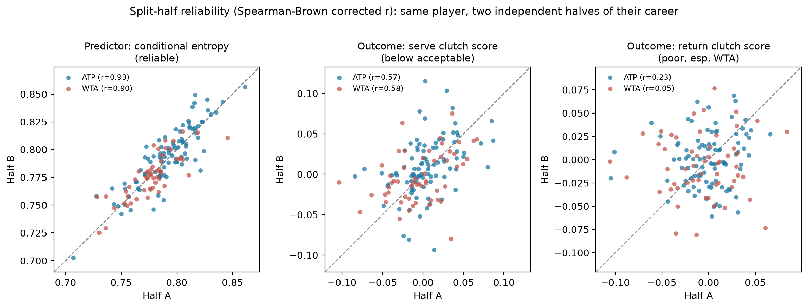

# Shot-Selection Consistency and Clutch Performance in Tennis: A Reliability Warning for Clutch Metrics

*Code, derived data and pre-registrations: [repository link supplied in the submission form].*

## Abstract

Leverage-weighted "clutch" ratings are used by scouts and broadcasters to say who plays the big points well, and tennis commentary treats stylistic unpredictability as a pressure asset. We ask whether such ratings are measured reliably enough to support claims about individual players, and whether shot-selection consistency (conditional Shannon entropy) predicts clutch performance. Using Match Charting Project data for 91 ATP and 55 WTA players (40 or more charted matches each) and hypotheses pre-registered before the data were touched, we find that role-specific clutch scores and Tennis Abstract's Balanced Leverage Ratio (BLR) are not reliably measured: over 1,000 random split-half tests, median reliability is 0.53 (ATP) and 0.41 (WTA) for serve clutch, 0.24 and 0.27 for return clutch, and 0.54 and 0.29 for BLR, against 0.90 to 0.93 for entropy. A single pooled leverage ratio is the exception on the ATP tour (0.76). Break-point rates are usable skill measures on the ATP tour, but their clutch-specific component is not (0.23 to 0.34). True serve-clutch differences between players are about 2 percentage points, roughly 5 points of match-win probability; return differences are small or not reliably detectable. A reliable ATP return score needs about 550 charted matches (95% interval 180 to unbounded) against a median of 74, and Carlos Alcaraz's return-clutch rank is 32 (95% interval 15 to 67 of 91). Entropy shows no relationship with clutch performance on either tour. We recommend that any clutch rating be published with its own split-half reliability.

## 1. Introduction

When a broadcaster says a player "raises their level on the big points," or a scouting report labels a returner "clutch," a number is usually behind the claim. Leverage-weighted metrics, descended from Morris's (1977) definition of a point's importance, are the standard way to produce it: weight each point by how much it moves the probability of winning the match, then ask whether a player wins more of the high-leverage points than the low-leverage ones. Tennis Abstract publishes such a metric, the Balanced Leverage Ratio (BLR), for individual matches (Sackmann, Tennis Abstract), and a 2022 finalist paper at this conference (Seidl and Lucey, 2022) used leverage, clutch and momentum metrics to detect key moments in women's tennis.

This paper asks two questions.

**Can these metrics be measured reliably?** A rating that cannot reproduce itself on a second sample of the same player's matches is a noisy estimate, not a trait. The question is old in other sports, but we are not aware of a published tennis clutch metric that reports its own reliability. We test it, and express the answer in units a practitioner can use.

**Does shot-selection predictability predict clutch performance?** The popular narrative contrasts a flair player such as Carlos Alcaraz with a metronomic one such as Jannik Sinner and implies that unpredictability pays under pressure. We test it with an information-theoretic style measure and a leverage-weighted outcome, pre-registered and replicated on the WTA tour.

The questions are linked: a null on the second is only as informative as the measurement behind it. We lead with reliability because it applies to any metric of this family, whatever predictor is tested against it.

**Contributions.** (1) To our knowledge the first split-half reliability estimates for leverage-weighted tennis clutch metrics, including a faithful reproduction of Tennis Abstract's BLR, on two tours and robust to the choice of split. (2) A test of break-point conversion and save rates, the clutch statistic broadcasters quote most, separating skill from clutch. (3) Practitioner-scale translations: data needed, true spread between players, and rank uncertainty for named players. (4) A pre-registered, power-analysed null for entropy as a predictor of clutch, replicated on a second tour (same code and author, different players), with equivalence bounds corrected for measurement error. (5) An open, reproducible pipeline with every bug disclosed.

## 2. Related work

Morris (1977) defined a point's importance as the change in match-win probability between winning and losing it, and recursive win-probability models are standard (Klaassen and Magnus, 2003; Barnett and Clarke, 2005; Newton and Keller, 2005). Klaassen and Magnus (2001) showed that points are not exactly independent and identically distributed but close enough that a constant server point-win probability is a reasonable approximation, which we use and test. BLR averages a serve and a return leverage ratio (mean leverage of points won divided by points lost; above 1 is read as clutch), and Seidl and Lucey (2022) built closely related metrics at Stats Perform. We build on this family rather than proposing a new one.

The reliability question has a long history outside tennis. Cramer (1977) asked whether a baseball batter who was clutch in one season stays clutch in the next and found that largely he does not; most later baseball studies agree, though whether the tests can detect a small true effect is still debated. We apply that logic to tennis and should be read as testing a known pattern in a new setting. Tennis pressure research is mostly economic or psychological: Cohen-Zada et al. (2017) and De Paola and Scoppa (2017) compare performance across stakes and by gender, which asks whether pressure changes average performance, not whether individual players differ stably in handling it. To our knowledge, neither reliability testing of leverage-weighted tennis metrics nor the pairing of an information-theoretic style predictor with a leverage-weighted outcome has been published. We use split-half reliability with Spearman-Brown correction from classical test theory, correct equivalence bounds for attenuation, and use empirical-Bayes shrinkage (Efron and Morris, 1975) as a candidate remedy.

## 3. Data and methods

**Data.** We use the Match Charting Project (Sackmann), crowd-sourced point-by-point data with shot-level notation (CC BY-NC-SA 4.0). The pools are every ATP player with at least 40 charted matches (n = 91; median 74 matches, 1.13 million points) and every WTA player with at least 40 (n = 55; median 64, 426,000 points). Derived per-player data and pinned fetch instructions are in the repository (Appendix C).

**Shot-selection consistency.** Conditional normalized Shannon entropy measures how unpredictable a player's shot choice is given the preceding shot, from the 6-by-6 matrix of shot-to-shot transition probabilities, scaled to [0, 1]; lower means more predictable. No player in either pool failed the sufficiency floor (30 observations per cell).

**Leverage and clutch.** Leverage comes from a recursive win-probability engine with a constant server point-win probability (p = 0.65 primary; four sensitivity variants: p = 0.60, p = 0.70, a tiered p, and tour-specific empirical p of 0.644 ATP and 0.573 WTA). For each player and role (serve or return), the **quartile clutch score** is the point-win rate in the top leverage quartile minus the rate in the bottom quartile. The **leverage ratio** (LR) is the mean leverage of points won divided by that of points lost; the faithful **BLR** is (LR serve + LR return) / 2, as Tennis Abstract defines it, and the **pooled LR** applies the ratio to serve and return points together. We test career-aggregated BLR only, so the per-match BLR Tennis Abstract publishes can only be less reliable.

**Break-point statistics.** BP conversion is the share of a player's break-point return points won, BP save the share of break-point serve points won (tiebreaks excluded). Because these mostly reflect general ability, we also compute a **clutch differential**: the break-point rate minus the player's non-break-point rate in that role.

**Reliability.** A tour's matches are sorted by date and assigned alternately to halves A and B, so career drift is not mistaken for noise. Each measure is computed on each half, and the split-half correlation across players is Spearman-Brown corrected to full length, with Fisher z intervals. We use 0.70 as the conventional threshold for acceptable reliability. Because one split is one draw, we repeat the clutch, BLR and LR analyses over 1,000 random balanced splits per tour and call "below 0.70" robust if at least 95% of splits agree. Entropy is not re-split (extraction is slow and its reliability is not contested).

**Pre-registration and tests.** The primary hypothesis was fixed before any regression was run; the WTA replication, pooled test, each follow-up, the Applications analyses (2026-11-03) and the extensions (2026-11-11) each have a dated pre-registration written before its script. These are self-registered Markdown files in the repository history, not entries in an external registry, and the last two were written after the primary results were known: they are pre-specified, not blind. Entropy hypotheses use Bonferroni-corrected Pearson correlations by tour and role, with Spearman and Cook's-distance checks, a pooled regression with an entropy-by-tour interaction, TOST equivalence bounds and power.

## 4. Are clutch metrics reliable?

### 4.1 Split-half reliability

**Table 1.** Split-half reliability (Spearman-Brown corrected). "Original" is the interleaved split used throughout; "random splits" gives the median and 95% range over 1,000 random balanced splits.

| Measure | ATP original | ATP random splits | WTA original | WTA random splits |
|---|---|---|---|---|
| Conditional entropy | 0.925 | not re-split | 0.897 | not re-split |
| Serve clutch (quartile) | 0.572 | 0.532 [0.343, 0.674] | 0.578 | 0.410 [0.107, 0.611] |
| Return clutch (quartile) | 0.231 | 0.241 [-0.058, 0.462] | 0.055 | 0.267 [-0.089, 0.538] |
| BLR (faithful) | 0.460 | 0.537 [0.353, 0.664] | 0.206 | 0.294 [-0.021, 0.557] |
| Pooled LR | 0.683 | **0.761 [0.679, 0.831]** | 0.443 | 0.449 [0.209, 0.641] |

Entropy is reliably measured on both tours. The clutch scores are not, and the problem is worst on return. Serve, return and BLR fall below 0.70 in at least 99% of random splits on both tours (Figure 1 shows the original split). The original split was a typical draw for every measure, though not always the central one: WTA return clutch is 0.055 on it and 0.27 at the median, both poor.

**Figure 1.** Each point is one player's half-A versus half-B value (original split). Entropy clusters tightly, serve clutch loosely, return clutch barely.

This is not a thin-data artifact: each player's leverage buckets hold hundreds to thousands of points per half (7,400 to 8,300 per bucket per half for Federer). Return clutch also depends on the opponent's serve quality, a variance source serve clutch does not share.

### 4.2 The faithful BLR, and what pooling does

BLR is below 0.70 in 99.7% (ATP) and 100% (WTA) of random splits. Our pre-registered rule said an original-split value below 0.50 would strengthen the claim (it is 0.46 ATP, 0.21 WTA), but the ATP random-split median is 0.54, so that rule is split-dependent and we report both.

Pooling serve and return points into one ratio behaves differently. On the ATP tour it is the one typically acceptable measure: median 0.76, with 93% of random splits at or above 0.70, because the BLR average inherits the noisy return component. On WTA it is 0.45 and below 0.70 in 99.6% of splits. The pooled ratio answers "does this player win more of the big points overall"; it cannot support role-level claims ("great on return"), which is how clutch is usually discussed and where every measure fails. The metrics do agree with one another: the faithful BLR correlates 0.716 (ATP) and 0.923 (WTA) with the pooled LR.

### 4.3 Attempted fixes

Three fixes did not rescue the scores. A continuous slope over all points lowered reliability in three of four tour-role cells (ATP return rose marginally, 0.231 to 0.256). Adjusting return points for the serving opponent's leave-one-out serve strength made it worse (ATP return 0.182; WTA return -0.106). Empirical-Bayes shrinkage helped in every cell (ATP serve 0.594, return 0.371; WTA serve 0.624, return 0.132) but cleared 0.70 in none. The gap looks like a property of the data, not of a construction choice.

## 5. Does shot-selection entropy predict clutch?

### 5.1 Primary tests

**Table 2.** Primary correlation of conditional entropy with p = 0.65 clutch score.

| Tour | Serve r (p) | Return r (p) | n |
|---|---|---|---|
| ATP | -0.041 (0.697) | +0.016 (0.877) | 91 |
| WTA | -0.259 (0.056) | +0.196 (0.151) | 55 |

No correlation survives Bonferroni correction (10 comparisons per tour: five leverage variants by two roles, threshold 0.005). WTA serve is closest (nominal p from 0.017 at p = 0.70 to 0.063 across variants) and does not survive correction, Spearman re-testing (rho = -0.17, p = 0.20) or removal of its three most influential players (r = -0.18, p = 0.20). The null also holds for era and surface confounds, four secondary style predictors (16 comparisons; lowest nominal p 0.013 against a corrected 0.003) and entropy change under pressure. Pooling the tours (n = 146) is null, with no evidence that the slope differs by tour (Table A3).

### 5.2 What the null can and cannot rule out

All pools are well powered for medium or larger effects (r of 0.3 or more) but not small ones; WTA alone has 61% power for a medium effect (Table A3). TOST bounds the true ATP correlation to |r| < 0.213 on serve and 0.189 on return at 95% confidence; WTA's bounds are looser (0.457 and 0.403).

Those bounds are on the observed scale, where both variables carry measurement error. Dividing by the attenuation factor implied by each reliability projects them onto the true-score scale (Figure 2; Table A2 adds random-split values). For ATP the claim survives, loosened: whatever the true relationship is, it is not large (serve 0.29, return 0.41). For WTA return the corrected bound exceeds 1 (1.81), so no true-score relationship can be ruled out. At the worst-case end of the random-split range the return bounds are vacuous on both tours.

**Figure 2.** Equivalence bound on |r|, observed versus reliability-corrected (original-split reliabilities). WTA return's bound exceeds 1 and is uninformative.

This is the sharpest illustration in the paper of why reliability must be reported before a clutch correlation is interpreted: it separates a modest null from a number that carries no information.

## 6. What the unreliability means in practice

These are derived projections and descriptive uncertainty, not new hypothesis tests.

### 6.1 Data needed, true spread, and what it is worth

If a measure has full-length reliability ρ, the Spearman-Brown prophecy gives the multiple of data needed to reach a target ρ\*: k = ρ\*(1 − ρ) / (ρ(1 − ρ\*)), which we multiply by each tour's median charted matches (ATP 74, WTA 64). Separately, a variance decomposition gives the standard deviation of players' true clutch scores, to compare with the typical standard error on one player's score. Table 3 puts both beside the reliability.

**Table 3.** What the reliability means. Reliability is the random-split median; matches needed for reliability 0.70 comes from passing its 95% range through the Spearman-Brown formula ("unbounded": the lower limit is zero or negative); true SD is the variance-method estimate with a 95% bootstrap interval; match-win equivalent is one true SD times the summed top-quartile leverage per match (first order, Section 6.1).

| Tour, role | Reliability | Matches needed [95% range] | True SD, pp [95% interval] | Noise SE per player, pp | One true SD in match-win probability, pp |
|---|---|---|---|---|---|
| ATP serve | 0.53 | 152 [83, 331] | 2.15 [1.62, 2.57] | 1.74 | about 5 |
| ATP return | 0.24 | 544 [201, unbounded] | 1.22 [0.52, 1.68] | 1.74 | about 3 |
| WTA serve | 0.41 | 215 [95, 1,246] | 1.88 [0.99, 2.48] | 2.08 | about 4 |
| WTA return | 0.27 | 411 [128, unbounded] | 1.31 [0.00, 1.99] | 2.07 | not detectable |

**Data needed.** An acceptable ATP return-clutch score needs about 550 matches (interval 180 to unbounded), 7 to 8 times the median player's 74; the longest career in the pool is 723 (Federer). The intervals are wide because the reliability itself is imprecise with 91 players, so return-side figures are best read as "several hundred matches at least". A model-based projection from each player's own bucket sizes agrees (about 120 matches for ATP serve, 374 for ATP return, 377 for WTA return), and only 31% of ATP players already reach player-level reliability 0.70 on serve and 3% on return (WTA 4% and 0%). Full tables, including the original-split values and BLR, are in Appendix A (Table A5).

**True spread.** On serve there are real differences between players: the true standard deviation is about 2 percentage points, about as large as the noise on one player's score. On return it is at most about 1.2 points against 1.7 to 2.1 of noise, and for WTA return neither estimator's interval excludes zero (the two estimators also differ by a factor of 2.2, beyond the factor of 2 we had set as acceptable; Table A6). Following our pre-registered rule, WTA return shows no detectable stable difference between players, and ATP return a small one not consistently distinguishable from zero.

**What 2 points is worth.** Leverage is by construction the change in match-win probability from winning rather than losing a point, so to first order a shift of d in a player's win rate on their top-quartile-leverage points changes their match-win probability by d times the summed leverage of those points (ATP median 2.4 per match on serve, 2.2 on return; WTA 1.9 and 2.0). One true standard deviation of serve clutch is therefore worth roughly 4 to 5 points of match-win probability. This treats the difference as a pure top-quartile shift and ignores opponent adjustment, so it is an order of magnitude, not an estimate for any player. The true differences are not trivially small; what fails is our ability to measure them.

### 6.2 How uncertain is a named player's rank?

Reliability is a pool-level statistic, but practitioners talk about named players. We resample each player's charted matches with replacement (B = 2,000, fixed seed), re-estimate quartile thresholds and rank all players in every replicate. Figure 3 shows the 95% rank intervals for every ATP player.

**Figure 3.** 95% bootstrap rank intervals for every ATP player, serve and return clutch (rank 1 = most clutch among 91). The dotted diagonal marks the point-estimate rank.

The data do not support the narrative that motivated this study. Alcaraz's return-clutch rank is 32 (95% interval 15 to 67) and Sinner's is 57 (33 to 79); on serve they are 50 (26 to 74) and 56 (36 to 77). Both players' score intervals span zero on both roles and their rank intervals overlap almost entirely. Only Djokovic (serve 72, return 78) and Federer (64, 86) have score intervals clearly below the pool mean, and even for them the plausible rank range is 23 to 31 positions wide. Across the pool the typical 95% rank interval spans 52 (serve) to 63 (return) of 91 ranks for ATP, and 37 and 39 of 55 for WTA. Only 23 ATP players' serve-clutch intervals exclude the pool mean (9 on return), and for ATP return clutch none of the top ten can be confidently placed in the top 20. Per-player intervals and pool summaries are in the repository (`results/applications/a3_bootstrap_players.csv`, `a3_bootstrap_summary.csv`).

### 6.3 Break-point conversion and save rates

The statistic broadcasters quote most is not a leverage ratio but break-point conversion or saving. On the ATP tour the raw rates are borderline-to-acceptable skill measures (median reliability 0.72 for save and 0.73 for conversion; 39% and 28% of random splits below 0.70), but they mostly measure general ability: they correlate 0.77 (serve) and 0.80 (return) with the player's non-break-point win rate. The clutch-specific component, how much better or worse a player does on break points than usual, is not reliable (median 0.34 serve, 0.23 return; below 0.70 in at least 99.9% of splits). On WTA even the raw rates fall below 0.70 in every split (medians 0.33 and 0.27) and the differentials are near zero or negative (Table A4). The pattern repeats in the statistic broadcasters cite: usable as a skill measure where data are plentiful, not as a clutch measure. A differential is a difference score and so mechanically less reliable than its components, and break-point situations are not randomly assigned, so it is a descriptive contrast, not a causal estimate.

## 7. Discussion

**The reliability finding and the null interact.** A reliable predictor paired with an unreliable outcome produces a null whether or not a true relationship exists. ATP's null remains informative (Section 5.2); WTA return's does not. Within what these data can detect, shot-selection predictability does not separate clutch from non-clutch players, which does not say style is irrelevant to pressure performance, only that this channel does not show up at the precision currently achievable.

**Why return is worse than serve.** True return clutch varies less between players while its noise equals serve's, so the signal-to-noise ratio is lower. Opponent-serve adjustment did not help, so the mechanism is more diffuse than opponent mix; we do not claim to have identified it.

**Reliability depends on the pool.** Reliability is the share of between-player variance that is signal, so it falls when a pool is homogeneous. Our players are 40-plus-match, mostly elite and heavily charted, which narrows the spread of true clutch relative to a wider population. For comparing elite players, the way clutch is usually discussed, this is the relevant pool, but the numbers should not be carried to another population without re-estimation.

**Scope.** We do not claim every leverage-based number is unreliable. Reliability falls as the question gets more specific: overall (acceptable on ATP), then by role, then the clutch-specific component of a skill statistic.

**Future work.** A multilevel model (points within matches within players) would estimate clutch variance without the split-half approximation; tour-level tracking data, far larger than charted matches, would show how much of the problem is data volume; per-match BLR can be tested directly; and the same audit applies to other sports' clutch metrics.

## 8. Limitations and deviations

- **Observational, selected data.** The Match Charting Project is crowd-sourced; the pool is well-charted and mostly elite. Ranking is not in the match metadata and is not controlled.
- **Constant-p leverage.** Rank correlations across the five variants are high, but 13 of 91 players (serve) and 19 of 91 (return) differ in sign between p = 0.60 and p = 0.70.
- **Reliability is estimated, not known.** A single split is one draw. Entropy was not re-split. The disattenuated bounds treat reliabilities as fixed and are shown at original and random-split values (Table A2).
- **ATP clutch-file provenance.** The script that generated the committed ATP clutch table was lost. The committed regeneration code (`src/pipeline/rebuild_clutch_features.py`) differs from it by up to about 0.005 in clutch scores (0.002 to 0.003 at p = 0.65; WTA reproduces exactly). Sections 4 and 6 regenerate leverage from raw data with the committed code; the Section 5 tests read the frozen ATP table. No conclusion changes under either.
- **Individual tests.** BLR is tested at career level. Break-point differentials are difference scores in non-randomly assigned situations. The true-spread variance method assumes binomial sampling variance, and the match-win translation is first-order.
- **Bootstrap bias.** Quartile clutch scores missed our pre-registered bias tolerance (mean absolute gap 0.0018 to 0.0027 against 0.002; maximum 0.011), likely because quartile thresholds sit on tied leverage values. We did not correct it, so rank intervals are approximate.
- **Pre-registration.** Self-registered and dated in the repository (Section 3). No decision rule was changed after seeing results, but the random-split extension showed that one rule (a faithful BLR below 0.50 strengthens the claim) is split-dependent, so we report original and random-split values side by side.

## 9. Conclusion

Role-specific leverage-weighted clutch scores and Tennis Abstract's BLR are too unreliable to support claims about individual players, particularly on return points: reliability is below 0.70 in at least 99% of 1,000 random splits on both tours, the clutch-specific component of break-point conversion is no better, and a named player's rank typically has a 95% interval covering more than half the pool. The true differences are not trivial (about 2 points on serve, roughly 5 points of match-win probability) but are about as large as the noise on one player's score, and a reliable ATP return score needs several hundred charted matches (about 550; interval 180 to unbounded) against a median of 74. The exception is a single pooled leverage ratio on the ATP tour.

Five practical rules follow. (1) Before citing a clutch rating, ask for its split-half reliability and treat a value below 0.70 as a noisy estimate. (2) Do not cite role-specific clutch, above all return clutch, for individual players. (3) If one number is needed, pool the points (ATP): the pooled ratio is acceptable where averaging serve and return ratios, as BLR does, is not. (4) If a ranking is needed, shrink it and show the interval. (5) Budget several hundred charted matches per player for any return-side measure. Separately, shot-selection predictability does not detect a pressure-performance channel on either tour, a result replicated on a second tour and bounded by a robustness battery whose limits we state.

The pipeline is open and every bug is disclosed, so testing another style predictor against the same outcome is now cheap, and the analyst learns in advance how much the outcome can bear.

## References

- Barnett, T., and Clarke, S. R. (2005). Combining player statistics to predict outcomes of tennis matches. *IMA Journal of Management Mathematics*, 16(2), 113-120.
- Cohen-Zada, D., Krumer, A., Rosenboim, M., and Shapir, O. M. (2017). Choking under pressure and gender: Evidence from professional tennis. *Journal of Economic Psychology*, 61, 176-190.
- Cramer, D. (1977). Do clutch hitters exist? *Baseball Research Journal* (Society for American Baseball Research).
- De Paola, M., and Scoppa, V. (2017). Gender differences in reaction to psychological pressure: Evidence from tennis players. *European Journal of Work and Organizational Psychology*, 26(3), 444-456.
- Efron, B., and Morris, C. (1975). Data analysis using Stein's estimator and its generalizations. *Journal of the American Statistical Association*, 70(350), 311-319.
- Klaassen, F. J. G. M., and Magnus, J. R. (2001). Are points in tennis independent and identically distributed? Evidence from a dynamic binary panel data model. *Journal of the American Statistical Association*, 96(454), 500-509.
- Klaassen, F., and Magnus, J. R. (2003). Forecasting the winner of a tennis match. *European Journal of Operational Research*, 148(2), 257-267.
- Morris, C. (1977). The most important points in tennis. In S. P. Ladany and R. E. Machol (Eds.), *Optimal Strategies in Sports* (pp. 131-140). North-Holland.
- Newton, P. K., and Keller, J. B. (2005). Probability of winning at tennis I. Theory and data. *Studies in Applied Mathematics*, 114(3), 241-269.
- Sackmann, J. Roger Federer wasn't clutch, but he was almost clutch enough. Tennis Abstract blog (defines the Balanced Leverage Ratio). tennisabstract.com/blog/?p=3666.
- Sackmann, J. et al. Match Charting Project. github.com/JeffSackmann/tennis_MatchChartingProject (CC BY-NC-SA 4.0).
- Seidl, R., and Lucey, P. (2022). Live counter-factual analysis in women's tennis using automatic key-moment detection. MIT Sloan Sports Analytics Conference (Stats Perform).

## Appendix A: Supporting tables

**Table A1.** Split-half reliability on the original split with 95% CI (Spearman-Brown), and the median and 95% range over 1,000 random splits, for the quartile clutch scores and the leverage ratios.

| Measure | Tour | Original [95% CI] | Random-split median [95% range] |
|---|---|---|---|
| Serve quartile clutch | ATP | 0.572 [0.350, 0.718] | 0.532 [0.343, 0.674] |
| Return quartile clutch | ATP | 0.231 [-0.167, 0.494] | 0.241 [-0.058, 0.462] |
| LR, serve | ATP | 0.500 [0.241, 0.671] | 0.525 [0.347, 0.648] |
| LR, return | ATP | 0.320 [-0.033, 0.552] | 0.321 [0.070, 0.508] |
| BLR (faithful) | ATP | 0.460 [0.180, 0.645] | 0.537 [0.353, 0.664] |
| Pooled LR | ATP | 0.683 [0.519, 0.791] | 0.761 [0.679, 0.831] |
| Serve quartile clutch | WTA | 0.578 [0.274, 0.755] | 0.410 [0.107, 0.611] |
| Return quartile clutch | WTA | 0.055 [-0.628, 0.451] | 0.267 [-0.089, 0.538] |
| LR, serve | WTA | 0.557 [0.237, 0.743] | 0.375 [0.094, 0.597] |
| LR, return | WTA | -0.092 [-0.881, 0.366] | 0.090 [-0.389, 0.398] |
| BLR (faithful) | WTA | 0.206 [-0.368, 0.539] | 0.294 [-0.021, 0.557] |
| Pooled LR | WTA | 0.443 [0.040, 0.676] | 0.449 [0.209, 0.641] |

**Table A2.** TOST equivalence bound on |r|, observed versus corrected for measurement error, at the original-split clutch reliability, the random-split median, and the range from the 97.5th to the 2.5th percentile reliability. "Vacuous" means the bound exceeds 1 or the reliability is at or below zero. The original-split column uses the documented (rounded) reliabilities, as in Figure 2.

| Tour | Role | Observed | Original split | Random-split median | Random-split range |
|---|---|---|---|---|---|
| ATP | Serve | 0.213 | 0.293 | 0.304 | [0.270, 0.379] |
| ATP | Return | 0.189 | 0.410 | 0.401 | [0.290, vacuous] |
| WTA | Serve | 0.457 | 0.635 | 0.754 | [0.617, vacuous (1.48)] |
| WTA | Return | 0.403 | **vacuous (1.81)** | 0.823 | [0.579, vacuous] |

**Table A3.** Pooled ATP+WTA test (n = 146) and power for the entropy hypothesis.

| Quantity | Serve | Return |
|---|---|---|
| Pooled r [95% CI], p | -0.124 [-0.282, 0.041], 0.141 | +0.084 [-0.081, 0.245], 0.320 |
| Entropy-by-tour interaction, p | 0.146 | 0.207 |
| Cochran's Q homogeneity, p | 0.200 | 0.297 |
| Pooled TOST bound on abs(r) | 0.174 | 0.241 |

Minimum detectable effect at 80% power and two-sided alpha = 0.05: ATP 0.29, WTA 0.37, pooled 0.23. Power to detect a medium effect (r = 0.3): ATP 82.7%, WTA 60.7%. Power to detect a small effect (r = 0.1): ATP 15.6%, WTA 11.2%.

**Table A4.** Split-half reliability (Spearman-Brown) of break-point statistics: original split, and median [95% range] over 1,000 random splits.

| Measure | ATP original | ATP random splits | WTA original | WTA random splits |
|---|---|---|---|---|
| BP save (serve), raw rate | 0.754 | 0.715 [0.619, 0.790] | 0.439 | 0.332 [0.043, 0.571] |
| BP save, differential from baseline | 0.400 | 0.344 [0.110, 0.533] | 0.118 | -0.159 [-0.677, 0.270] |
| BP conversion (return), raw rate | 0.617 | 0.729 [0.631, 0.807] | 0.063 | 0.267 [-0.094, 0.511] |
| BP conversion, differential from baseline | 0.054 | 0.227 [-0.060, 0.446] | -0.290 | -0.016 [-0.487, 0.323] |

**Table A5.** Charted matches needed for reliability 0.70 (Spearman-Brown projection), with the interval obtained by passing the 95% limits of the reliability estimate (the Fisher interval for the original split, the 2.5th to 97.5th percentile for random splits) through the same formula. "Unbounded" means the lower limit of the reliability is zero or negative.

| Measure | Original split: ρ, matches [95% interval] | Random-split median: ρ, matches [95% range] |
|---|---|---|
| ATP serve clutch | 0.572, 129 [68, 321] | 0.532, 152 [83, 331] |
| ATP return clutch | 0.231, 575 [177, unbounded] | 0.241, 544 [201, unbounded] |
| ATP BLR | 0.460, 203 [95, 786] | 0.537, 149 [88, 316] |
| WTA serve clutch | 0.578, 109 [48, 396] | 0.410, 215 [95, 1,246] |
| WTA return clutch | 0.055, 2,566 [182, unbounded] | 0.267, 411 [128, unbounded] |
| WTA BLR | 0.206, 577 [128, unbounded] | 0.294, 358 [119, unbounded] |

For WTA return, the original split's 0.055 implies 2,566 matches and the random-split median of 0.27 implies about 410; we take the lower as the better point estimate, though the intervals show the data cannot pin it down.

**Table A6.** True between-player standard deviation of quartile clutch (percentage points), with 95% bootstrap intervals, by two estimators, beside the typical standard error on one player's score.

| Tour, role | True SD, variance method | True SD, half-split method | Typical SE per player |
|---|---|---|---|
| ATP serve | 2.15 [1.62, 2.57] | 2.10 [1.61, 2.50] | 1.74 |
| ATP return | 1.22 [0.52, 1.68] | 1.04 [0.00, 1.63] | 1.74 |
| WTA serve | 1.88 [0.99, 2.48] | 2.14 [1.30, 2.71] | 2.08 |
| WTA return | 1.31 [0.00, 1.99] | 0.59 [0.00, 1.82] | 2.07 |

The variance method assumes binomial sampling variance, an approximation.

## Appendix B: Bug disclosures

Five issues were found and disclosed, with full write-ups in `docs/`: (1) a shot-parsing bug that inverted hitter labels in early entropy runs, now guarded by a regression check that fails any run with hitter-attribution parity below 85%; (2) a hardcoded server-alternation flag in the leverage engine's tiebreak branch (about 3.4% of points; convergent-validity r moved from 0.792 to 0.793); (3) two bit-different ways of writing one probability that flipped tied leverage values across a quartile boundary in the WTA replication; (4) a head-to-head check that looked like a validation failure and was a scoping error; and (5) the ATP clutch-table provenance gap in Section 8.

## Appendix C: Data and reproduction

**Source data.** Match Charting Project (Sackmann et al.), upstream commit `2c59eef194967e688b69e73df344184a06322cd8` (2026-05-25), CC BY-NC-SA 4.0. The eight raw files used (ATP and WTA match metadata plus three points files each) are byte-identical to that commit, verified by git blob hash; the repository's `DATA_MANIFEST.csv` lists each file's size, SHA-256 and commit-pinned URL. Raw files are not copied into the repository; fetch commands pinned to the commit are in its README.

**Derived data committed to the repository.** Per-player feature and clutch tables for each tour (`results/atp`, `results/wta`), the per-player split-half values behind Figure 1 (`results/figures/split_half_raw_*.csv`), and every output of the Applications analyses (`results/applications/`): BLR reliability, data-requirement projections, bootstrap intervals for all players, random-split reliabilities, break-point reliabilities and true-spread estimates. These carry the source data's CC BY-NC-SA terms; the code is MIT-licensed.

**Reproduction.** After installing the requirements and fetching the pinned raw files, `python src/pipeline/run_pipeline.py --tour atp` (and `--tour wta`) rebuilds the primary pipeline; `python src/robustness/applications_analyses.py` then `python src/robustness/applications_extensions.py` reproduce Sections 4.1, 4.3 and 6; Figure 3 is `src/figures/make_bootstrap_rank_figure.py`; the Table 3 intervals and the Section 6.1 win-probability translation come from `src/robustness/matches_needed_ci.py` and `src/robustness/win_prob_translation.py`, which read committed outputs and point tables. Pre-registrations are in `docs/`, and every analysis script checks itself against previously reported values before writing output (for example, the extensions script aborts unless it reproduces all twelve original-split reliabilities).
