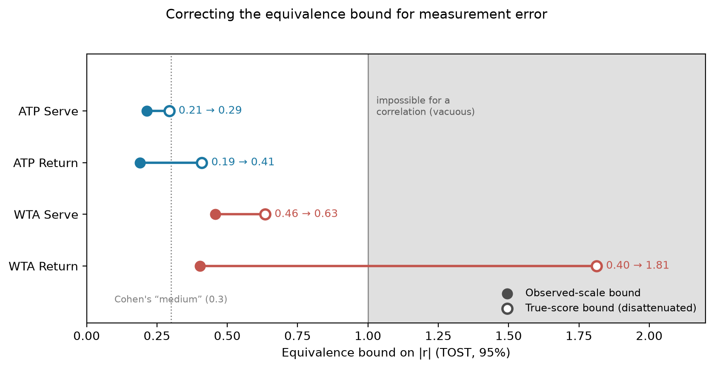

# Shot-Selection Consistency and Clutch Performance in Tennis: A Reliability Warning for Clutch Metrics

*Code, derived data and analysis plans: [repository link supplied in the submission form].*

## 1. Introduction

When a broadcaster says a player "raises their level on the big points," or a scouting report labels a returner "clutch," a number is usually behind the claim, and judgements about who is a big-match player follow from it. Leverage-weighted metrics, descended from Morris's (1977) definition of a point's importance, are the standard way to produce that number: weight each point by how much it moves the probability of winning the match, then ask whether a player wins more of the high-leverage points than the low-leverage ones. Tennis Abstract publishes such a metric, the Balanced Leverage Ratio (BLR), for individual matches (Sackmann, Tennis Abstract), and a 2022 finalist paper at this conference (Seidl and Lucey, 2022) used leverage, clutch and momentum metrics to detect key moments in women's tennis.

**What we find.** In Match Charting Project data for 91 ATP and 55 WTA players, the clutch ratings we tested are not reliable enough to support claims about individual players. Split a player's charted matches into two halves, compute the rating on each, and ask whether players keep their relative positions: across 1,000 random splits, ATP serve clutch has a median reliability of 0.53 and return clutch 0.24 (WTA is similar), and Tennis Abstract's BLR is no better, against about 0.9 for shot-selection entropy. The problem extends to every shot: clutch on rally points and on the errors and winners of each shot also stays below the conventional 0.70 threshold. One pooled ratio on the ATP tour is the exception, an exploratory finding. True differences between players are real on serve but no larger than the noise on one player's score; a reliable return rating would need about 550 charted matches, and Carlos Alcaraz's return-clutch rank is 32 of 91 with a 95% interval of 14 to 64. Entropy shows no detectable relationship with clutch on either tour, with bounds that are informative for ATP but say little about WTA return. We recommend that any clutch rating be published with its own split-half reliability.

This paper asks two questions.

**Can these metrics be measured reliably?** A rating that fails the split-half test is mostly noise, not a trait; the correlation across players, corrected to full length, is its reliability. The question is old in other sports, but we are not aware of a published tennis clutch metric that reports its own reliability. We test it on serve and return points, then on every shot in the rally, and express the answer in units a practitioner can use.

**Does shot-selection predictability predict clutch performance?** A common framing in commentary contrasts a flair player such as Carlos Alcaraz with a metronomic one such as Jannik Sinner and implies that unpredictability pays under pressure. We test it with an information-theoretic style measure against every clutch outcome we can build, replicated on the WTA tour. The questions are linked: a null on the second is only as informative as the measurement behind it, so we lead with reliability.

**Contributions.** (1) To our knowledge the first split-half reliability estimates for leverage-weighted tennis clutch metrics, including Tennis Abstract's BLR, on serve, return, rally and shot-level outcomes and robust to the choice of split. (2) Practitioner-scale translations: data needed, true spread between players, rank uncertainty, and break-point statistics split into skill and clutch. (3) A power-analysed null for entropy with equivalence bounds corrected for measurement error, replicated on a second tour. (4) An open, reproducible pipeline. Section 3 describes the data and methods, Sections 4 and 5 the reliability and entropy results, and Section 6 what they mean in practice.

## 2. Related work

Morris (1977) defined a point's importance as the change in match-win probability between winning and losing it, and recursive win-probability models are standard (Klaassen and Magnus, 2003; Barnett and Clarke, 2005; Newton and Keller, 2005). Klaassen and Magnus (2001) showed that points are close enough to independent and identically distributed that a constant server point-win probability is a reasonable approximation, which we use and test. BLR averages a serve and a return leverage ratio (mean leverage of points won divided by points lost; above 1 is read as clutch), and Seidl and Lucey (2022) built closely related metrics at Stats Perform. We build on this family rather than proposing a new one.

The reliability question has a long history outside tennis. Cramer (1977) asked whether a baseball batter who was clutch in one season stays clutch in the next and found that largely he does not; most later baseball studies agree, though whether the tests can detect a small true effect is still debated. We test a known pattern in a new setting. Tennis pressure research is mostly economic or psychological: Cohen-Zada et al. (2017) and De Paola and Scoppa (2017) compare performance across stakes and by gender, which asks whether pressure changes average performance, not whether individual players differ stably in handling it. To our knowledge, neither reliability testing of leverage-weighted tennis metrics nor the pairing of an information-theoretic style predictor with a leverage-weighted outcome has been published. We use split-half reliability with Spearman-Brown correction, attenuation-corrected equivalence bounds, and empirical-Bayes shrinkage (Efron and Morris, 1975) as a candidate remedy.

## 3. Data and methods

**Data.** We use the Match Charting Project (Sackmann), crowd-sourced point-by-point data with shot-level notation (CC BY-NC-SA 4.0). The pools are every ATP player with at least 40 charted matches (n = 91; median 74 matches, 1.13 million points) and every WTA player with at least 40 (n = 55; median 64, 426,000 points). Derived per-player data and pinned fetch instructions are in the repository (Appendix C).

**Shot-selection consistency.** Conditional normalized Shannon entropy measures how unpredictable a player's shot choice is given the preceding shot, from the 6-by-6 matrix (forehand and backhand by three directions) of shot-to-shot transition probabilities over every rally shot, scaled to [0, 1]; lower means more predictable. It is nearly uncorrelated with net-play rate, drop-shot rate, serve direction and return depth (|r| at most 0.17 on both tours), so it is not a proxy for those style markers.

**Leverage and clutch.** Leverage comes from a recursive win-probability engine with a constant server point-win probability (p = 0.65 primary; four sensitivity variants: p = 0.60, p = 0.70, a tiered p, and tour-specific empirical p of 0.644 ATP and 0.573 WTA). For each player and role (serve or return), the **quartile clutch score** is the point-win rate in the top leverage quartile minus the rate in the bottom quartile. The **leverage ratio** (LR) is the mean leverage of points won divided by that of points lost; the faithful **BLR** is (LR serve + LR return) / 2, as Tennis Abstract defines it, and the **pooled LR** applies the ratio to serve and return points together. We test career-aggregated BLR only, so the per-match BLR Tennis Abstract publishes can only be less reliable.

**All-shot outcomes.** Serve and return are only the first two shots of a point. We therefore classify each point by where it ended (serve-decided: ace, service winner or double fault; return-decided; or rally-decided, meaning a third shot or later was hit), attribute each shot to its hitter, and build shot-level outcomes under the same leverage quartiles: **R1** the point-win clutch score on rally-decided points; **R2** unforced errors per shot hit, and **R3** winners per shot hit, over every return and rally shot (top minus bottom quartile, signed so that higher always means better under pressure); **R4 to R7** the error outcome within shot families (forehand, backhand, slice, net game); and **R8, R9** double faults and aces per serve point. All were specified, with sufficiency floors, before they were computed.

**Break-point statistics.** BP conversion and BP save are the shares of break-point return and serve points won (tiebreaks excluded). Because these mostly reflect general ability, we also compute a **clutch differential**: the break-point rate minus the player's non-break-point rate in that role.

**Reliability.** A tour's matches are sorted by date and assigned alternately to halves A and B, so career drift is not mistaken for noise. Each measure is computed on each half, and the split-half correlation across players is Spearman-Brown corrected to full length, with Fisher z intervals. We use 0.70 as the conventional threshold for acceptable reliability, and call an outcome reliably measured only if its random-split median is at least 0.70 and at least 95% of splits are. Because one split is one draw, we repeat the analysis over 1,000 random balanced splits per tour. Entropy is not re-split (extraction is slow and its reliability is not contested).

**Hypothesis, plans and tests.** The plan fixed the predictor (conditional entropy), the outcomes and two-sided Pearson tests by tour and role with Bonferroni correction, plus Spearman and Cook's-distance checks, a pooled regression, TOST equivalence bounds and power; the motivating narrative implies a positive sign (more unpredictable, better under pressure). Every analysis has a dated plan in the repository, written by the authors before the corresponding script with decision rules stated in advance. These are self-registered, not deposited in a registry, and version control cannot independently verify their order: the earliest preserved commit is dated 2026-07-07, the public history was squashed on 2026-09-23, and the November plans were written after earlier results were known (`docs/combined/preregistration_timeline.md`).

## 4. Are clutch metrics reliable?

### 4.1 Serve and return

**Table 1.** Split-half reliability (Spearman-Brown corrected). "Original" is the interleaved split used throughout; "random splits" gives the median and 95% range over 1,000 random balanced splits.

| Measure | ATP original | ATP random splits | WTA original | WTA random splits |
|---|---|---|---|---|
| Conditional entropy | 0.925 | not re-split | 0.897 | not re-split |
| Serve clutch (quartile) | 0.572 | 0.532 [0.343, 0.674] | 0.578 | 0.410 [0.107, 0.611] |
| Return clutch (quartile) | 0.231 | 0.241 [-0.058, 0.462] | 0.055 | 0.267 [-0.089, 0.538] |
| BLR (faithful) | 0.460 | 0.537 [0.353, 0.664] | 0.206 | 0.294 [-0.021, 0.557] |
| Pooled LR | 0.683 | **0.761 [0.679, 0.831]** | 0.443 | 0.449 [0.209, 0.641] |

Entropy is reliably measured on both tours. The clutch scores are not, and the problem is worst on return. Serve, return and BLR fall below 0.70 in at least 99% of random splits on both tours (Figure 1 shows the original split). The original split was a typical draw for every measure, though not always the central one: WTA return clutch is 0.055 on it and 0.27 at the median, both poor.

**Figure 1.** Each point is one player's half-A versus half-B value (original split). Entropy clusters tightly, serve clutch loosely, return clutch barely.

This is not a thin-data artifact (each player's leverage buckets hold hundreds to thousands of points per half), and return clutch also depends on the opponent's serve quality, a variance source serve clutch does not share.

### 4.2 The faithful BLR, and what pooling does

BLR is below 0.70 in 99.7% (ATP) and 100% (WTA) of random splits. Our pre-registered rule said an original-split value below 0.50 would strengthen the claim (0.46 ATP, 0.21 WTA), but the ATP random-split median is 0.54, so that rule is split-dependent and we report both.

Pooling serve and return points into one ratio behaves differently. On ATP it is the one typically acceptable measure (median 0.76; 93% of random splits at or above 0.70), because the BLR average inherits the noisy return component; on WTA it is 0.45 and below 0.70 in 99.6% of splits. It answers "does this player win more of the big points overall" but cannot support role-level claims ("great on return"). It is reliable but not validated: it is not a proxy for general strength, yet it is related to it (r with overall point-win rate -0.22 ATP, -0.47 WTA), so part of its reliability may reflect exposure to high-leverage states. We found it after seeing the other results, on one tour, so it is exploratory.

### 4.3 Attempted fixes

Three fixes did not rescue the scores: a continuous slope over all points (lower in three of four tour-role cells), opponent-serve adjustment of return points (ATP return 0.182, WTA -0.106) and empirical-Bayes shrinkage, which helped in every cell (ATP serve 0.594, return 0.371; WTA serve 0.624, return 0.132) but cleared 0.70 in none.

### 4.4 Beyond serve and return: every shot

A reader can fairly ask whether the problem is specific to the serve and return roles. About two thirds of points are decided in the rally (ATP 62% to 66%, WTA 67% to 71%), 20% to 24% on the return and 9% to 13% on the serve, and high-leverage points are slightly more often rally-decided than low-leverage ones (ATP 66% versus 62%; Table A8), so the rally is where most of the high-leverage points end. Figure 2 applies the same test to the all-shot outcomes defined in Section 3 (numbers in Table A7).

**Figure 2.** Median split-half reliability (dot) and 95% range over 1,000 random splits (line) for clutch measured on serve and return points, on rally-decided points, and on shot-level outcomes. The dotted line is the 0.70 threshold. WTA net-game errors are not estimable (too few shots).

No outcome meets the pre-registered criterion on either tour. The most reliable are the error and winner outcomes that use every shot hit: unforced-error clutch reaches 0.60 on ATP [0.44, 0.72] and 0.50 on WTA, winner clutch 0.58 and 0.47, and at most 4.2% of random splits reach 0.70. Both beat return clutch (0.24, 0.27) and rally-decided point clutch (0.44, 0.25) and modestly exceed serve clutch (0.54, 0.41), but none reaches 0.70. By shot type, forehand errors are the most reliable (0.49 ATP, 0.41 WTA), backhand errors less (0.32, 0.23), and slice and net-game errors are indistinguishable from noise; aces (0.41, 0.32) and double faults (0.16, 0.12) are no better. So the pattern holds across the whole point: the measures built on counts of every shot hit are the most reliable, a binary point outcome in the rally is not, and no measure reaches 0.70.

## 5. Does shot-selection entropy predict clutch?

### 5.1 Tests

**Table 2.** Correlation of conditional entropy with each clutch outcome, with the outcome's reliability (random-split median) and the 95% TOST bound on the true |r|, as observed and corrected for both variables' reliability. n = 91 (ATP) and 55 (WTA). R1 to R3 are the all-shot outcomes of Section 3 (rally-decided points, unforced errors and winners over every shot hit). A corrected bound near or above 1 means the data cannot rule out any relationship.

| Tour | Outcome | r (p) | Outcome reliability | Bound, observed | Bound, corrected |
|---|---|---|---|---|---|
| ATP | Serve | -0.041 (0.697) | 0.53 | 0.213 | 0.30 |
| ATP | Return | +0.016 (0.877) | 0.24 | 0.189 | 0.40 |
| ATP | R1 rally points | +0.007 (0.947) | 0.44 | 0.180 | 0.28 |
| ATP | R2 errors | +0.155 (0.142) | 0.60 | 0.320 | 0.43 |
| ATP | R3 winners | -0.064 (0.544) | 0.58 | 0.235 | 0.32 |
| WTA | Serve | -0.259 (0.056) | 0.41 | 0.457 | 0.75 |
| WTA | Return | +0.196 (0.151) | 0.27 | 0.403 | 0.82 |
| WTA | R1 rally points | +0.069 (0.616) | 0.25 | 0.289 | 0.61 |
| WTA | R2 errors | -0.056 (0.683) | 0.50 | 0.277 | 0.41 |
| WTA | R3 winners | +0.024 (0.859) | 0.47 | 0.247 | 0.38 |

No correlation survives Bonferroni correction (serve and return: 10 comparisons per tour, threshold 0.005; all-shot: 6, threshold 0.0083), and the smallest nominal p in Table 2 is 0.056 (WTA serve; 0.017 under the p = 0.70 leverage variant), which does not survive Spearman re-testing (rho = -0.17, p = 0.20) or removal of its three most influential players (p = 0.20). The null also holds across five leverage variants, era and surface confounds, four secondary style predictors (16 comparisons; lowest nominal p 0.013 against 0.003), entropy change under pressure and the regenerated ATP clutch table (Section 8). Pooling the tours (n = 146) is null, with no evidence the slope differs by tour (Table A3).

### 5.2 What the null can and cannot rule out

All pools are well powered for medium effects (r of 0.3 or more) but not small ones; WTA alone has 61% power for a medium effect (Table A3). Observed bounds apply where both variables carry measurement error, so we divide by the attenuation implied by both reliabilities (Figure 3 uses the original-split reliabilities; Table A2 adds random-split values). For ATP the claim survives, loosened: the true relationship is not large for serve (0.30), return (0.40), rally points (0.28), winners (0.32) or errors (0.43). For WTA the corrected bounds are informative only for the shot-level outcomes (0.38 to 0.41) and loose for serve (0.75), rally points (0.61) and return (0.82; 1.81 at the original-split reliability, so no true relationship can be ruled out).

**Figure 3.** Equivalence bound on |r|, observed versus reliability-corrected (original-split reliabilities). WTA return's bound exceeds 1 and is uninformative.

This is the sharpest illustration of why reliability must be reported before a clutch correlation is interpreted: it separates a modest null from a number that carries no information.

## 6. What the unreliability means in practice

These are derived projections and descriptive uncertainty, not new hypothesis tests.

### 6.1 Data needed, true spread, and what it is worth

If a measure has full-length reliability ρ, the Spearman-Brown prophecy gives the multiple of data needed to reach a target ρ\*: k = ρ\*(1 − ρ) / (ρ(1 − ρ\*)), which we multiply by each tour's median charted matches (ATP 74, WTA 64). Separately, a variance decomposition gives the standard deviation of players' true clutch scores, to compare with the typical standard error on one player's score. Table 3 puts both beside the reliability.

**Table 3.** What the reliability means. Reliability is the random-split median; matches needed for reliability 0.70 comes from passing its 95% range through the Spearman-Brown formula ("unbounded": the lower limit is zero or negative); true SD is the variance-method estimate with a 95% bootstrap interval; the last column is one true SD times the summed leverage per match of the bottom quartile (low end) and the top quartile (high end), a first-order range (see "What 2 points is worth").

| Tour, role | Reliability | Matches needed [95% range] | True SD, pp [95% interval] | Noise SE per player, pp | One true SD in match-win probability, pp |
|---|---|---|---|---|---|
| ATP serve | 0.53 | 152 [83, 331] | 2.15 [1.62, 2.57] | 1.74 | 0.5 to 5 |
| ATP return | 0.24 | 544 [201, unbounded] | 1.22 [0.52, 1.68] | 1.74 | 0.3 to 3 |
| WTA serve | 0.41 | 215 [95, 1,246] | 1.88 [0.99, 2.48] | 2.08 | 0.4 to 4 |
| WTA return | 0.27 | 411 [128, unbounded] | 1.31 [0.00, 1.99] | 2.07 | not detectable |

**Data needed.** An acceptable ATP return-clutch score needs about 550 matches (interval 180 to unbounded), 7 to 8 times the median player's 74; the longest career in the pool is 723 (Federer). The intervals are wide because the reliability itself is imprecise with 91 players, so return-side figures are best read as "several hundred matches at least". A model-based projection agrees (about 120 matches for ATP serve, 374 for ATP return), and only 31% of ATP players already reach player-level reliability 0.70 on serve and 3% on return (Table A5).

**True spread.** On serve there are real differences between players: the true standard deviation is about 2 percentage points, about as large as the noise on one player's score. On return it is at most about 1.2 points against 1.7 to 2.1 of noise, and for WTA return neither estimator's interval excludes zero, so we report no detectable stable difference there and a small, not consistently nonzero one for ATP return (Table A6).

**What 2 points is worth.** Leverage is by construction the change in match-win probability from winning rather than losing a point, so to first order a shift of d in a player's win rate on a set of points changes their match-win probability by d times the summed leverage of those points. The median ATP player has about 2.4 units of top-quartile serve leverage per charted match but only 0.2 in the bottom quartile (return 2.2 and 0.2; WTA about 2.0 and 0.2). A quartile score is top minus bottom, so one true standard deviation of serve clutch is worth from about 0.5 points of match-win probability (all from the bottom quartile) to about 5 (all from the top). The true differences are not necessarily trivial; what fails is our ability to measure them.

### 6.2 How uncertain is a named player's rank?

Reliability is a pool-level statistic, but practitioners talk about named players. About 70% of ATP matches are between two pool players, so we resample the global list of matches with replacement (B = 2,000, fixed seed), give each match the same draw count in both players' scores, re-estimate quartile thresholds and rank all players in every replicate (widths are within 2% of a player-by-player bootstrap on ATP).

**Figure 4.** 95% match-level bootstrap rank intervals for every ATP player, serve and return clutch (rank 1 = most clutch among 91). The dotted diagonal marks the point-estimate rank.

The data do not support the narrative that motivated this study, and not because these players are thinly charted: Alcaraz (221 charted matches) and Sinner (297) are among the nine most charted in the pool. Alcaraz's return-clutch rank is 32 (95% interval 14 to 64) and Sinner's is 57 (33 to 80); on serve they are 50 (28 to 74) and 56 (35 to 77). Both players' score intervals span zero on both roles. Only Djokovic (serve 72 [54, 79], return 78 [53, 84]) and Federer (64 [48, 73], 86 [63, 86]) have intervals clearly below the pool mean, and even theirs span 23 to 31 ranks. Across the pool the typical 95% rank interval spans 52 (serve) to 64 (return) of 91 ranks on ATP and 35 and 40 of 55 on WTA; only 21 ATP serve-clutch intervals exclude the pool mean (8 on return, close to the 4.5 that 5% chance alone would give), and for ATP return clutch none of the top ten can be confidently placed in the top 20. Per-player intervals are in `results/applications/a3c_cluster_bootstrap_players.csv`.

### 6.3 Break-point conversion and save rates

The statistic broadcasters quote most is break-point conversion or saving. On ATP the raw rates are borderline-to-acceptable skill measures (median reliability 0.72 save, 0.73 conversion; 39% and 28% of random splits below 0.70) but mostly measure general ability (r of 0.77 and 0.80 with the player's non-break-point win rate). The clutch-specific component, how much better a player does on break points than usual, is not reliable (median 0.34 serve, 0.23 return; below 0.70 in at least 99.9% of splits), and on WTA even the raw rates fall below 0.70 in every split (Table A4). The pattern repeats: usable as a skill measure where data are plentiful, not as a clutch measure. A differential is a difference score and so mechanically less reliable than its components, and break-point situations are not randomly assigned, so it is descriptive, not causal.

## 7. Discussion

**The reliability finding and the null interact.** A reliable predictor paired with an unreliable outcome produces a null whether or not a true relationship exists. ATP's null remains informative (Section 5.2) and the more reliable all-shot outcomes extend it; WTA return's does not.

**What the null says about style.** Our predictor is how predictable a player's next groundstroke wing and direction are given the previous shot. It does not capture serve placement, net approaches, rally length or tactical variation, so this is a null for that measure of unpredictability, not for every notion of it, and it rules out large effects on ATP but not on WTA return. The flair narrative finds no support here; it is not refuted.

**The rally does not rescue the metric.** Because most points, including most high-leverage ones, end in the rally, a measure using every shot might have been expected to be reliable. It is more reliable than return clutch but still below 0.70, so the limit does not look specific to which shots are counted. Return is worse than serve because true return clutch varies less while its noise equals serve's (Table 3); opponent-serve adjustment did not help, and we do not claim to have identified the mechanism.

**What this means for people who use these numbers.** Broadcasters and scouting reports can keep citing clutch statistics as descriptions of what happened, but not as stable traits. Publishers of a rating, such as Tennis Abstract, can report its split-half reliability and an interval at almost no cost. Teams with tracking data far larger than charted matches can run the same audit and learn how much of the problem is data volume.

**Reliability depends on the pool.** Our players are 40-plus-match, mostly elite and heavily charted, which narrows the spread of true clutch and lowers reliability relative to a wider population, so the numbers should not be carried to another population without re-estimation. A hierarchical model (points within matches within players) would estimate clutch variance without the split-half approximation and is the natural next step.

## 8. Limitations and deviations

- **Selected, observational data.** The Match Charting Project is crowd-sourced, the pool is well-charted and mostly elite, the charted matches are not a random sample of a player's career, and ranking is not controlled. Shot-level outcomes depend on charters' coding, and hitter parity passes at 95% to 97% on winner points, not 100%. WTA net-game errors are not estimable.
- **Constant-p leverage.** Rank correlations across the five variants are high, but 13 of 91 players (serve) and 19 of 91 (return) differ in sign between p = 0.60 and p = 0.70.
- **Reliability is estimated.** One split is one draw; entropy was not re-split; corrected bounds treat reliabilities as fixed (Table A2). About 70% of ATP matches are between two pool players: the rank bootstrap resamples matches jointly, but the Fisher intervals and cross-player correlations treat players as independent.
- **ATP clutch-file provenance.** The script that generated the committed ATP clutch table was lost. Sections 4 and 6 regenerate leverage from raw data with committed code; Section 5 reads the frozen table, and re-running it on the regenerated table moves no correlation by more than 0.005 (smallest p 0.66).
- **Individual tests.** Quartile contrasts compare different score states, so a clutch score is a descriptive contrast, not the causal effect of pressure. BLR is tested at career level. Break-point differentials are difference scores. We report many reliability comparisons without a multiplicity correction; the conclusion rests on the consistency of the pattern, not on any single cell. The true-spread method assumes binomial sampling variance, the match-win translation is first-order, and the player-level bootstrap missed its pre-registered bias tolerance (mean absolute gap 0.0018 to 0.0027 against 0.002), a check not repeated for the match-level version.
- **Plans are self-registered** and their order cannot be independently verified (Section 3). No decision rule was changed after seeing results, but one (a faithful BLR below 0.50 strengthens the claim) proved split-dependent, so we report original and random-split values side by side.

## 9. Conclusion

Role-specific leverage-weighted clutch scores and Tennis Abstract's BLR are too unreliable to support routine claims about individual players, particularly on return points, and the problem extends to every shot: rally-decided points and the errors, winners, aces and double faults of each shot all stay below 0.70 reliability in at least 95% of 1,000 random splits. The clutch-specific component of break-point conversion is no better, and a named player's rank typically has a 95% interval covering more than half the pool. True differences are about 2 points on serve (up to about 5 points of match-win probability) but are as large as the noise on one player's score, and a reliable ATP return score needs several hundred charted matches (about 550; interval 180 to unbounded) against a median of 74. The exception is one pooled leverage ratio on ATP, found exploratorily and not validated as a measure of clutch.

Five rules follow. (1) Before citing a clutch rating, ask for its split-half reliability; treat a value below 0.70 as a noisy estimate. (2) Treat role-specific clutch, above all return clutch, as a noisy descriptor: cite a named player only with an interval, and only when it excludes the pool mean (21 of 91 ATP players on serve; on return 8, about what chance alone would give). (3) The ATP pooled ratio is the only reliable measure we found, but it is exploratory and its validity is untested, so treat it as a lead for further work, not a rating to publish. (4) If a ranking is needed, show the interval. (5) Budget several hundred charted matches per player for any return-side measure. Separately, we detect no pressure-performance channel for shot-selection predictability on either tour, on any outcome from serve to shot level, with bounds that are informative for ATP but not for WTA return.

The pipeline is open and every bug is disclosed, so testing another style predictor against the same outcomes is now cheap, and the analyst learns in advance how much the outcome can bear.

## References

- Barnett, T., and Clarke, S. R. (2005). Combining player statistics to predict outcomes of tennis matches. *IMA Journal of Management Mathematics*, 16(2), 113-120.
- Cohen-Zada, D., Krumer, A., Rosenboim, M., and Shapir, O. M. (2017). Choking under pressure and gender: Evidence from professional tennis. *Journal of Economic Psychology*, 61, 176-190.
- Cramer, D. (1977). Do clutch hitters exist? *Baseball Research Journal* (Society for American Baseball Research).
- De Paola, M., and Scoppa, V. (2017). Gender differences in reaction to psychological pressure: Evidence from tennis players. *European Journal of Work and Organizational Psychology*, 26(3), 444-456.
- Efron, B., and Morris, C. (1975). Data analysis using Stein's estimator and its generalizations. *Journal of the American Statistical Association*, 70(350), 311-319.
- Klaassen, F. J. G. M., and Magnus, J. R. (2001). Are points in tennis independent and identically distributed? Evidence from a dynamic binary panel data model. *Journal of the American Statistical Association*, 96(454), 500-509.
- Klaassen, F., and Magnus, J. R. (2003). Forecasting the winner of a tennis match. *European Journal of Operational Research*, 148(2), 257-267.
- Morris, C. (1977). The most important points in tennis. In S. P. Ladany and R. E. Machol (Eds.), *Optimal Strategies in Sports* (pp. 131-140). North-Holland.
- Newton, P. K., and Keller, J. B. (2005). Probability of winning at tennis I. Theory and data. *Studies in Applied Mathematics*, 114(3), 241-269.
- Sackmann, J. Roger Federer wasn't clutch, but he was almost clutch enough. Tennis Abstract blog (defines the Balanced Leverage Ratio). tennisabstract.com/blog/?p=3666.
- Sackmann, J. et al. Match Charting Project. github.com/JeffSackmann/tennis_MatchChartingProject (CC BY-NC-SA 4.0).
- Seidl, R., and Lucey, P. (2022). Live counter-factual analysis in women's tennis using automatic key-moment detection. MIT Sloan Sports Analytics Conference (Stats Perform).

## Appendix A: Supporting tables

**Table A1.** Split-half reliability on the original split with 95% CI (Spearman-Brown), and the median and 95% range over 1,000 random splits, for the quartile clutch scores and the leverage ratios.

| Measure | Tour | Original [95% CI] | Random-split median [95% range] |
|---|---|---|---|
| Serve quartile clutch | ATP | 0.572 [0.350, 0.718] | 0.532 [0.343, 0.674] |
| Return quartile clutch | ATP | 0.231 [-0.167, 0.494] | 0.241 [-0.058, 0.462] |
| LR, serve | ATP | 0.500 [0.241, 0.671] | 0.525 [0.347, 0.648] |
| LR, return | ATP | 0.320 [-0.033, 0.552] | 0.321 [0.070, 0.508] |
| BLR (faithful) | ATP | 0.460 [0.180, 0.645] | 0.537 [0.353, 0.664] |
| Pooled LR | ATP | 0.683 [0.519, 0.791] | 0.761 [0.679, 0.831] |
| Serve quartile clutch | WTA | 0.578 [0.274, 0.755] | 0.410 [0.107, 0.611] |
| Return quartile clutch | WTA | 0.055 [-0.628, 0.451] | 0.267 [-0.089, 0.538] |
| LR, serve | WTA | 0.557 [0.237, 0.743] | 0.375 [0.094, 0.597] |
| LR, return | WTA | -0.092 [-0.881, 0.366] | 0.090 [-0.389, 0.398] |
| BLR (faithful) | WTA | 0.206 [-0.368, 0.539] | 0.294 [-0.021, 0.557] |
| Pooled LR | WTA | 0.443 [0.040, 0.676] | 0.449 [0.209, 0.641] |

**Table A2.** TOST equivalence bound on |r|, observed versus corrected for measurement error, at the original-split clutch reliability, the random-split median, and the range from the 97.5th to the 2.5th percentile reliability. "Vacuous" means the bound exceeds 1 or the reliability is at or below zero. The original-split column uses the documented (rounded) reliabilities, as in Figure 3.

| Tour | Role | Observed | Original split | Random-split median | Random-split range |
|---|---|---|---|---|---|
| ATP | Serve | 0.213 | 0.293 | 0.304 | [0.270, 0.379] |
| ATP | Return | 0.189 | 0.410 | 0.401 | [0.290, vacuous] |
| WTA | Serve | 0.457 | 0.635 | 0.754 | [0.617, vacuous (1.48)] |
| WTA | Return | 0.403 | **vacuous (1.81)** | 0.823 | [0.579, vacuous] |

**Table A3.** Pooled ATP+WTA test (n = 146) and power for the entropy hypothesis.

| Quantity | Serve | Return |
|---|---|---|
| Pooled r [95% CI], p | -0.124 [-0.282, 0.041], 0.141 | +0.084 [-0.081, 0.245], 0.320 |
| Entropy-by-tour interaction, p | 0.146 | 0.207 |
| Cochran's Q homogeneity, p | 0.200 | 0.297 |
| Pooled TOST bound on abs(r) | 0.174 | 0.241 |

Minimum detectable effect at 80% power and two-sided alpha = 0.05: ATP 0.29, WTA 0.37, pooled 0.23. Power to detect a medium effect (r = 0.3): ATP 82.7%, WTA 60.7%. Power to detect a small effect (r = 0.1): ATP 15.6%, WTA 11.2%.

**Table A4.** Split-half reliability (Spearman-Brown) of break-point statistics: original split, and median [95% range] over 1,000 random splits.

| Measure | ATP original | ATP random splits | WTA original | WTA random splits |
|---|---|---|---|---|
| BP save (serve), raw rate | 0.754 | 0.715 [0.619, 0.790] | 0.439 | 0.332 [0.043, 0.571] |
| BP save, differential from baseline | 0.400 | 0.344 [0.110, 0.533] | 0.118 | -0.159 [-0.677, 0.270] |
| BP conversion (return), raw rate | 0.617 | 0.729 [0.631, 0.807] | 0.063 | 0.267 [-0.094, 0.511] |
| BP conversion, differential from baseline | 0.054 | 0.227 [-0.060, 0.446] | -0.290 | -0.016 [-0.487, 0.323] |

**Table A5.** Charted matches needed for reliability 0.70 (Spearman-Brown projection), with the interval obtained by passing the 95% limits of the reliability estimate (the Fisher interval for the original split, the 2.5th to 97.5th percentile for random splits) through the same formula. "Unbounded" means the lower limit of the reliability is zero or negative.

| Measure | Original split: ρ, matches [95% interval] | Random-split median: ρ, matches [95% range] |
|---|---|---|
| ATP serve clutch | 0.572, 129 [68, 321] | 0.532, 152 [83, 331] |
| ATP return clutch | 0.231, 575 [177, unbounded] | 0.241, 544 [201, unbounded] |
| ATP BLR | 0.460, 203 [95, 786] | 0.537, 149 [88, 316] |
| WTA serve clutch | 0.578, 109 [48, 396] | 0.410, 215 [95, 1,246] |
| WTA return clutch | 0.055, 2,566 [182, unbounded] | 0.267, 411 [128, unbounded] |
| WTA BLR | 0.206, 577 [128, unbounded] | 0.294, 358 [119, unbounded] |

For WTA return, the original split's 0.055 implies 2,566 matches and the random-split median of 0.27 implies about 410; we take the lower as the better point estimate, though the intervals show the data cannot pin it down.

**Table A6.** True between-player standard deviation of quartile clutch (percentage points), with 95% bootstrap intervals, by two estimators, beside the typical standard error on one player's score.

| Tour, role | True SD, variance method | True SD, half-split method | Typical SE per player |
|---|---|---|---|
| ATP serve | 2.15 [1.62, 2.57] | 2.10 [1.61, 2.50] | 1.74 |
| ATP return | 1.22 [0.52, 1.68] | 1.04 [0.00, 1.63] | 1.74 |
| WTA serve | 1.88 [0.99, 2.48] | 2.14 [1.30, 2.71] | 2.08 |
| WTA return | 1.31 [0.00, 1.99] | 0.59 [0.00, 1.82] | 2.07 |

The variance method assumes binomial sampling variance, an approximation.

**Table A7.** Split-half reliability of the all-shot clutch outcomes (Section 3): original split, and median [95% range] over 1,000 random balanced splits, with the share of random splits at or above 0.70. The first two rows are the paper's own serve and return scores, recomputed by the same code as a validation (they reproduce the original-split values in Table 1 within 0.0005; their random-split medians differ slightly from Table 1 because this run uses its own random seed).

| Outcome | ATP original | ATP random splits | ATP share >= 0.70 | WTA original | WTA random splits | WTA share >= 0.70 |
|---|---|---|---|---|---|---|
| Serve quartile clutch (paper) | 0.572 | 0.538 [0.346, 0.676] | 0.9% | 0.578 | 0.414 [0.142, 0.620] | 0.0% |
| Return quartile clutch (paper) | 0.231 | 0.239 [-0.035, 0.476] | 0.0% | 0.055 | 0.271 [-0.074, 0.534] | 0.1% |
| R1 Rally-phase point clutch | 0.391 | 0.436 [0.218, 0.598] | 0.1% | 0.047 | 0.251 [-0.090, 0.514] | 0.0% |
| R2 Unforced-error clutch, all shots | 0.651 | 0.596 [0.437, 0.715] | 4.2% | 0.437 | 0.505 [0.222, 0.673] | 0.9% |
| R3 Winner clutch, all shots | 0.611 | 0.578 [0.407, 0.711] | 3.5% | 0.595 | 0.466 [0.207, 0.656] | 0.6% |
| R4 Error clutch, forehand | 0.546 | 0.490 [0.276, 0.658] | 0.2% | 0.312 | 0.411 [0.126, 0.638] | 0.1% |
| R5 Error clutch, backhand | 0.413 | 0.320 [0.000, 0.539] | 0.0% | 0.241 | 0.225 [-0.239, 0.536] | 0.0% |
| R6 Error clutch, slice | -0.102 | -0.015 [-0.505, 0.308] | 0.0% | -0.255 | 0.150 [-0.421, 0.519] | 0.0% |
| R7 Error clutch, net game | 0.202 | 0.175 [-0.278, 0.506] | 0.0% | not estimable | not estimable | - |
| R8 Double-fault clutch (serve) | 0.111 | 0.157 [-0.197, 0.409] | 0.0% | -0.012 | 0.116 [-0.398, 0.436] | 0.0% |
| R9 Ace clutch (serve) | 0.364 | 0.405 [0.139, 0.593] | 0.1% | 0.300 | 0.318 [-0.016, 0.567] | 0.1% |

**Table A8.** Share of points decided on the serve, on the return and in the rally, by leverage quartile (top, middle, bottom; "other" points, 0.3% to 1.4%, are not shown).

| Tour | Leverage | Serve-decided | Return-decided | Rally-decided |
|---|---|---|---|---|
| ATP | bottom | 12.5% | 23.9% | 62.3% |
| ATP | middle | 11.4% | 22.2% | 65.2% |
| ATP | top | 11.5% | 22.1% | 65.9% |
| WTA | bottom | 10.1% | 22.7% | 66.8% |
| WTA | middle | 9.2% | 21.2% | 69.1% |
| WTA | top | 8.8% | 20.2% | 70.7% |

## Appendix B: Bug disclosures

Five issues were found and disclosed, with full write-ups in `docs/`: (1) a shot-parsing bug that inverted hitter labels in early entropy runs, now guarded by a regression check that fails any run with hitter-attribution parity below 85%; (2) a hardcoded server-alternation flag in the leverage engine's tiebreak branch (about 3.4% of points; convergent-validity r moved from 0.792 to 0.793); (3) two bit-different ways of writing one probability that flipped tied leverage values across a quartile boundary in the WTA replication; (4) a head-to-head check that looked like a validation failure and was a scoping error; and (5) the ATP clutch-table provenance gap in Section 8.

## Appendix C: Data and reproduction

**Source data.** Match Charting Project (Sackmann et al.), upstream commit `2c59eef194967e688b69e73df344184a06322cd8` (2026-05-25), CC BY-NC-SA 4.0. The eight raw files used (ATP and WTA match metadata plus three points files each) are byte-identical to that commit, verified by git blob hash; the repository's `DATA_MANIFEST.csv` lists each file's size, SHA-256 and commit-pinned URL. Raw files are not copied into the repository; fetch commands pinned to the commit are in its README.

**Derived data committed to the repository.** Per-player feature and clutch tables for each tour (`results/atp`, `results/wta`), the per-player split-half values behind Figure 1 (`results/figures/split_half_raw_*.csv`), and every output of the Applications analyses (`results/applications/`): BLR reliability, data-requirement projections, bootstrap intervals for all players, random-split reliabilities, break-point reliabilities and true-spread estimates. These carry the source data's CC BY-NC-SA terms; the code is MIT-licensed.

**Reproduction.** After installing the requirements and fetching the pinned raw files, `python src/pipeline/run_pipeline.py --tour atp` (and `--tour wta`) rebuilds the primary pipeline; `python src/robustness/applications_analyses.py` then `python src/robustness/applications_extensions.py` reproduce Sections 4.1, 4.2 and 6; `python src/robustness/all_shots_analyses.py` reproduces Section 4.4 and the all-shot rows of Table 2; `python src/robustness/cluster_bootstrap_ranks.py` reproduces Section 6.2; Figures 2 and 4 are `src/figures/make_allshots_figure.py` and `src/figures/make_bootstrap_rank_figure.py`; the Table 3 intervals, the Section 6.1 win-probability range and the Section 8 frozen-versus-regenerated check come from `src/robustness/matches_needed_ci.py`, `src/robustness/win_prob_translation.py` and `src/robustness/atp_frozen_vs_regenerated_tests.py`. The all-shot and cluster-bootstrap plans are `docs/combined/all_shots_preregistration.md` and `docs/combined/cluster_bootstrap_preregistration.md`, and `docs/combined/preregistration_timeline.md` records what can and cannot be verified about plan dates. Pre-registrations are in `docs/`, and every analysis script checks itself against previously reported values before writing output (for example, the extensions script aborts unless it reproduces all twelve original-split reliabilities).
