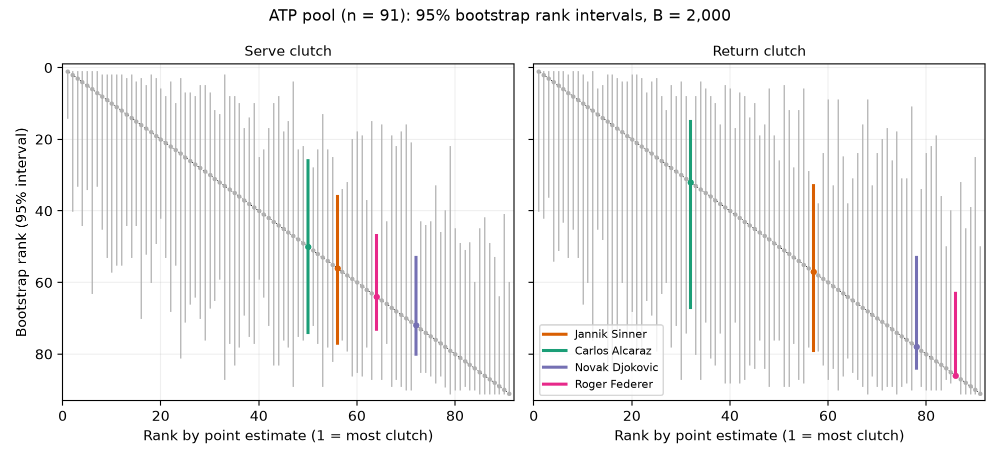

# Shot-Selection Consistency and Clutch Performance in Tennis: A Reliability Warning for Clutch Metrics

*Code, derived data and pre-registrations: [repository link supplied in the submission form].*

## Abstract

Tennis commentary treats stylistic unpredictability as a pressure-performance asset, and leverage-weighted "clutch" ratings are used by scouts and broadcasters to say who plays the big points well. We ask two questions. First, can these ratings be measured reliably enough to support claims about individual players? Second, does shot-selection consistency, measured as conditional Shannon entropy, predict clutch performance? Using point-by-point Match Charting Project data for 91 ATP and 55 WTA players (40 or more charted matches each) and hypotheses pre-registered before the data were touched, we find that role-specific clutch scores and Tennis Abstract's Balanced Leverage Ratio (BLR) are not reliably measured: across 1,000 random split-half tests, serve clutch has median reliability 0.53 (ATP) and 0.41 (WTA), return clutch 0.24 and 0.27, and BLR 0.54 and 0.29, against 0.90 to 0.93 for entropy. A single pooled leverage ratio is the exception on the ATP tour (median 0.76). Break-point conversion on return is also unreliable (ATP 0.62; its clutch-specific component 0.05). Players' true clutch differences are about 2 percentage points on serve and not detectably different from zero on return, and a reliable ATP return score needs roughly 550 charted matches against a median of 74. Carlos Alcaraz's ATP return-clutch rank is 32, with a 95% interval of 15 to 67 among 91 players. Entropy shows no relationship with clutch performance on either tour, on serve or return, across five leverage variants, and in a pooled test (n = 146). We recommend that any clutch rating be published with its own split-half reliability.

## 1. Introduction

When a broadcaster says a player "raises their level on the big points," or a scouting report labels a returner "clutch," a number is usually behind the claim. Leverage-weighted metrics, descended from Morris's (1977) definition of a point's importance, are the standard way to produce that number: weight each point by how much it moves the probability of winning the match, then ask whether a player wins more of the high-leverage points than the low-leverage ones. Tennis Abstract publishes such a metric (the Balanced Leverage Ratio, BLR) for individual players and matches, and Stats Perform presented leverage- and momentum-based tennis metrics at this conference in 2022.

Two questions follow, and this paper answers both.

**Can these metrics be measured reliably?** A rating that cannot reproduce itself on a second sample of the same player's matches is a noisy estimate, not a trait. We are not aware of any published tennis clutch metric that reports its own reliability. We test this directly, and we put the result in units a practitioner can use: how many matches a reliable score needs, how large the true differences between players are, and how uncertain a named player's rank is.

**Does a style variable predict clutch performance?** The popular narrative contrasts a flair player such as Carlos Alcaraz with a metronomic player such as Jannik Sinner and implies that unpredictability pays off under pressure. We test it with an information-theoretic measure of shot-selection predictability and a leverage-weighted outcome. We pre-registered the hypothesis, replicated it independently on the WTA tour, and stress-tested the result.

The two questions are linked. A null result on the second question is only as informative as the measurement behind it, and our reliability work shows exactly how much weight the null can bear. We lead with the reliability finding because it is the more consequential result for the industry: it applies to any metric of this family regardless of what predictor is tested against it.

**Contributions.**
1. The first split-half reliability estimates for leverage-weighted tennis clutch metrics, including a faithful reproduction of Tennis Abstract's BLR, on two tours, with robustness to the choice of split.
2. A test of the clutch statistic broadcasters quote most, break-point conversion and save rates, separating its skill component from its clutch-specific component.
3. Practitioner-scale translations of the unreliability: required data volume, the true spread of clutch between players, and bootstrap rank intervals for named players.
4. A pre-registered, independently replicated, power-analysed null for shot-selection entropy as a predictor of clutch performance, with equivalence bounds corrected for measurement error.
5. A reproducible, openly documented pipeline, including every bug found along the way.

## 2. Related work

Morris (1977) defined a point's importance as the change in match-win probability between winning and losing it, and recursive win-probability models are standard (Klaassen and Magnus, 2003; Barnett and Clarke, 2005; Newton and Keller, 2005). Klaassen and Magnus (2001) showed that points are not exactly independent and identically distributed but close enough that a constant server point-win probability is a reasonable approximation, which we use and test (Section 3.3). Tennis Abstract's Balanced Leverage Ratio (BLR) averages a serve and a return leverage ratio (mean leverage of points won divided by points lost; above 1 is read as clutch), and Stats Perform presented closely related metrics at this conference in 2022. We build on this family rather than proposing a new one.

To our knowledge, neither reliability testing of this metric family nor the pairing of an information-theoretic style predictor with a leverage-weighted outcome has been published for tennis; prior pressure research is largely physiological or psychological, or built on serve and return percentages. Our reliability analysis uses split-half correlation with Spearman-Brown correction from classical test theory, corrects equivalence bounds for attenuation, and uses empirical-Bayes shrinkage (Efron and Morris, 1975) as a candidate remedy.

## 3. Data and methods

### 3.1 Data and player pools

We use the Match Charting Project (Sackmann), crowd-sourced point-by-point data with shot-level notation. The pools are every ATP player with at least 40 charted matches (n = 91; median 74 matches, 1.13 million points) and every WTA player with at least 40 (n = 55; median 64, 426,000 points). The data are CC BY-NC-SA 4.0; our repository includes derived per-player data and fetch instructions (Appendix C).

### 3.2 Shot-selection consistency

Conditional normalized Shannon entropy measures how unpredictable a player's shot choice is given the preceding shot, normalized to [0, 1], from the 6-by-6 matrix of shot-to-shot transition probabilities; lower means more predictable. A cell with fewer than 30 observations fails a sufficiency floor, and no player in either pool was excluded.

### 3.3 Leverage and clutch

Leverage is computed by a recursive win-probability engine with a constant server point-win probability, p = 0.65 for the primary specification. For each player and role (serve or return), the **quartile clutch score** is the player's point-win rate in the top leverage quartile minus the rate in the bottom quartile, with each quartile needing at least 30 points. Sensitivity variants use p = 0.60, p = 0.70, a tiered variant (p = 0.6425 on high-pressure points) and a tour-specific empirical p (ATP 0.644, WTA 0.573), giving five variants in all.

The **leverage ratio** (LR) for a role is the mean leverage of points won divided by the mean leverage of points lost. The faithful **BLR** is (LR serve + LR return) / 2, following Tennis Abstract's definition. The **pooled LR** applies the same ratio to serve and return points together. Tennis Abstract publishes BLR per match; we test career-aggregated BLR only, and note that a single match contains far fewer points, so per-match BLR can only be less reliable.

**Break-point statistics.** A break point is any point where the returner is one point from winning a standard game (tiebreak points are excluded). **BP conversion** is the share of a player's break-point return points won; **BP save** is the share of break-point serve points won. Because these raw rates mostly reflect a player's general ability, we also compute a **clutch differential**: the break-point rate minus the same player's win rate on non-break-point points in that role.

### 3.4 Reliability

Each tour's relevant matches are sorted by date and assigned alternately to half A and half B, so a player's matches are interleaved across halves and career drift is not mistaken for noise. Each measure is computed independently on each half, and the split-half Pearson correlation across players is Spearman-Brown corrected to a full-length reliability. We use the conventional 0.70 as the threshold for acceptable reliability, and Fisher z intervals on the split-half r, with endpoints Spearman-Brown transformed.

Because any single split is one draw, we repeat the clutch, BLR and LR analyses over 1,000 random balanced splits per tour (a random permutation of the match list, then alternate positions). We call a statement "below 0.70" robust to the split if at least 95% of random splits agree. Entropy is not re-split, because its extraction is slow and its reliability is not contested.

### 3.5 Pre-registration and analysis plan

The primary hypothesis was fixed before any regression was run. The WTA replication, the pooled test and each follow-up check have their own pre-registration, as do the Applications analyses of Section 6 (2026-11-03) and the extensions (2026-11-11), each written before its script and with decision rules fixed in advance. Deviations are logged with dates in the repository, and Section 8 summarizes the material ones.

### 3.6 Statistical tests for the entropy hypothesis

Primary tests are Pearson correlations of entropy against clutch score by tour and role, Bonferroni-corrected, supplemented by Spearman correlations, Cook's-distance checks and a pooled regression with an entropy-by-tour interaction. Because failing to reject is not evidence of absence, we also report TOST equivalence bounds on the true correlation, and power.

## 4. Results A: clutch metrics are not reliably measured

### 4.1 Split-half reliability

**Table 1.** Split-half reliability (Spearman-Brown corrected). "Original" is the interleaved split used throughout; "random splits" gives the median and 95% range over 1,000 random balanced splits.

| Measure | ATP original | ATP random splits | WTA original | WTA random splits |
|---|---|---|---|---|
| Conditional entropy | 0.925 | not re-split | 0.897 | not re-split |
| Serve clutch (quartile) | 0.572 | 0.532 [0.343, 0.674] | 0.578 | 0.410 [0.107, 0.611] |
| Return clutch (quartile) | 0.231 | 0.241 [-0.058, 0.462] | 0.055 | 0.267 [-0.089, 0.538] |
| BLR (faithful) | 0.460 | 0.537 [0.353, 0.664] | 0.206 | 0.294 [-0.021, 0.557] |
| Pooled LR | 0.683 | **0.761 [0.679, 0.831]** | 0.443 | 0.449 [0.209, 0.641] |

Entropy is a reliable measurement on both tours. The clutch scores are not, and the problem is worst on return. The conclusion that a score falls below 0.70 is robust to the split for every row except ATP pooled LR: serve, return and BLR are below 0.70 in at least 99% of random splits on both tours, and WTA pooled LR in 99.6%. The original split was a typical draw for every measure (inside the random-split range), though its exact values are not the central estimates: WTA return clutch is 0.055 on the original split and 0.27 at the median, both poor, and ATP BLR is 0.46 against a median of 0.54.

This is not a thin-data artifact: each player's leverage buckets hold hundreds to thousands of points per half (for example 7,400 to 8,300 per bucket per half for Roger Federer). Return clutch depends on the opponent's serve quality, a source of variance that serve clutch, driven by the player's own execution, does not share. Full-sample and per-measure detail, including confidence intervals and the role-specific leverage ratios, is in Appendix A (Table A1).

### 4.2 Attempts to fix it

We tried three fixes. A continuous slope over all of a player's points did not help (equal or worse in three of four tour-role cells). Adjusting each return point for the serving opponent's leave-one-out serve strength made it worse (ATP return 0.231 to 0.182; WTA return 0.055 to -0.106). Empirical-Bayes shrinkage helped in all four cells (ATP serve 0.594, return 0.371; WTA serve 0.624, return 0.132) but cleared 0.70 in none. One partial success and two failures suggest the gap is a property of the data, not of a construction choice.

**Figure 1.** Each point is one player's half-A versus half-B value (original split). Entropy clusters tightly, serve clutch loosely, return clutch barely.

### 4.3 The faithful BLR, and what pooling does

We reproduced Tennis Abstract's BLR exactly as defined, on the same halves. Before reporting results we verified that the same run reproduces the entropy, serve-clutch and return-clutch reliabilities above to within 0.001 and that the pooled LR matches the pipeline's own column to machine precision.

The original-split value is 0.46 for ATP and 0.21 for WTA. Our first pre-registered rule for this analysis said a faithful-BLR reliability below 0.50 would strengthen the claim; across random splits the ATP median is 0.54, so whether the value falls below 0.50 depends on the split. What does not depend on it is that BLR is below 0.70: in 99.7% (ATP) and 100% (WTA) of random splits.

Pooling serve and return points into one ratio behaves differently. For ATP it is the one measure that is typically acceptable: median 0.76, with 93% of random splits at or above 0.70 (the original split, 0.68, fell on the low side). It is more reliable than the BLR average (0.54) because the average inherits the noisy return component. For WTA it is 0.45 and below 0.70 in 99.6% of splits. The pooled ratio answers the question "does this player win more of the big points overall", but it cannot support role-level claims ("great on return"), which is how clutch is usually discussed and where every measure fails.

Full-sample correlations clarify how the metrics relate. The faithful BLR correlates 0.716 (ATP) and 0.923 (WTA) with the pooled LR, and 0.902 and 0.866 with the mean of our serve and return quartile scores. The 0.793 convergent-validity figure from our earlier work refers to the pooled LR against the combined quartile score (reproduced exactly: 0.793 ATP, 0.808 WTA), not to the faithful BLR. The metrics agree with each other substantially, and the role-specific ones share the same reliability problem.

## 5. Results B: shot-selection entropy does not predict clutch performance

### 5.1 Primary tests

**Table 2.** Primary correlation of conditional entropy with p65 clutch score.

| Tour | Serve r (p) | Return r (p) | n |
|---|---|---|---|
| ATP | -0.041 (0.697) | +0.016 (0.877) | 91 |
| WTA | -0.259 (0.056) | +0.196 (0.151) | 55 |

No correlation approaches significance after Bonferroni correction; WTA serve is borderline before correction and does not survive correction, Spearman re-testing or influence-point removal. The null holds across all five leverage variants and across pre-registered checks for era and surface confounds, four secondary style predictors (16 comparisons) and entropy change under pressure. Pooling the tours (n = 146) is also null, with no evidence that the slope differs by tour (entropy-by-tour interaction p = 0.146 on serve, 0.207 on return; Table A4).

### 5.2 What the null can and cannot rule out

All pools are well powered for medium or larger effects (r of 0.3 or more) but not for small ones; WTA alone has only 61% power for a medium effect (Table A4). TOST equivalence testing bounds the true ATP correlation to |r| < 0.213 on serve and |r| < 0.189 on return at 95% confidence; WTA's observed-scale bounds are far looser (0.457 and 0.403).

Those bounds are on the observed scale, where both variables are measured with error. Dividing by the attenuation factor implied by each variable's reliability projects them onto the true-score scale (Figure 2; Table A2). ATP's claim survives, loosened but intact: whatever the true relationship is, it is not large (serve 0.29, return 0.41). For WTA return the corrected bound exceeds 1 (1.81, and 1.17 with shrinkage-corrected reliability), so our data cannot rule out any true-score relationship. This is the sharpest illustration in the paper of why reliability must be reported before a clutch correlation is interpreted: it is the difference between a modest null and a number that carries no information.

**Figure 2.** Equivalence bound on |r|, observed versus reliability-corrected. WTA return's bound exceeds 1 and is uninformative.

The corrected bounds use the original-split reliabilities and treat them as fixed. With the random-split median in Table 1 (WTA return 0.27, not 0.055), a back-of-envelope recalculation gives a true-score bound of about 0.82 (0.403 divided by the square root of 0.897 times 0.267): below 1, so no longer vacuous, but still too loose to rule out even a large effect (r = 0.5). We have not formally rerun this check. The honest reading is that for ATP a style-clutch relationship larger than about r = 0.3 is ruled out, and for WTA the data are informative only about large effects on serve and almost nothing on return.

## 6. Results C: what the unreliability means for practitioners

These analyses translate the reliability finding into units a team or broadcaster can use. They were pre-registered before they were run and are derived projections and descriptive uncertainty, not new hypothesis tests.

### 6.1 How much data a reliable clutch score needs

If a measure has full-length reliability ρ, the Spearman-Brown prophecy gives the multiple of data needed to reach a target reliability ρ\*: k = ρ\*(1 − ρ) / (ρ(1 − ρ\*)). We multiply k by each tour's median charted-match count (ATP 74, WTA 64). Because the answer depends on which reliability is used, Table 3 gives it for the original split and for the random-split median.

**Table 3.** Charted matches needed for reliability 0.70, Spearman-Brown projection.

| Measure | Original split: ρ, matches | Random-split median: ρ, matches |
|---|---|---|
| ATP serve clutch | 0.572, 129 | 0.532, 152 |
| ATP return clutch | 0.231, 575 | 0.241, 544 |
| ATP BLR | 0.460, 203 | 0.537, 149 |
| WTA serve clutch | 0.578, 109 | 0.410, 215 |
| WTA return clutch | 0.055, 2,566 | 0.267, 411 |
| WTA BLR | 0.206, 577 | 0.294, 358 |

For ATP the two columns agree closely: an acceptable return-clutch score needs about 550 to 575 matches, 7 to 8 times the median player's 74 (the longest career in the pool is 723, Federer's). For WTA return, the original split's 0.055 implied 2,566 matches and the random-split median of 0.27 implies about 410. We take the lower figure as the better estimate, since 0.055 is at the low end of the random-split range, though either is far beyond a typical WTA career. A second, model-based projection from each player's own bucket sizes (the shrinkage variance decomposition) agrees: about 120 matches for ATP serve, 374 for ATP return and 377 for WTA return (the earlier 6.8-fold disagreement for WTA return came from the single low split). Only 31% of ATP players already reach a player-level reliability of 0.70 on serve and 3% on return (WTA 4% and 0%). Targets of 0.80 and the shrinkage-based variants are in the repository.

### 6.2 How uncertain is a named player's clutch score and rank?

Reliability is a pool-level statistic, while practitioners talk about named players. We resample each player's own charted matches with replacement (B = 2,000, fixed seed), recompute scores with quartile thresholds re-estimated in every replicate, and rank all players in each replicate, so every player's sampling noise enters at once.

**Table 4.** ATP named players: rank among 91 (1 = most clutch), with 95% bootstrap interval.

| Player | Serve clutch rank | Return clutch rank | BLR rank |
|---|---|---|---|
| Carlos Alcaraz | 50 [26, 74] | 32 [15, 67] | 48 [26, 75] |
| Jannik Sinner | 56 [36, 77] | 57 [33, 79] | 68 [41, 82] |
| Novak Djokovic | 72 [53, 80] | 78 [53, 84] | 83 [64, 86] |
| Roger Federer | 64 [47, 73] | 86 [63, 86] | 81 [63, 86] |

The data do not support the narrative that motivated this study: the 95% score intervals for both Alcaraz and Sinner span zero on both serve and return clutch, and their rank intervals overlap almost entirely. The scores whose intervals sit clearly below the pool mean are Djokovic's on serve and return and Federer's on both (Federer's serve interval, which tops out at +0.003, is below the pool mean of +0.008). Even for these players the plausible rank range is 20 to 30 positions wide.

**Figure 3.** 95% bootstrap rank intervals for every ATP player, serve and return clutch. The dotted diagonal marks the point-estimate rank.

Across the pool, the typical player's 95% rank interval spans 52 (serve) to 63 (return) of 91 ranks for ATP, and 37 and 39 of 55 for WTA. Only 23 ATP players' serve-clutch score intervals exclude the pool mean (9 on return). For ATP return clutch, none of the ten highest-ranked players can be confidently placed in the top 20 (Table A3). The bootstrap intervals are consistent with the pool-level reliability, and no separate reconciliation is needed.

### 6.3 Break-point conversion and save rates

The clutch statistic broadcasters quote most is not a leverage ratio but break-point conversion or saving. Table 5 applies the same split-half test to those rates and to their clutch-specific component (the differential from a player's non-break-point rate). Each player-half has a median of 430 (ATP) or 310 (WTA) break points per role.

**Table 5.** Split-half reliability (Spearman-Brown, original split, 95% CI) of break-point statistics.

| Measure | ATP | WTA |
|---|---|---|
| BP save (serve), raw rate | 0.754 [0.627, 0.838] | 0.439 [0.034, 0.674] |
| BP save, differential from baseline | 0.400 [0.088, 0.605] | 0.118 [-0.519, 0.488] |
| BP conversion (return), raw rate | 0.617 [0.419, 0.748] | 0.063 [-0.613, 0.456] |
| BP conversion, differential from baseline | 0.054 [-0.437, 0.377] | -0.290 [-1.221, 0.251] |

On ATP serve, the raw break-point save rate is acceptably reliable, but it mostly measures how well a player serves in general: across players it correlates 0.77 with their non-break-point serve win rate (0.80 on return). The clutch-specific component, how much better or worse a player does on break points than usual, has reliability 0.40 on serve and effectively zero on return. On WTA, even the raw rates fall below 0.70. So the pattern of the leverage-weighted metrics repeats in the statistic broadcasters actually cite: stable as a skill measure where data are plentiful, not stable as a clutch measure. Two cautions apply. A differential is a difference score and is mechanically less reliable than its components. And break-point situations are not randomly assigned, so the differential is a descriptive contrast, not a causal estimate of clutch.

### 6.4 How large is the true spread of clutch?

"Unreliable" does not say how big the real differences are. Using the variance decomposition behind the shrinkage model, and an independent estimate from the covariance of the two halves' scores, we estimate the standard deviation of players' true clutch scores (Table 6).

**Table 6.** True between-player standard deviation of quartile clutch (percentage points), with 95% bootstrap intervals, beside the typical standard error on one player's score.

| Tour, role | True SD, variance method | True SD, half-split method | Typical SE per player |
|---|---|---|---|
| ATP serve | 2.15 [1.62, 2.57] | 2.10 [1.61, 2.50] | 1.74 |
| ATP return | 1.22 [0.52, 1.68] | 1.04 [0.00, 1.63] | 1.74 |
| WTA serve | 1.88 [0.99, 2.48] | 2.14 [1.30, 2.71] | 2.08 |
| WTA return | 1.31 [0.00, 1.99] | 0.59 [0.00, 1.82] | 2.07 |

On serve there are real differences between players: the standard deviation of true serve clutch is about 2 percentage points, about as large as the noise on any one player's score (1.7 to 2.1 points). On return the true spread is at most about 1.2 points against 1.7 to 2.1 points of noise, and for WTA return neither estimate's interval excludes zero (the two estimators also differ by a factor of 2.2, beyond the factor of 2 we had set as acceptable). Following our pre-registered rule, we describe WTA return as showing no detectable stable difference between players, and ATP return as small and not consistently distinguishable from zero. The variance method assumes binomial sampling variance, an approximation.

## 7. Discussion

**The reliability finding and the null interact.** A reliable predictor paired with an unreliable outcome produces a null whether or not a true relationship exists. Section 5.2 shows how this plays out: ATP's null remains informative, WTA return's does not. We therefore read the serve-side nulls as moderately informative and the return-side nulls, especially WTA return, as inconclusive and not as confirmatory.

**What the null means for coaching narratives.** Within what these data can detect, shot-selection predictability does not distinguish clutch from non-clutch players on either tour. This does not say style is irrelevant to pressure performance; it says this specific, intuitive channel does not show up at the precision currently achievable.

**Why return is worse than serve.** True return clutch varies less between players (Table 6) while its noise equals serve's, so the signal-to-noise ratio is lower. Adjusting for opponent serve strength did not help, so the mechanism is more diffuse than opponent mix; we do not claim to have identified it.

**The scope of the claim.** We do not claim that every leverage-based number is unreliable. Role-specific clutch scores and the averaged BLR are below 0.70 in essentially all random splits on both tours; the pooled ratio is acceptable for ATP and not for WTA. The pattern that matters for practice is that reliability falls as the question gets more specific: overall, then by role, then the clutch-specific component of a skill statistic.

**Future work.** A multilevel model (points within matches within players) would estimate player-level clutch variance without the split-half approximation. Per-match BLR, as Tennis Abstract publishes it, can be tested for reliability directly. And the same audit applies to other sports' clutch metrics.

## 8. Limitations and deviations

- **Observational charting data.** The Match Charting Project is crowd-sourced, and the pool is a selected set of well-charted, mostly elite players. Ranking was not available in the match metadata and is not controlled.
- **Constant-p leverage.** Leverage uses a constant server point-win probability (Klaassen and Magnus's simplification) with five sensitivity variants. Rank correlations across variants are high, but 13 of 91 players (serve) and 19 of 91 (return) change the sign of their score within the p range tested.
- **Reliability is estimated, not known.** A single split is one draw (WTA return is 0.055 on the original split and 0.27 at the random-split median). Entropy was not re-split, and the disattenuated bounds and the pre-registered BLR threshold were evaluated on the original split, treating reliabilities as fixed.
- **ATP clutch-file provenance.** The script that generated the committed ATP clutch table was lost; the reconstruction differs by up to about 0.005 in clutch scores, changes no conclusion, and WTA reproduces exactly.
- **Scope of individual tests.** BLR is tested at career level, while Tennis Abstract publishes it per match (per-match reliability can only be lower). Break-point differentials are difference scores in non-randomly assigned situations. The true-spread variance method assumes binomial sampling variance, and for WTA return its two estimators differ by more than our pre-registered factor of 2.
- **Bootstrap bias.** Quartile clutch scores missed our pre-registered bias tolerance (mean absolute gap 0.0018 to 0.0027 against a target of 0.002; maximum 0.011), likely because quartile thresholds sit on tied leverage values. We did not correct it, and the rank intervals should be read as approximate.
- **Pre-registration and clarifications.** All hypotheses were pre-registered before the relevant analysis and no decision rule was changed after seeing results. Clarifications made when running the analyses (the definition of "combined quartile clutch", the entropy sanity check taken from committed data, a shared match resample across serve, return and BLR) are logged with dates in the repository. The random-split extension showed that one pre-registered rule, that a faithful BLR below 0.50 strengthens the claim, is split-dependent, so we report the original value and the random-split median side by side.

## 9. Conclusion

Role-specific leverage-weighted clutch scores and Tennis Abstract's BLR are too unreliable to support claims about individual players, particularly on return points. Across 1,000 random splits their reliability is below 0.70 in at least 99% of draws on both tours; the clutch-specific component of break-point conversion is no better; the true differences between players are about 2 percentage points on serve and not detectable on return; a reliable ATP return-clutch score needs roughly 550 charted matches against a median of 74; and a named player's rank typically has a 95% interval covering more than half the pool. The exception is a single pooled leverage ratio on the ATP tour, which is typically acceptable. We draw five practical rules. (1) Before citing a clutch rating, ask for its split-half reliability, as for any psychometric instrument, and treat a value below 0.70 as a noisy estimate of a possibly small true effect. (2) Do not cite role-specific clutch, above all return clutch, for individual players. (3) If one number is needed, pool the points (ATP): the pooled ratio is acceptable where averaging serve and return ratios, as BLR does, is not. (4) If a ranking is needed, shrink it and show the interval. (5) Budget several hundred charted matches per player for any return-side measure. Separately, shot-selection predictability does not detect a pressure-performance channel on either tour, a corrective supported by independent replication and a robustness battery whose limits we state explicitly.

The pipeline is open, every bug is disclosed, and the infrastructure now makes it cheap to test any other style predictor against the same outcome, while telling the analyst in advance how much the outcome can bear.

## References

- Barnett, T., and Clarke, S. R. (2005). Combining player statistics to predict outcomes of tennis matches. *IMA Journal of Management Mathematics*, 16(2), 113-120.
- Efron, B., and Morris, C. (1975). Data analysis using Stein's estimator and its generalizations. *Journal of the American Statistical Association*, 70(350), 311-319.
- Klaassen, F. J. G. M., and Magnus, J. R. (2001). Are points in tennis independent and identically distributed? Evidence from a dynamic binary panel data model. *Journal of the American Statistical Association*, 96(454), 500-509.
- Klaassen, F., and Magnus, J. R. (2003). Forecasting the winner of a tennis match. *European Journal of Operational Research*, 148(2), 257-267.
- Morris, C. (1977). The most important points in tennis. In S. P. Ladany and R. E. Machol (Eds.), *Optimal Strategies in Sports*. North-Holland.
- Newton, P. K., and Keller, J. B. (2005). Probability of winning at tennis (I): Theory and data. *Studies in Applied Mathematics*, 114(3), 241-269.
- Sackmann, J. Tennis Abstract, including the Balanced Leverage Ratio. tennisabstract.com.
- Sackmann, J. et al. Match Charting Project. github.com/JeffSackmann/tennis_MatchChartingProject (CC BY-NC-SA 4.0).
- Stats Perform (2022). [Title and authors to be confirmed against the SSAC 2022 program.] MIT Sloan Sports Analytics Conference.

## Appendix A: Supporting tables

**Table A1.** Split-half reliability on the original split with 95% CI (Spearman-Brown), and the median and 95% range over 1,000 random splits, for the quartile clutch scores and the leverage ratios.

| Measure | Tour | Original [95% CI] | Random-split median [95% range] |
|---|---|---|---|
| Serve quartile clutch | ATP | 0.572 [0.350, 0.718] | 0.532 [0.343, 0.674] |
| Return quartile clutch | ATP | 0.231 [-0.167, 0.494] | 0.241 [-0.058, 0.462] |
| LR, serve | ATP | 0.500 [0.241, 0.671] | 0.525 [0.347, 0.648] |
| LR, return | ATP | 0.320 [-0.033, 0.552] | 0.321 [0.070, 0.508] |
| BLR (faithful) | ATP | 0.460 [0.180, 0.645] | 0.537 [0.353, 0.664] |
| Pooled LR | ATP | 0.683 [0.519, 0.791] | 0.761 [0.679, 0.831] |
| Serve quartile clutch | WTA | 0.578 [0.274, 0.755] | 0.410 [0.107, 0.611] |
| Return quartile clutch | WTA | 0.055 [-0.628, 0.451] | 0.267 [-0.089, 0.538] |
| LR, serve | WTA | 0.557 [0.237, 0.743] | 0.375 [0.094, 0.597] |
| LR, return | WTA | -0.093 [-0.881, 0.366] | 0.090 [-0.389, 0.398] |
| BLR (faithful) | WTA | 0.206 [-0.368, 0.539] | 0.294 [-0.021, 0.557] |
| Pooled LR | WTA | 0.443 [0.040, 0.676] | 0.449 [0.209, 0.641] |

**Table A2.** TOST equivalence bound on |r|, observed versus corrected for measurement error (quartile reliabilities).

| Tour | Role | Observed | Reliability-corrected |
|---|---|---|---|
| ATP | Serve | 0.213 | 0.293 |
| ATP | Return | 0.189 | 0.410 |
| WTA | Serve | 0.457 | 0.635 |
| WTA | Return | 0.403 | **1.813 (vacuous)** |

**Table A3.** Pool-level uncertainty from the rank bootstrap.

| Tour | Measure | Median 95% rank-interval width | Players whose score interval excludes the pool mean | Of the top 10, rank interval wholly within the top 20 |
|---|---|---|---|---|
| ATP (of 91) | Serve clutch | 52 | 23 | 1 |
| ATP | Return clutch | 63 | 9 | 0 |
| ATP | BLR | 56 | 19 | 1 |
| WTA (of 55) | Serve clutch | 37 | 8 | 2 |
| WTA | Return clutch | 39 | 6 | 1 |
| WTA | BLR | 40 | 8 | 0 |

**Table A4.** Pooled ATP+WTA test (n = 146) and power for the entropy hypothesis.

| Quantity | Serve | Return |
|---|---|---|
| Pooled r [95% CI], p | -0.124 [-0.282, 0.041], 0.141 | +0.084 [-0.081, 0.245], 0.320 |
| Entropy-by-tour interaction, p | 0.146 | 0.207 |
| Cochran's Q homogeneity, p | 0.200 | 0.297 |
| Pooled TOST bound on abs(r) | 0.174 | 0.241 |

Minimum detectable effect at 80% power and two-sided alpha = 0.05: ATP 0.29, WTA 0.37, pooled 0.23. Power to detect a medium effect (r = 0.3): ATP 82.7%, WTA 60.7%. Power to detect a small effect (r = 0.1): ATP 15.6%, WTA 11.2%.

## Appendix B: Bug disclosures

1. A shot-parsing bug inverted every hitter label in the first versions of the entropy pipeline. It was caught by checking against ground truth and fixed by consolidating parsing into one module; a standing regression guard now fails any run whose hitter-attribution parity is below 85%.
2. The leverage engine had a hardcoded server-alternation flag in its tiebreak branch, affecting roughly 3.4% of points; it was caught in review and the pipeline rerun (convergent-validity r moved from 0.792 to 0.793).
3. Two numerically equal but bit-different ways of writing one probability flipped a cluster of tied leverage values across a quartile boundary in the WTA replication.
4. A head-to-head check on Djokovic and Federer first looked like a validation failure and was a scoping error, not a bug.
5. The ATP clutch-table provenance gap described in Section 8.

## Appendix C: Data and reproduction

**Source data.** Match Charting Project (Sackmann et al.), upstream commit `2c59eef194967e688b69e73df344184a06322cd8` (2026-05-25), CC BY-NC-SA 4.0. The eight raw files used (ATP and WTA match metadata plus three points files each) are byte-identical to that commit, verified by git blob hash; the repository's `DATA_MANIFEST.csv` lists each file's size, SHA-256 and commit-pinned URL. Raw files are not copied into the repository; fetch commands pinned to the commit are in its README.

**Derived data committed to the repository.** Per-player feature and clutch tables for each tour (`results/atp`, `results/wta`), the per-player split-half values behind Figure 1 (`results/figures/split_half_raw_*.csv`), and every output of the Applications analyses (`results/applications/`): BLR reliability, data-requirement projections, bootstrap intervals for all players, random-split reliabilities, break-point reliabilities and true-spread estimates. These carry the source data's CC BY-NC-SA terms; the code is MIT-licensed.

**Reproduction.** After installing the requirements and fetching the pinned raw files, `python src/pipeline/run_pipeline.py --tour atp` (and `--tour wta`) rebuilds the primary pipeline; `python src/robustness/applications_analyses.py` then `python src/robustness/applications_extensions.py` reproduce Sections 4.1, 4.3 and 6; Figure 3 is `src/figures/make_bootstrap_rank_figure.py`. Pre-registrations are in `docs/`, and every analysis script checks itself against previously reported values before writing output (for example, the extensions script aborts unless it reproduces all twelve original-split reliabilities).
