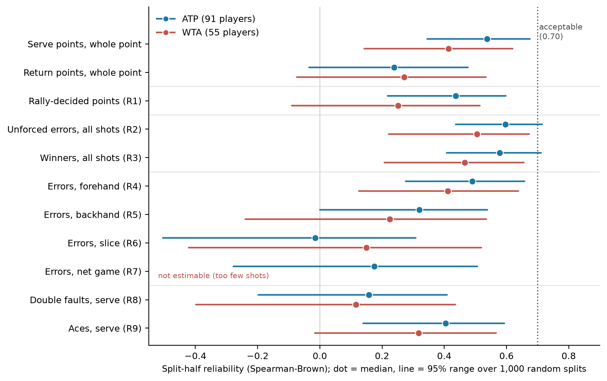

# Shot-Selection Consistency and Clutch Performance in Tennis: A Reliability Warning for Clutch Metrics

*Code, derived data and analysis plans: [repository link supplied in the submission form].*

## 1. Introduction

When a broadcaster says a player "raises their level on the big points," or a scouting report labels a returner "clutch," a number is usually behind the claim, and judgements about who is a big-match player follow from it. Leverage-weighted metrics, descended from Morris's (1977) definition of a point's importance, are the standard way to produce that number: weight each point by how much it moves the probability of winning the match, then ask whether a player wins more of the high-leverage points than the low-leverage ones. Tennis Abstract publishes such a metric, the Balanced Leverage Ratio (BLR), for individual matches (Sackmann, Tennis Abstract), and a 2022 finalist paper at this conference (Seidl and Lucey, 2022) used leverage, clutch and momentum metrics to detect key moments in women's tennis.

**What we find.** In Match Charting Project data for 91 ATP and 55 WTA players, the clutch ratings we tested are not reliable enough to support claims about individual players. Split a player's charted matches into two halves, compute the rating on each, and ask whether players keep their relative positions: across 1,000 random splits, ATP serve clutch has a median reliability of 0.53 and return clutch 0.24 (WTA is similar), and Tennis Abstract's BLR is no better, against about 0.9 for shot-selection entropy. The problem extends to every shot: clutch on rally points and on the errors and winners of each shot also stays below the conventional 0.70 threshold; one pooled ratio on the ATP tour is the exploratory exception. True differences between players are real on serve but no larger than the noise on one player's score; a reliable return rating would need about 550 charted matches, and Carlos Alcaraz's return-clutch rank is 32 of 91 with a 95% interval of 14 to 64. Entropy shows no detectable relationship with clutch on either tour, with bounds that are informative for ATP but say little about WTA return. We recommend that any clutch rating be published with its own split-half reliability.

Two questions drive the paper. **Can these metrics be measured reliably?** A rating that fails the split-half test is mostly noise, not a trait; the correlation across players, corrected to full length, is its reliability. The question is old in other sports, but we are not aware of a published tennis clutch metric that reports its own reliability. **Does shot-selection predictability predict clutch performance?** Commentary contrasts a flair player such as Carlos Alcaraz with a metronomic one such as Jannik Sinner and implies that unpredictability pays under pressure. We test it with an information-theoretic style measure against every clutch outcome we can build, replicated on the WTA tour. A null on the second is only as informative as the measurement behind it, so we lead with reliability.

**Contributions.** (1) To our knowledge the first split-half reliability estimates for leverage-weighted tennis clutch metrics, including BLR, on serve, return, rally and shot-level outcomes. (2) Practitioner-scale translations: data needed, true spread, rank uncertainty and break-point statistics. (3) A power-analysed null for entropy with equivalence bounds corrected for measurement error, replicated on a second tour. (4) An open, reproducible pipeline.

## 2. Related work

Morris (1977) defined a point's importance as the change in match-win probability between winning and losing it, and recursive win-probability models are standard (Klaassen and Magnus, 2003; Barnett and Clarke, 2005; Newton and Keller, 2005). Klaassen and Magnus (2001) showed that points are close enough to independent and identically distributed that a constant server point-win probability is a reasonable approximation, which we use and test. BLR averages a serve and a return leverage ratio (mean leverage of points won divided by points lost; above 1 is read as clutch), and Seidl and Lucey (2022) built closely related metrics at Stats Perform. We build on this family rather than proposing a new one.

The reliability question has a long history outside tennis. Cramer (1977) asked whether a baseball batter who is clutch in one season stays clutch in the next and found that largely he does not; most later baseball studies agree, though whether the tests can detect a small true effect is debated. Tennis pressure research is mostly economic or psychological: Cohen-Zada et al. (2017) and De Paola and Scoppa (2017) compare performance across stakes and by gender, which asks whether pressure changes average performance, not whether individual players differ stably in handling it. To our knowledge, neither reliability testing of leverage-weighted tennis metrics nor the pairing of an information-theoretic style predictor with a leverage-weighted outcome has been published. We use split-half reliability with Spearman-Brown correction, attenuation-corrected equivalence bounds, and empirical-Bayes shrinkage (Efron and Morris, 1975).

## 3. Data and methods

**Data.** We use the Match Charting Project (Sackmann), crowd-sourced point-by-point data with shot-level notation (CC BY-NC-SA 4.0). The pools are every ATP player with at least 40 charted matches (n = 91; median 74 matches, 1.13 million points) and every WTA player with at least 40 (n = 55; median 64, 426,000 points). Derived per-player data and pinned fetch instructions are in the repository (Appendix), which also holds the supplementary tables S1 to S13 (`paper/supplementary_tables.md`) cited below.

**Shot-selection consistency.** Conditional normalized Shannon entropy measures how unpredictable a player's shot choice is given the preceding shot, from the 6-by-6 matrix (forehand and backhand by three directions) of shot-to-shot transition probabilities over every rally shot, scaled to [0, 1]; lower means more predictable. It is nearly uncorrelated with net-play rate, drop-shot rate, serve direction and return depth (|r| at most 0.17).

**Leverage and clutch.** Leverage comes from a recursive win-probability engine with a constant server point-win probability (p = 0.65 primary; four sensitivity variants: p = 0.60, p = 0.70, a tiered p, and tour-specific empirical p of 0.644 ATP and 0.573 WTA). For each player and role (serve or return), the **quartile clutch score** is the point-win rate in the top leverage quartile minus the rate in the bottom quartile. The **leverage ratio** (LR) is the mean leverage of points won divided by that of points lost; the faithful **BLR** is (LR serve + LR return) / 2, as Tennis Abstract defines it, and the **pooled LR** applies the ratio to serve and return points together. We test career-aggregated BLR only, so the per-match BLR Tennis Abstract publishes can only be less reliable.

**All-shot outcomes.** Serve and return are only the first two shots of a point. We classify each point by where it ended (serve-decided: ace, service winner or double fault; return-decided; or rally-decided, a third shot or later), attribute each shot to its hitter, and build outcomes under the same leverage quartiles: **R1** the point-win clutch score on rally-decided points; **R2** unforced errors and **R3** winners per shot hit, over every return and rally shot (top minus bottom quartile, signed so that higher means better under pressure); **R4 to R7** errors within forehand, backhand, slice and net-game shots; and **R8, R9** double faults and aces per serve point. All were specified, with sufficiency floors, before they were computed.

**Break-point statistics.** BP conversion and BP save are the shares of break-point return and serve points won (tiebreaks excluded). Because these mostly reflect general ability, we also compute a **clutch differential**: the break-point rate minus the player's non-break-point rate in that role.

**Reliability.** A tour's matches are sorted by date and assigned alternately to halves A and B, so career drift is not mistaken for noise. Each measure is computed on each half, and the split-half correlation across players is Spearman-Brown corrected to full length, with Fisher z intervals. We use 0.70, the common minimum for group-level comparisons, as the threshold; decisions about individuals are usually held to 0.90 or more (Nunnally and Bernstein, 1994), so 0.70 is lenient for the claims at issue. We call an outcome reliably measured only if its random-split median is at least 0.70 and at least 95% of splits are. Because one split is one draw, we repeat the analysis over 1,000 random balanced splits per tour. Entropy is not re-split (extraction is slow and its reliability is not contested).

**Hypothesis, plans and tests.** The plan fixed the predictor (conditional entropy), the outcomes and two-sided Pearson tests by tour and role with Bonferroni correction, plus Spearman and Cook's-distance checks, a pooled regression, TOST equivalence bounds and power; the narrative implies a positive sign. Every analysis has a dated plan in the repository, written before the corresponding script with decision rules stated in advance. These are self-registered, not deposited in a registry, and version control cannot independently verify their order: the earliest preserved commit is dated 2026-07-07, the public history was squashed on 2026-09-23, and the November plans were written after earlier results were known (`docs/combined/preregistration_timeline.md`).

## 4. Are clutch metrics reliable?

### 4.1 Serve and return

**Table 1.** Split-half reliability (Spearman-Brown corrected). "Original" is the interleaved split used throughout; "random splits" gives the median and 95% range over 1,000 random balanced splits.

| Measure | ATP original | ATP random splits | WTA original | WTA random splits |
|---|---|---|---|---|
| Conditional entropy | 0.925 | not re-split | 0.897 | not re-split |
| Serve clutch (quartile) | 0.572 | 0.532 [0.343, 0.674] | 0.578 | 0.410 [0.107, 0.611] |
| Return clutch (quartile) | 0.231 | 0.241 [-0.058, 0.462] | 0.055 | 0.267 [-0.089, 0.538] |
| BLR (faithful) | 0.460 | 0.537 [0.353, 0.664] | 0.206 | 0.294 [-0.021, 0.557] |
| Pooled LR | 0.683 | **0.761 [0.679, 0.831]** | 0.443 | 0.449 [0.209, 0.641] |

Entropy is reliably measured on both tours. The clutch scores are not, and the problem is worst on return. Serve, return and BLR fall below 0.70 in at least 99% of random splits on both tours (Figure 1 shows the original split). The original split was a typical draw for every measure, though not always the central one: WTA return clutch is 0.055 on it and 0.27 at the median, both poor.

**Figure 1.** Each point is one player's half-A versus half-B value (original split). Entropy clusters tightly, serve clutch loosely, return clutch barely.

This is not a thin-data artifact (each player's leverage buckets hold hundreds to thousands of points per half), and return clutch also depends on the opponent's serve quality, a variance source serve clutch does not share.

### 4.2 The faithful BLR, and what pooling does

BLR is below 0.70 in 99.7% (ATP) and 100% (WTA) of random splits. Our rule that an original-split value below 0.50 would strengthen the claim (0.46 ATP, 0.21 WTA) proved split-dependent, since the ATP random-split median is 0.54, so we report both.

Pooling serve and return points into one ratio behaves differently. On ATP it is the one typically acceptable measure (median 0.76; 93% of random splits at or above 0.70), because the BLR average inherits the noisy return component; on WTA it is 0.45 and below 0.70 in 99.6% of splits. It answers "does this player win more of the big points overall" but cannot support role-level claims. It is reliable but not validated: it relates to general strength (r with overall point-win rate -0.22 ATP, -0.47 WTA), so part of its reliability may reflect exposure to high-leverage states. We found it after seeing the other results, on one tour, so it is exploratory.

### 4.3 Attempted fixes

Three fixes did not rescue the scores: a continuous slope of point-win on leverage over all points (random-split medians of at most 0.50 on serve and 0.31 on return in either tour, against up to 0.54 and 0.27 for the quartile score, and at most 0.1% of splits at or above 0.70; Table S10), opponent-serve adjustment of return points (ATP return 0.182, WTA -0.106) and empirical-Bayes shrinkage, which helped in every cell (ATP serve 0.594, return 0.371; WTA serve 0.624, return 0.132) but cleared 0.70 in none. The rally outcomes behave the same way (Table S9): shrinkage lifts ATP winner clutch to a random-split median of 0.74 and WTA unforced-error clutch to 0.71, but only 79% and 55% of splits reach 0.70, short of our 95% rule, and every other rally outcome stays at or below 0.62; and under the four other leverage variants no rally outcome reaches a median of 0.65.

The split-half tests interleave matches. A chronological split, each player's earlier matches against the later ones, is harder because it also absorbs real change in form and opposition, and it does no better (Table S11): Spearman-Brown reliabilities of 0.44 and 0.20 for ATP serve and return and 0.40 and 0.12 for WTA. The highest of any outcome is 0.66 for ATP unforced-error clutch; its interval (0.53 to 0.76) does not exclude 0.70, but one split per tour is imprecise.

Surface, opponent and time do not explain the unreliability. Adjusting serve, return and rally-point outcomes for surface, Best-of-5, match date and opponent strength, within player and leverage bucket, leaves scores almost unchanged (correlation with the raw score 0.96 to 1.00) and reliability unchanged: random-split medians of at most 0.54 and at most 1.1% of splits at or above 0.70 (Table S13). A within-match estimator is less reliable (at most 0.43), the entropy-clutch correlations barely move (smallest p 0.070), and in a simulation that ties leverage to opponent strength the adjustment removes a 9 to 19 point bias in the raw score.

### 4.4 Beyond serve and return: every shot

Is the problem specific to the serve and return roles? About two thirds of points are decided in the rally (ATP 62% to 66%, WTA 67% to 71%; Table S8), and high-leverage points are slightly more often rally-decided than low-leverage ones, so the rally is where most high-leverage points end. Figure 2 applies the same test to the all-shot outcomes defined in Section 3 (numbers in Table S7).

**Figure 2.** Median split-half reliability (dot) and 95% range over 1,000 random splits (line) for clutch measured on serve and return points, on rally-decided points, and on shot-level outcomes. The dotted line is the 0.70 threshold. WTA net-game errors are not estimable (too few shots).

No outcome meets the pre-registered criterion on either tour. The most reliable are the error and winner outcomes that use every shot hit: unforced-error clutch reaches 0.60 on ATP [0.44, 0.72] and 0.50 on WTA, winner clutch 0.58 and 0.47, and at most 4.2% of random splits reach 0.70. Both beat return clutch (0.24, 0.27) and rally-decided point clutch (0.44, 0.25) and modestly exceed serve clutch (0.54, 0.41; these random splits differ from Table 1's, where serve is 0.53), but none reaches 0.70. By shot type, forehand errors are the most reliable (0.49 ATP, 0.41 WTA), backhand errors less (0.32, 0.23), and slice, net-game, ace and double-fault outcomes are no better. Measures built on counts of every shot hit are the most reliable, a binary point outcome in the rally is not, and none reaches 0.70. We repeated the practice-side analyses of Section 6 and the checks of Section 4.3 for the rally-point, error and winner outcomes (Section 6.1 and Table S9); they give the same picture.

## 5. Does shot-selection entropy predict clutch?

### 5.1 Tests

**Table 2.** Correlation of conditional entropy with each clutch outcome, the outcome's reliability (random-split median) and the 95% bound on the true |r| (Section 5.2) after correcting for both variables' reliability; observed bounds are in Table S2. n = 91 (ATP) and 55 (WTA). R1 to R3 are the all-shot outcomes of Section 3 (rally-decided points, unforced errors and winners over every shot hit). A corrected bound near or above 1 means the data cannot rule out any relationship.

| Tour | Outcome | r (p) | Outcome reliability | Corrected bound on true r |
|---|---|---|---|---|
| ATP | Serve | -0.041 (0.697) | 0.53 | 0.30 |
| ATP | Return | +0.016 (0.877) | 0.24 | 0.40 |
| ATP | R1 rally points | +0.007 (0.947) | 0.44 | 0.28 |
| ATP | R2 errors | +0.155 (0.142) | 0.60 | 0.43 |
| ATP | R3 winners | -0.064 (0.544) | 0.58 | 0.32 |
| WTA | Serve | -0.259 (0.056) | 0.41 | 0.75 |
| WTA | Return | +0.196 (0.151) | 0.27 | 0.82 |
| WTA | R1 rally points | +0.069 (0.616) | 0.25 | 0.61 |
| WTA | R2 errors | -0.056 (0.683) | 0.50 | 0.41 |
| WTA | R3 winners | +0.024 (0.859) | 0.47 | 0.38 |

No correlation survives Bonferroni correction (thresholds 0.005 for serve and return, 0.0083 for the all-shot outcomes), and the smallest nominal p in Table 2, 0.056 (WTA serve), does not survive Spearman re-testing (p = 0.20) or removal of its three most influential players (p = 0.20). The null also holds across five leverage variants, era and surface confounds, four secondary style predictors (16 comparisons; lowest nominal p 0.013 against 0.003), entropy change under pressure and the regenerated ATP clutch table (Section 8). Pooling the tours (n = 146) is null, with no evidence the slope differs by tour (Table S3).

### 5.2 What the null can and cannot rule out

The bound used throughout is the largest true correlation, in absolute value, that the data cannot rule out with 95% confidence (a two one-sided equivalence test). A bound of 0.30 means that entropy and clutch are at most 0.30 correlated in either direction, so entropy would explain at most 9% of the variation in true clutch; a bound near or above 1 means no relationship can be ruled out.

All pools are well powered for medium effects (r of 0.3 or more) but not small ones; WTA alone has 61% power for a medium effect (Table S3). Observed bounds apply where both variables carry measurement error, so we divide by the attenuation implied by both reliabilities (Figure 3 uses the original-split reliabilities; Table S2 adds random-split values). For ATP the claim survives, loosened: the true relationship is not large for serve (0.30), return (0.40), rally points (0.28), winners (0.32) or errors (0.43). For WTA the corrected bounds are informative only for the shot-level outcomes (0.38 to 0.41) and loose for serve (0.75), rally points (0.61) and return (0.82; 1.82 at the original-split reliability, so no true relationship can be ruled out).

**Figure 3.** Equivalence bound on |r|, observed versus reliability-corrected (original-split reliabilities). WTA return's bound exceeds 1 and is uninformative.

This is the sharpest illustration of why reliability must be reported before a clutch correlation is interpreted: it separates a modest null from a number that carries no information.

## 6. What the unreliability means in practice

These are derived projections and descriptive uncertainty, not new hypothesis tests.

### 6.1 Data needed, true spread, and what it is worth

If a measure has full-length reliability ρ, the Spearman-Brown prophecy gives the multiple of data needed to reach a target ρ\*: k = ρ\*(1 − ρ) / (ρ(1 − ρ\*)), which we multiply by each tour's median charted matches (ATP 74, WTA 64). Separately, a variance decomposition gives the standard deviation of players' true clutch scores, to compare with the typical standard error on one player's score. Table 3 puts both beside the reliability.

**Table 3.** What the reliability means. Reliability is the random-split median; matches needed for reliability 0.70 passes its 95% range through the Spearman-Brown formula ("unbounded": the lower limit is zero or negative). True SD is the between-player standard deviation of true clutch (95% intervals in Tables S6 and S9; † marks an interval that reaches zero) and noise SE the typical standard error on one player's score. The last column is one true SD times the summed leverage per match of the bottom quartile (low end) and the top quartile (high end), a first-order range (see "What 2 points is worth"). The rally rows use the match-clustered estimator of Section 6.1.

| Tour, role | Reliability | Matches needed [95% range] | True SD, pp | Noise SE, pp | One true SD in match-win probability, pp |
|---|---|---|---|---|---|
| ATP serve | 0.53 | 152 [83, 331] | 2.15 | 1.74 | 0.5 to 5 |
| ATP return | 0.24 | 544 [201, unbounded] | 1.22 | 1.74 | 0.3 to 3 |
| ATP rally points | 0.44 | 223 [116, 618] | 1.62 | 1.71 | 0.5 to 6 |
| WTA serve | 0.41 | 215 [95, 1,246] | 1.88 | 2.08 | 0.4 to 4 |
| WTA return | 0.27 | 411 [128, unbounded] | 1.31† | 2.07 | not detectable |
| WTA rally points | 0.25 | 445 [141, unbounded] | 1.06† | 1.87 | not detectable |

**Data needed.** An acceptable ATP return-clutch score needs about 550 matches (interval 200 to unbounded), 7 to 8 times the median player's 74; the longest career in the pool is 723 (Federer). The intervals are wide because the reliability itself is imprecise, so return-side figures are best read as "several hundred matches at least". Rally-decided points are no easier (about 220 matches on ATP, 445 on WTA), and the error and winner outcomes need 120 to 170 (Table S9). A model-based projection agrees (about 120 matches for ATP serve, 374 for ATP return), and only 31% of ATP players already reach player-level reliability 0.70 on serve and 3% on return (Table S5).

**True spread.** On serve there are real differences between players: the true standard deviation is about 2 percentage points, about as large as the noise on one player's score. On return it is at most about 1.2 points against 1.7 to 2.1 of noise, and for WTA return the interval reaches zero, so we report no detectable stable difference there (Table S6). Rally-point clutch looks like serve on ATP (true SD 1.6 points against 1.7 of noise) and like return on WTA; for unforced-error and winner clutch the true SD is 0.6 to 0.8 points per shot, about the size of the noise (Table S9).

**A direct estimate.** The variance decomposition assumes binomial sampling noise and points within a match are not independent, so we also estimated the true spread with a multilevel model (a random slope on the top-versus-bottom quartile for each player) and a two-stage estimator with match-clustered standard errors. They agree with the earlier estimates (Table S6): ATP serve 2.0 and 2.1 points against 2.15, ATP return 1.1 and 1.1 against 1.22. Clustering makes the noise on one player's score 2% to 10% larger than the binomial value, and the implied reliability of a career-length score is 0.56 (ATP serve), 0.25 (ATP return), 0.42 (WTA serve) and 0.27 (WTA return), none near 0.70. A likelihood-ratio test finds clutch variance distinguishable from zero in all four cells (p of 0.002 or less) but ignores the clustering; a three-level model for ATP (player, match within player, sampling error; Table S12) does not. It finds a stable difference on serve (SD 2.0 points [1.4, 2.5]) and rally points (1.2) but none on return (0.5 [0.0, 1.1], p = 0.27), against 3.6 to 4.7 points of match-to-match variation in a player's own clutch. Its career-length reliability is 0.46 (serve), 0.30 (rally points) and 0.06 (return), and it needs about 250, 500 and 3,600 charted matches to reach 0.70, against a median of 74 (the split-half figures are 150, 220 and 550; the intervals overlap, and the nested model is higher on return because it finds almost no stable spread). The WTA fit failed our simulation check and is not reported. So real, small differences exist on serve, and the weakness is in measuring them.

**What 2 points is worth.** Leverage is by construction the change in match-win probability from winning rather than losing a point, so to first order a shift of d in a player's win rate on a set of points changes their match-win probability by d times the summed leverage of those points. The median ATP player has about 2.4 units of top-quartile serve leverage per charted match but only 0.2 in the bottom quartile. A quartile score is top minus bottom, so one true standard deviation of serve clutch is worth from about 0.5 points of match-win probability (all from the bottom quartile) to about 5 (all from the top); rally-point clutch gives a similar range (0.5 to 5.6 on ATP, 0.3 to 3.4 on WTA).

### 6.2 How uncertain is a named player's rank?

Reliability is a pool-level statistic, but practitioners talk about named players. About 70% of ATP matches are between two pool players, so we resample the global list of matches with replacement (B = 2,000, fixed seed), give each match the same draw count in both players' scores, re-estimate quartile thresholds and rank all players in every replicate (widths are within 2% of a player-by-player bootstrap on ATP).

**Figure 4.** 95% match-level bootstrap rank intervals for every ATP player, serve and return clutch (rank 1 = most clutch among 91). The dotted diagonal marks the point-estimate rank.

The data do not support the narrative that motivated this study, and not because these players are thinly charted: Alcaraz (221 charted matches) and Sinner (297) are among the nine most charted in the pool. Alcaraz's return-clutch rank is 32 (95% interval 14 to 64) and Sinner's is 57 (33 to 80); on serve they are 50 (28 to 74) and 56 (35 to 77). Only Djokovic (serve rank 72 [54, 79], return 78 [53, 84]) and Federer (64 [48, 73], 86 [63, 86]) have intervals clearly below the pool mean, and even theirs span 23 to 31 ranks. On Tennis Abstract's BLR, Federer and Djokovic both score 0.976 against a pool mean of 1.006, and their score intervals (0.966 to 0.988 and 0.963 to 0.988) exclude it, so the data can say they are below average on this ratio. Their ranks, though, are 81 and 83 with intervals of 62 to 86 and 63 to 86: the data cannot order the two, or say how far either sits below players near them. The ratio is also lower for stronger players (r with overall point-win rate of -0.22 on ATP, Section 4.2), so a low value for two of the greatest players is not evidence of weakness under pressure. In short, these ratings can separate an extreme from the middle of the pool, not neighbours from one another. Across the pool the typical 95% rank interval spans 52 (serve) to 64 (return) of 91 ranks on ATP and 35 and 40 of 55 on WTA; only 21 ATP serve-clutch intervals exclude the pool mean (8 on return, close to the 4.5 that 5% chance alone would give). The rally outcomes are no sharper: the typical interval spans 55 of 91 ranks for ATP rally-point clutch (48 to 49 for errors and winners) and 38 of 55 on WTA (Table S9; thresholds held fixed, which on serve and return changes widths by under 6%).

### 6.3 Break-point conversion and save rates

The statistic broadcasters quote most is break-point conversion or saving. On ATP the raw rates are borderline-to-acceptable skill measures (median reliability 0.72 save, 0.73 conversion) but mostly measure general ability (r of 0.77 and 0.80 with the player's non-break-point win rate). The clutch-specific component, how much better a player does on break points than usual, is not reliable (median 0.34 serve, 0.23 return), and on WTA even the raw rates fall below 0.70 in every split (Table S4). A differential is a difference score and so mechanically less reliable than its components, and break-point situations are not randomly assigned, so it is descriptive, not causal.

## 7. Discussion

**The reliability finding and the null interact.** A reliable predictor paired with an unreliable outcome produces a null whether or not a true relationship exists. ATP's null remains informative (Section 5.2) and the more reliable all-shot outcomes extend it; WTA return's does not.

**What the null says about style.** Our predictor is how predictable a player's next groundstroke wing and direction are given the previous shot. It does not capture serve placement, net approaches, rally length or tactical variation, so this is a null for that measure of unpredictability, and it rules out large effects on ATP but not on WTA return. The flair narrative finds no support here; it is not refuted. For ATP players, a player one standard deviation more varied than average would differ in true clutch by at most 0.3 standard deviations, a gap the clutch scores could not reliably show. For WTA players the data cannot separate no effect from a moderate one. A null here is a reason to measure the outcome better before asking what predicts it.

**The rally does not rescue the metric.** Most high-leverage points end in the rally, so a measure using every shot might have been expected to be reliable. It is more reliable than return clutch but still below 0.70, and matches serve and return on every practice-side number: hundreds of matches needed, true spread about the size of the noise, rank intervals covering over half the pool, and no rescue from shrinkage or the leverage variant (Table S9). Return is worse than serve because true return clutch varies less while its noise equals serve's (Table 3); we do not claim to have identified the mechanism.

**The threshold matters, and the verdict is about individuals.** At a lenient 0.50, ATP serve clutch (median 0.53) and the all-shot error and winner outcomes (0.60 and 0.58) would pass, and at 0.90 nothing does. We hold the 0.70 line because the claims at issue are about named players; the threshold-free reading is the ratio of true spread to noise in Table 3, about 1.2 points of signal against 1.7 of noise for ATP return. Scores of this quality can still describe groups or large differences, which is why a few extreme players are detectable (Section 6.2).

**Reliability depends on the pool.** Our players are 40-plus-match, mostly elite and heavily charted, which narrows the spread of true clutch and lowers reliability relative to a wider population, so the numbers need re-estimation for another population. The multilevel and clustered estimates (Section 6.1) show the split-half approximation is not driving the result; a three-level model with match nested in player (ATP only; the WTA fit failed validation, Section 6.1) agrees.

## 8. Limitations and deviations

- **Selected, observational data.** The Match Charting Project is crowd-sourced, the pool is well-charted and mostly elite, the charted matches are not a random sample of a player's career, and ranking is not controlled. Context adjustment is linear and uses measured covariates only (Section 4.3). Shot-level outcomes depend on charters' coding (hitter parity 95% to 97% on winner points).
- **Constant-p leverage.** 13 of 91 players (serve) and 19 of 91 (return) differ in sign between p = 0.60 and p = 0.70.
- **Reliability is estimated.** One split is one draw; entropy was not re-split; corrected bounds treat reliabilities as fixed (Table S2). About 70% of ATP matches are between two pool players; the rank bootstrap resamples matches jointly, but Fisher intervals and cross-player correlations treat players as independent.
- **ATP clutch-file provenance.** The script that generated the committed ATP clutch table was lost. Sections 4 and 6 regenerate leverage from raw data; Section 5 reads the frozen table, and rerunning it on the regenerated table moves no correlation by more than 0.005 (smallest p 0.66).
- **Individual tests.** Quartile contrasts compare different score states, so a clutch score is descriptive, not the causal effect of pressure and many reliability comparisons are reported without multiplicity correction, so the conclusion rests on the pattern, not on any single cell. The match-win translation is first-order and covers point-win outcomes only, and the player-level bootstrap missed its pre-registered bias tolerance (gap 0.0018 to 0.0027 against 0.002), a check not repeated for the match-level version.
- **Plans are self-registered** and their order cannot be independently verified (Section 3). One plan changed after a first run (the match-nested model moved from maximum likelihood to REML after its validation simulation failed, and its WTA fit was dropped; Section 6.1), and the confounder-adjustment validation was redesigned after a debugging run (Table S13). No other decision rule was changed after seeing results, but one (a faithful BLR below 0.50 strengthens the claim) proved split-dependent, so we report original and random-split values side by side.

## 9. Conclusion

Role-specific leverage-weighted clutch scores and Tennis Abstract's BLR are too unreliable to support routine claims about individual players, particularly on return points, and the problem extends to every shot, from rally-decided points to the errors, winners, aces and double faults of each shot. True differences are real on serve (about 2 points, up to about 5 points of match-win probability) but no larger than the noise on one player's score, a named player's rank typically has a 95% interval covering more than half the pool, and a reliable ATP return score needs several hundred charted matches (about 550; interval 200 to unbounded) against a median of 74. The exception is one pooled ATP ratio, exploratory and not validated as a measure of clutch.

Five rules follow. (1) Before citing a clutch rating, ask for its split-half reliability; treat a value below 0.70 as a noisy estimate. (2) Treat role-specific clutch, above all return clutch, as a noisy descriptor: cite a named player only with an interval, and only when it excludes the pool mean (21 of 91 ATP players on serve; on return 8, about what chance alone would give). (3) The ATP pooled ratio is the only reliable measure we found, but it is exploratory and its validity is untested, so treat it as a lead for further work, not a rating to publish. (4) If a ranking is needed, show the interval. (5) Budget several hundred charted matches per player for any return-side measure. Separately, we detect no pressure-performance channel for shot-selection predictability on either tour, on any outcome from serve to shot level, with bounds that are informative for ATP but not for WTA return.

## References

- Barnett, T., and Clarke, S. R. (2005). Combining player statistics to predict outcomes of tennis matches. *IMA Journal of Management Mathematics*, 16(2), 113-120.
- Cohen-Zada, D., Krumer, A., Rosenboim, M., and Shapir, O. M. (2017). Choking under pressure and gender: Evidence from professional tennis. *Journal of Economic Psychology*, 61, 176-190.
- Cramer, D. (1977). Do clutch hitters exist? *Baseball Research Journal* (Society for American Baseball Research).
- De Paola, M., and Scoppa, V. (2017). Gender differences in reaction to psychological pressure: Evidence from tennis players. *European Journal of Work and Organizational Psychology*, 26(3), 444-456.
- Efron, B., and Morris, C. (1975). Data analysis using Stein's estimator and its generalizations. *Journal of the American Statistical Association*, 70(350), 311-319.
- Klaassen, F. J. G. M., and Magnus, J. R. (2001). Are points in tennis independent and identically distributed? Evidence from a dynamic binary panel data model. *Journal of the American Statistical Association*, 96(454), 500-509.
- Klaassen, F., and Magnus, J. R. (2003). Forecasting the winner of a tennis match. *European Journal of Operational Research*, 148(2), 257-267.
- Morris, C. (1977). The most important points in tennis. In S. P. Ladany and R. E. Machol (Eds.), *Optimal Strategies in Sports* (pp. 131-140). North-Holland.
- Newton, P. K., and Keller, J. B. (2005). Probability of winning at tennis I. Theory and data. *Studies in Applied Mathematics*, 114(3), 241-269.
- Nunnally, J. C., and Bernstein, I. H. (1994). *Psychometric Theory* (3rd ed.). McGraw-Hill.
- Sackmann, J. Roger Federer wasn't clutch, but he was almost clutch enough. Tennis Abstract blog (defines the Balanced Leverage Ratio). tennisabstract.com/blog/?p=3666.
- Sackmann, J. et al. Match Charting Project. github.com/JeffSackmann/tennis_MatchChartingProject (CC BY-NC-SA 4.0).
- Seidl, R., and Lucey, P. (2022). Live counter-factual analysis in women's tennis using automatic key-moment detection. MIT Sloan Sports Analytics Conference (Stats Perform).

## Appendix: Disclosures, data and reproduction

**Bugs.** Five issues were found and disclosed, with write-ups in `docs/`: (1) a shot-parsing bug that inverted hitter labels in early entropy runs, now guarded by a check that fails any run with hitter-attribution parity below 85%; (2) a hardcoded server-alternation flag in the leverage engine's tiebreak branch (about 3.4% of points; r moved from 0.792 to 0.793); (3) two bit-different ways of writing one probability that flipped tied leverage values across a quartile boundary in the WTA replication; (4) a head-to-head check that looked like a validation failure but was a scoping error; and (5) the ATP clutch-table provenance gap (Section 8).

**Data.** Match Charting Project (Sackmann et al.), upstream commit `2c59eef194967e688b69e73df344184a06322cd8` (2026-05-25), CC BY-NC-SA 4.0. Raw files are fetched at run time and checked against `DATA_MANIFEST.csv`. Derived tables and every analysis output are committed (CC BY-NC-SA for data, MIT for code).

**Reproduction.** The README lists the commands for each table and figure. Dated plans are in `docs/`, and `preregistration_timeline.md` there records what can be verified about their dates. Every script validates itself before writing output.
