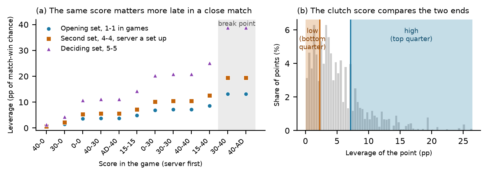
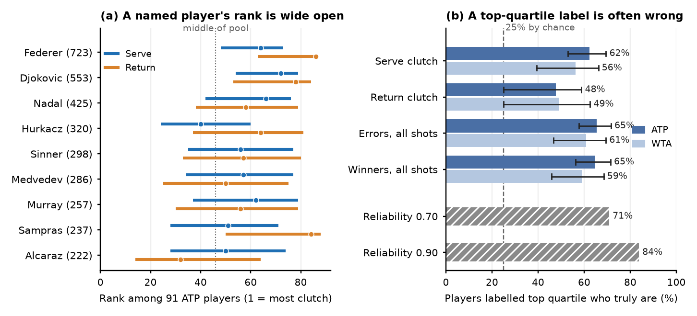

# Shot-Selection Consistency and Clutch Performance in Tennis: A Reliability Warning for Clutch Metrics

*Code, derived data and analysis plans: [repository link supplied in the submission form].*

## 1. Introduction

When a broadcaster says a player "raises their level on the big points," a number is usually behind the claim. Leverage-weighted metrics, descended from Morris's (1977) definition of a point's importance, are the standard way to produce it: weight each point by how much it moves the probability of winning the match, then ask whether a player wins more of the high-leverage points than the low-leverage ones. Tennis Abstract publishes such a metric, the Balanced Leverage Ratio (BLR), which compares the importance of the points a player wins with those they lose (Sackmann, Tennis Abstract), and a 2022 finalist paper at this conference (Seidl and Lucey, 2022) used leverage and momentum metrics to find key moments in women's tennis.

**In plain terms.** A *clutch score* is how much better a player does on the most important points than on the least important. *Reliability* asks whether a score repeats: rate players from half their matches, then again from the other half; a reliability of 0.70 or more means the two rankings mostly agree, and 0 means they agree no better than chance. *Entropy* is how hard a player's shot patterns are to predict.

**What we find.** In Match Charting Project data for 91 ATP and 55 WTA players, differences in clutch are small and too noisy to rate individual players.

- **No rating is reliable.** None reaches the 0.70 reliability criterion, whether built on serve points, return points, rally points or the errors and winners of every shot hit (table below). Tennis Abstract's BLR is no better. The test is not the obstacle: planted differences of 4 points between players would pass it.
- **Real differences are small.** About 2 points of point-win rate on serve (one standard deviation, the typical gap between a player and the average; worth 0.5 to 5 points of match-win probability), about the size of the noise on one player's score, and at most about 1.2 points on return.
- **What is stable is specific to shots.** On ATP, errors, winners and forehand errors under pressure persist from earlier to later matches beyond overall ability. But different indicators do not pick out the same players, and the scores do not predict who wins decisive sets in other matches.
- **Named players are uncertain.** A reliable return rating would need about 550 charted matches, and Carlos Alcaraz's return-clutch rank is 32 of 91 with a 95% interval of 14 to 64.
- **Entropy.** It shows no detectable relationship with clutch (informative bounds on ATP, not on WTA return).

We recommend that any clutch rating be published with its own split-half reliability.

Two questions drive the paper. **Can these metrics be measured reliably?** **Does shot-selection predictability predict clutch performance?** Commentary contrasts flair players such as Carlos Alcaraz with metronomic ones such as Jannik Sinner and implies that unpredictability pays. A null result (no relationship found) on the second is only as informative as the measurement behind it, so we lead with reliability.

**At a glance: median split-half reliability over 1,000 random splits of each player's charted matches (0.70 is the criterion; "Yes" means a score repeats from one half of a player's matches to the other).**

| Measure | ATP | WTA | Reliably measured? |
|---|---|---|---|
| Entropy (predictor) | 0.93 | 0.90 | Yes |
| Serve clutch | 0.53 | 0.41 | No |
| Return clutch | 0.24 | 0.27 | No |
| BLR (Tennis Abstract) | 0.54 | 0.29 | No |
| Rally-point clutch | 0.44 | 0.25 | No |
| Error clutch (all shots) | 0.60 | 0.50 | No |
| Winner clutch (all shots) | 0.58 | 0.47 | No |
| Forehand / backhand error clutch | 0.49 / 0.32 | 0.41 / 0.22 | No |
| Pooled ratio (exploratory) | 0.76 | 0.45 | No (ATP 93% of splits) |

**Contributions.** To our knowledge, the first split-half reliability estimates for leverage-weighted tennis clutch metrics, including BLR, from serve to shot level, with a positive control; practitioner-scale translations and a test against decisive-set results; a power-analysed entropy null on two tours; and an open pipeline.

## 2. Related work

Recursive win-probability models following Morris (1977) are standard (Klaassen and Magnus, 2003; Barnett and Clarke, 2005; Newton and Keller, 2005). Klaassen and Magnus (2001) showed that points are close enough to independent that a constant server point-win probability is a reasonable approximation, which we use and test.

Cramer (1977) asked whether a baseball batter who is clutch in one season stays clutch in the next and found that largely he does not; later studies mostly agree. Tennis pressure research (Cohen-Zada et al., 2017; De Paola and Scoppa, 2017) asks whether pressure changes average performance, not whether individual players differ stably in handling it. To our knowledge neither reliability testing of leverage-weighted tennis metrics nor an entropy predictor paired with such an outcome has been published. We use Spearman-Brown split-half reliability and empirical-Bayes shrinkage (Efron and Morris, 1975).

## 3. Data and methods

In brief: we score each player by how much better they do on the most important points than the least important, then test whether that score repeats across matches and relates to how predictable the player's shots are. Precise definitions follow.

**Data.** We use the Match Charting Project (Sackmann), crowd-sourced point-by-point data with shot-level notation (CC BY-NC-SA 4.0). The pools are every ATP player with at least 40 charted matches (n = 91; median 74 matches, 1.13 million points) and every WTA player with at least 40 (n = 55; median 64, 426,000 points). The repository (Appendix) holds derived per-player data, fetch instructions and the supplementary tables S1 to S22 cited below.

**Shot-selection consistency.** Conditional normalized Shannon entropy measures how unpredictable a player's shot choice is given the preceding shot, from the 6-by-6 matrix (forehand and backhand by three directions) of shot-to-shot transition probabilities, scaled to [0, 1]; lower means more predictable, higher harder to guess. It is nearly uncorrelated with net-play rate, drop-shot rate, serve direction and return depth (|r| at most 0.17).

**Leverage and clutch.** Leverage comes from a recursive win-probability engine with a constant server point-win probability (the chance the server wins any point; p = 0.65 primary; four sensitivity variants: p = 0.60, p = 0.70, a tiered p, and tour-specific empirical p of 0.644 ATP and 0.573 WTA). For each player and role (serve or return), the **quartile clutch score** is the point-win rate in the top leverage quartile minus the rate in the bottom quartile (Figure 1). The **leverage ratio** (LR) is the mean leverage of points won divided by that of points lost; the faithful **BLR** is (LR serve + LR return) / 2, as Tennis Abstract defines it, and the **pooled LR** applies the ratio to serve and return points together. We test career-aggregated BLR only, so the per-match BLR Tennis Abstract publishes can only be less reliable.

**Figure 1.** What a high-leverage point is. (a) Leverage is how much winning rather than losing a point moves the server's chance of winning the match; the same score is worth more late in a close match (best of three, 65% serve-point win probability). (b) Over every ATP point in the pool, a clutch score is the win rate in the top quarter by leverage minus the rate in the bottom quarter.

**All-shot outcomes.** Serve and return are only the first two shots of a point. We classify each point by where it ended (serve-, return- or rally-decided), attribute each shot to its hitter, and build outcomes under the same leverage quartiles: the point-win clutch score on rally-decided points (**R1**), unforced errors (**R2**) and winners (**R3**) per shot hit, signed so that higher means better under pressure, errors within forehand, backhand, slice and net-game shots (**R4 to R7**), and double faults and aces per serve point (**R8, R9**). All were specified, with sufficiency floors, before computing.

**Break-point statistics.** Conversion and save are the shares of break-point return and serve points won; the clutch differential subtracts the player's rate on other points in that role.

**Reliability.** A tour's matches are sorted by date and assigned alternately to halves A and B, so career drift is not mistaken for noise. The split-half correlation across players is Spearman-Brown corrected (the standard adjustment for having halved the data) to full length, with Fisher z intervals. We use 0.70, the common minimum for group-level comparisons, as the threshold; decisions about individuals are usually held to 0.90 or more (Nunnally and Bernstein, 1994), so 0.70 is lenient for the claims at issue. Because one split is one draw, we repeat the analysis over 1,000 random balanced splits per tour (entropy is not re-split) and call an outcome reliably measured only if its median is at least 0.70 and at least 95% of splits are.

**Plans and tests.** The entropy plan fixed the predictor and outcomes, two-sided Pearson tests by tour and role with Bonferroni correction (a stricter bar when many tests are run), equivalence bounds (TOST, which test that a relation is smaller than a stated size) and power. Every analysis has a dated, self-registered plan whose order cannot be independently verified (Section 8).

## 4. Are clutch metrics reliable?

### 4.1 Serve and return

**Table 1.** Split-half reliability (Spearman-Brown corrected): the interleaved original split, and the median and 95% range over 1,000 random balanced splits.

| Measure | ATP original | ATP random splits | WTA original | WTA random splits |
|---|---|---|---|---|
| Conditional entropy | 0.925 | not re-split | 0.897 | not re-split |
| Serve clutch (quartile) | 0.572 | 0.532 [0.343, 0.674] | 0.578 | 0.410 [0.107, 0.611] |
| Return clutch (quartile) | 0.231 | 0.241 [−0.058, 0.462] | 0.055 | 0.267 [−0.089, 0.538] |
| BLR (faithful) | 0.460 | 0.537 [0.353, 0.664] | 0.206 | 0.294 [−0.021, 0.557] |
| Pooled LR | 0.683 | **0.761 [0.679, 0.831]** | 0.443 | 0.449 [0.209, 0.641] |

**Entropy is reliably measured on both tours; the clutch scores are not, and the problem is worst on return.** Serve, return and BLR fall below 0.70 in at least 99% of random splits on both tours (Figure S3 shows the original split). The original split was a typical draw: WTA return clutch is 0.055 on it and 0.27 at the median, both poor. Thin data is not the cause: each leverage bucket holds hundreds to thousands of points per half.

**Figure 2.** Positive control. Median reliability (line) and 95% range (band) of the same test when stable differences of known size are planted in the real design, by outcome. The hollow marker is the real data (estimated true spread, observed reliability). Noise is binomial only, so the curves are upper bounds (Table S15).

**Could the pipeline detect real clutch?** Yes, for larger differences. Planting stable differences of known size in the real design (Figure 2, Table S15), the criterion is met at a true standard deviation of 4 points on ATP serve, return and rally points (WTA: 4 to 6), about twice the estimated serve spread and three times the return spread (for scale, ordinary serve-point win rates differ between players with a standard deviation of 3.0 points on ATP and 1.9 on WTA; Table S22); at the estimated spreads the simulation reproduces the observed reliabilities within 0.09.

### 4.2 The faithful BLR, and what pooling does

**BLR is no better.** It is below 0.70 in 99.7% (ATP) and 100% (WTA) of random splits. The original-split values (0.46 ATP, 0.21 WTA) look worse than the random-split medians (0.54, 0.29), so we report both.

**Pooling serve and return points into one ratio behaves differently.** On ATP it is the one typically acceptable measure (median 0.76; 93% of random splits at or above 0.70); on WTA it is 0.45 and below 0.70 in 99.6% of splits. It answers "does this player win more of the big points overall" but cannot support role-level claims, and it is reliable but not validated: it relates to general strength (r with overall point-win rate −0.22 ATP, −0.47 WTA). We found it after seeing the other results, on one tour, so it is exploratory.

### 4.3 Attempted fixes

**No fix rescues the scores** (Tables S5, S9 to S14). Table 2 gives serve and return reliability under each; none reaches 0.70.

**Table 2.** Reliability of serve and return clutch under each attempted fix (random-split medians unless stated; 0.70 is the criterion). Shrinkage is on the original split (unshrunk: 0.572, 0.231, 0.578, 0.055); the chronological split compares each player's earlier with later matches.

| Fix | ATP serve | ATP return | WTA serve | WTA return |
|---|---|---|---|---|
| None (Table 1) | 0.53 | 0.24 | 0.41 | 0.27 |
| Continuous leverage slope (Table S10) | 0.50 | 0.31 | 0.36 | 0.10 |
| Adjusted for surface, best-of-5, date, opponent (Table S13) | 0.54 | 0.21 | 0.41 | 0.28 |
| Empirical-Bayes shrinkage, original split (Table S5) | 0.59 | 0.37 | 0.62 | 0.13 |
| Chronological split (Table S11) | 0.44 | 0.20 | 0.40 | 0.12 |

Shrinkage (pulling each player's score toward the pool average in proportion to its noise) helps in every cell, and for rally outcomes it lifts ATP winner clutch to 0.74 and WTA unforced-error clutch to 0.71, but only 79% and 55% of splits reach 0.70, short of our 95% rule (Table S9).

**Surface, opponent and time do not explain it.** Adjusting for surface, best-of-5, match date and opponent strength leaves scores almost unchanged (correlation with the raw score 0.96 to 1.00).

**Selection does not explain it either.** Pools of 20 to 80 charted matches raise ATP serve reliability from 0.29 to 0.68 with the length of the record, but none meets the criterion; tournament-blocked splits and Grand Slam matches alone change nothing (Table S14).

**Break-point rates, the statistics broadcasters quote most, fare no better.** On ATP the raw rates are borderline (median reliability 0.72 save, 0.73 conversion) but mostly measure general ability (r of 0.77 and 0.80 with the player's other points); the clutch-specific part is not reliable (0.34, 0.23), and on WTA even the raw rates fall below 0.70 (Table S4).

### 4.4 Beyond serve and return: every shot

**No outcome on any shot meets the criterion.** About two thirds of points are decided in the rally (ATP 62% to 66%, WTA 67% to 71%; Table S8), so Figure S1 applies the same test to the all-shot outcomes of Section 3 (Table S7). The best use every shot hit: unforced-error clutch reaches 0.60 on ATP [0.44, 0.72] and 0.50 on WTA, winner clutch 0.58 and 0.47, and at most 4.2% of random splits reach 0.70. Both beat return and rally-point clutch and modestly exceed serve clutch.

**By shot type the forehand leads.** Forehand errors are the most reliable (0.49 ATP, 0.41 WTA), backhand errors less (0.32, 0.22), and slice, net-game, ace and double-fault outcomes are no better. Winners by shot type give the forehand again (ATP 0.39, WTA 0.44) and short rallies beat long ones (ATP 0.31 against 0.15), but none reaches the criterion (Table S20).

### 4.5 What is stable, and does it converge?

**Is the stable part more than ability? Partly, on ATP.** A noisy score can still be partly stable, so we ask two questions of the earlier-versus-later split (Table S17). Holding the early overall rate fixed leaves the early-to-late correlation almost unchanged for rally points, errors, winners and forehand errors (partial correlations 0.29 to 0.50). Serve (0.27, p = 0.010) narrowly misses our 0.007 bar, so it is borderline, and return is not stable. On ATP, then, how a player's errors and winners respond to pressure is a stable habit, not just ability; on WTA only winners clear the bar.

**Do different indicators pick out the same players? Largely not.** Of 21 cross-time correlations, one passes the multiplicity correction on ATP (all-shot errors with forehand errors, which overlap by construction) and none on WTA (mean +0.11 on ATP against 0.31 for an indicator with itself; −0.03 on WTA). Stable differences belong to a role or a shot, not to one general clutch trait. This is weak evidence, since stabilities of 0.1 to 0.5 attenuate every cross-time correlation, so a small common trait cannot be ruled out.

### 4.6 Does clutch predict winning?

**No: the scores do not predict deciding-set results.** Agreement and persistence are not winning, so we tested the scores against results they never saw: each player's deciding-set matches and tiebreak sets in tour-level matches outside the charted sample, against what each player's Elo rating (a running strength rating from match results), built without those sets, predicts (Table S18). A standard deviation of serve clutch goes with +0.5 points of deciding-set win probability on ATP [95% interval −0.7, +1.8] and −0.1 on WTA [−1.7, +1.5]; the composite of all seven indicators gives +1.0 [−0.2, +2.3] on ATP.

If the estimated spread in serve clutch were a shift in the points of a deciding set, it would be worth 4.6 to 9.2 points per standard deviation of the score on ATP and 3.8 to 7.7 on WTA, so the intervals exclude it. None of the 28 secondary tests passes its correction. The criterion is partly stable (split-half 0.20 ATP, 0.53 WTA): some players win decisive sets more than their strength predicts, but the clutch scores do not identify them.

## 5. Does shot-selection entropy predict clutch?

### 5.1 Tests

**Entropy does not predict clutch on either tour.** Table S16 gives the correlation of conditional entropy with each clutch outcome, with the outcome's reliability and the corrected bound on the true correlation (Section 5.2). The ten correlations run from −0.26 to +0.20. No correlation survives Bonferroni correction, and the smallest nominal p, 0.056 (WTA serve), does not survive Spearman re-testing or removal of its three most influential players (both p = 0.20). The null also holds across five leverage variants, era and surface confounds, four secondary style predictors and the pooled tours (n = 146; Table S3).

### 5.2 What the null can and cannot rule out

The bound is the largest true correlation the data cannot rule out with 95% confidence: 0.30 means entropy would explain at most 9% of the variation in true clutch, and near 1 means nothing can be ruled out.

Pools are well powered for medium effects (r of 0.3 or more) but not small ones (WTA alone, 61%; Table S3). Bounds are corrected for measurement error in both variables (Figure S2, Table S2). For ATP the claim survives, loosened: the true relationship is not large for serve (0.30), return (0.40), rally points (0.28), winners (0.32) or errors (0.43). For WTA the corrected bounds are informative only for the shot-level outcomes (0.38 to 0.41) and loose for serve (0.75), rally points (0.61) and return (0.82; 1.82 at the original-split reliability).

## 6. What the unreliability means in practice

These are derived projections and descriptive uncertainty, not new hypothesis tests.

### 6.1 Data needed, true spread, and what it is worth

If a measure has full-length reliability ρ, the Spearman-Brown prophecy gives the multiple of data needed to reach a target ρ\*: k = ρ\*(1 − ρ) / (ρ(1 − ρ\*)), applied to each tour's median charted matches (ATP 74, WTA 64). A variance decomposition separately gives the standard deviation of players' true clutch scores, to compare with the typical standard error on one player's score. Table 3 puts both beside the reliability.

**Table 3.** What the reliability means. Reliability is the random-split median; matches needed for 0.70 passes its 95% range through the Spearman-Brown formula ("unbounded": the lower limit is zero or negative). True SD is the between-player standard deviation of true clutch († the interval reaches zero) and noise SE the typical standard error on one player's score; the last column is one true SD times the summed leverage per match of the bottom (low end) and top (high end) quartile (Tables S6, S9).

| Tour, role | Reliability | Matches needed [95% range] | True SD, pp | Noise SE, pp | Match-win pp per true SD |
|---|---|---|---|---|---|
| ATP serve | 0.53 | 152 [83, 331] | 2.15 | 1.74 | 0.5 to 5 |
| ATP return | 0.24 | 544 [201, unbounded] | 1.22 | 1.74 | 0.3 to 3 |
| ATP rally points | 0.44 | 223 [116, 618] | 1.62 | 1.71 | 0.5 to 6 |
| WTA serve | 0.41 | 215 [95, 1,246] | 1.88 | 2.08 | 0.4 to 4 |
| WTA return | 0.27 | 411 [128, unbounded] | 1.31† | 2.07 | not detectable |
| WTA rally points | 0.25 | 445 [141, unbounded] | 1.06† | 1.87 | not detectable |

**Data needed.** An acceptable ATP return-clutch score needs about 550 matches (interval 200 to unbounded), 7 to 8 times the median player's 74. Rally-decided outcomes are no easier (errors and winners need 120 to 170; Table S9), and only 31% of ATP players reach player-level reliability 0.70 on serve and 3% on return (Table S5).

**True spread: real but small.** On serve the true standard deviation is about 2 percentage points, about as large as the noise on one player's score and about 70% of the spread in ordinary ATP serving ability (Table S22); on return it is at most about 1.2 points against 1.7 to 2.1 of noise, and for WTA return the interval reaches zero. For unforced-error and winner clutch it is 0.6 to 0.8 points per shot, about the size of the noise (Table S9). Three other estimators agree: a stable difference on serve and rally points but none on return, against 3.6 to 4.7 points of match-to-match variation in a player's own clutch (Tables S6, S12).

**What it is worth.** In tennis terms, a typical ATP player plays about 21 top-quartile serve points per match, so one true standard deviation of serve clutch is about 0.45 of a point per match (0.26 on return; WTA 0.34 and 0.24; Table S22). In win-probability terms: because leverage is the change in match-win probability from winning rather than losing a point, a shift of d in a player's win rate on a set of points changes their match-win probability by d times the summed leverage of those points. The median ATP player has about 2.4 units of top-quartile serve leverage per match but only 0.2 in the bottom quartile, so one true standard deviation of serve clutch is worth from about 0.5 points of match-win probability (all from the bottom quartile) to about 5 (all from the top).

**How often is a label right?** A player placed in the top quarter of ATP serve clutch (the "top-quartile label") truly belongs there about 62% of the time (95% range 53% to 69%; 25% by chance) and is placed there again by a fresh record of the same length half the time. For ATP return the figures are 48% and 35%, for all-shot errors 65% and 54%, and even at our 0.70 criterion a label would be right 71% of the time (Figure 3b and Table S21; a normal-model projection).

**A model-free check agrees.** Over 1,000 random splits, 48% of the ATP players in the top quartile of serve clutch in one half were in it again in the other (95% range 35% to 61%; 35% on return, 52% for all-shot errors), at or above the 41%, 31% and 44% the projection gives for records that short, so the projection is if anything conservative; the WTA shares are also inside its range (Table S22). The ratings sort players into broad groups but cannot name individuals.

### 6.2 How uncertain is a named player's rank?

Practitioners talk about named players, so we ask how uncertain a rank is. About 70% of ATP matches are between two pool players, so we use a bootstrap: redo the ranking 2,000 times on reshuffled lists of matches (resampled with replacement), give each match the same draw count in both players' scores, re-estimate quartile thresholds and rank all players in every replicate (Figure 3a; Figure S4 shows the whole pool).

The data do not support the narrative that motivated this study, and not because these players are thinly charted: Alcaraz (222 charted matches) and Sinner (298) are among the nine most charted in the pool. Alcaraz's return-clutch rank is 32 (95% interval 14 to 64) and Sinner's is 57 (33 to 80); on serve they are 50 (28 to 74) and 56 (35 to 77). Only Djokovic (serve rank 72 [54, 79], return 78 [53, 84]) and Federer (64 [48, 73], 86 [63, 86]) have intervals clearly below the pool mean, and even theirs span 23 to 31 ranks.

In short, these ratings can separate an extreme from the middle of the pool, not neighbours from one another. Across the pool the typical 95% rank interval spans 52 (serve) to 64 (return) of 91 ranks on ATP and 35 and 40 of 55 on WTA; only 21 ATP serve-clutch intervals exclude the pool mean (8 on return, close to the 4.5 that chance alone would give).

**Figure 3.** What the unreliability means for individuals. (a) 95% match-level bootstrap rank intervals, serve and return clutch, for the nine most charted ATP players (charted matches in brackets; rank 1 is the most clutch of 91). (b) How often a player labelled top quartile truly is, by outcome and tour (normal-model projection; whiskers carry the 95% range of the reliability estimate), against 25% by chance and the reliability criteria of 0.70 and 0.90.

## 7. Discussion

**Reliability and the null interact.** A reliable predictor paired with an unreliable outcome produces a null whether or not a true relationship exists; ATP's null remains informative (Section 5.2), WTA return's does not, which is why reliability must be reported before a clutch correlation is interpreted.

**What the null says about style.** Our predictor is how predictable a player's next groundstroke wing and direction are given the previous shot; it does not capture serve placement, net approaches or tactical variation. It rules out large effects on ATP (at most 0.3 standard deviations of true clutch per standard deviation of entropy) but not on WTA. The flair narrative finds no support here; it is not refuted.

**The threshold matters.** At a lenient 0.50, ATP serve clutch and the all-shot error and winner outcomes would pass, and at 0.90 nothing does. We hold 0.70 because the claims at issue concern named players; even then a label is right only 71% of the time.

## 8. Limitations and deviations

- **Selected, observational data.** The Match Charting Project is crowd-sourced, the pool is mostly elite, and charted matches favour Grand Slams rather than sampling a career at random.
- **Coding and external data.** Shot-level outcomes depend on charters' coding (hitter parity 95% to 97%), and the decisive-set test rests on an Elo expectation and a third-party copy of the results.
- **Model assumptions.** Leverage uses a constant server point-win probability (13 of 91 players on serve and 19 of 91 on return differ in sign between p = 0.60 and p = 0.70). A clutch score is descriptive, not a causal effect of pressure.
- **Estimation.** One split is one draw; corrected bounds treat reliabilities as fixed (Table S2); many reliability comparisons are reported without multiplicity correction, so the conclusion rests on the pattern. Fisher intervals and cross-player correlations treat players as independent, although about 70% of ATP matches pair two pool players.
- **ATP clutch-file provenance.** The script that generated the committed ATP clutch table was lost; regenerating leverage from raw data and rerunning Section 5 moves no correlation by more than 0.005.
- **Plans are self-registered.** Their order cannot be independently verified: the earliest preserved commit is dated 2026-07-07, the public history was squashed on 2026-09-23, and the November plans were written after earlier results were known (`docs/combined/preregistration_timeline.md`). Two plans changed after a first run (Tables S12, S13), some checks were seen in validation runs first, the player-level bootstrap missed its bias tolerance, and one rule proved split-dependent.

## 9. Conclusion

Role-specific leverage-weighted clutch scores and Tennis Abstract's BLR are too unreliable to support routine claims about individual players, and the problem extends to every shot. The reason is size, not absence: true differences are real on serve and, on ATP, in errors, winners and forehand errors beyond ability, but about the size of the noise on one player's score. The exception is one pooled ATP ratio, a lead rather than a rating to publish: exploratory and not validated.

Three rules follow. (1) Before citing a clutch rating, ask for its split-half reliability; below 0.70 it is a noisy estimate. (2) Treat role-specific clutch, above all return clutch, as a noisy descriptor: cite a named player or ranking only with an interval that excludes the pool mean (21 of 91 ATP players on serve, 8 on return, about chance). (3) Budget several hundred charted matches per player for any return-side measure. Separately, shot-selection predictability shows no detectable relation to clutch (informative for ATP, not WTA return).

**What next.** This paper does not recommend using clutch ratings to label named players. For analysts the priority is measurement: the most repeatable outcomes are shot-level (winners and errors per shot, the forehand first) and the serve, and a rating built on them needs shrinkage, an interval and 120 to 200 matches per player. Their repeatability may owe much to data volume (Table S19); the next study should follow them across full careers and test whether the stable part predicts anything.

## References

- Barnett, T., and Clarke, S. R. (2005). Combining player statistics to predict outcomes of tennis matches. *IMA Journal of Management Mathematics*, 16(2), 113-120.
- Cohen-Zada, D., Krumer, A., Rosenboim, M., and Shapir, O. M. (2017). Choking under pressure and gender: Evidence from professional tennis. *Journal of Economic Psychology*, 61, 176-190.
- Cramer, D. (1977). Do clutch hitters exist? *Baseball Research Journal* (Society for American Baseball Research).
- De Paola, M., and Scoppa, V. (2017). Gender differences in reaction to psychological pressure: Evidence from tennis players. *European Journal of Work and Organizational Psychology*, 26(3), 444-456.
- Efron, B., and Morris, C. (1975). Data analysis using Stein's estimator and its generalizations. *Journal of the American Statistical Association*, 70(350), 311-319.
- Klaassen, F. J. G. M., and Magnus, J. R. (2001). Are points in tennis independent and identically distributed? Evidence from a dynamic binary panel data model. *Journal of the American Statistical Association*, 96(454), 500-509.
- Klaassen, F., and Magnus, J. R. (2003). Forecasting the winner of a tennis match. *European Journal of Operational Research*, 148(2), 257-267.
- Morris, C. (1977). The most important points in tennis. In S. P. Ladany and R. E. Machol (Eds.), *Optimal Strategies in Sports* (pp. 131-140). North-Holland.
- Newton, P. K., and Keller, J. B. (2005). Probability of winning at tennis I. Theory and data. *Studies in Applied Mathematics*, 114(3), 241-269.
- Nunnally, J. C., and Bernstein, I. H. (1994). *Psychometric Theory* (3rd ed.). McGraw-Hill.
- Sackmann, J. Roger Federer wasn't clutch, but he was almost clutch enough. Tennis Abstract blog (defines the Balanced Leverage Ratio). tennisabstract.com/blog/?p=3666.
- Sackmann, J. et al. Match Charting Project. github.com/JeffSackmann/tennis_MatchChartingProject (CC BY-NC-SA 4.0).
- Seidl, R., and Lucey, P. (2022). Live counter-factual analysis in women's tennis using automatic key-moment detection. MIT Sloan Sports Analytics Conference (Stats Perform).

## Appendix: Disclosures, data and reproduction

**Bugs.** Five issues are written up in `docs/` with their effects, including a shot-parsing bug that inverted hitter labels (now guarded by a parity check).

**Data.** Match Charting Project (Sackmann et al.), commit `2c59eef194967e688b69e73df344184a06322cd8` (2026-05-25), CC BY-NC-SA 4.0. Raw files are checked against `DATA_MANIFEST.csv`; the README lists the commands and dated plans are in `docs/`. Section 4.6 uses Sackmann's ATP and WTA match files (CC BY-NC-SA 4.0) from an archival mirror (`Aneeshers/tennis-sackmann-archive`, commit `83733587353df8a41f2fd4f516147d5aa83f5a8d`), because the upstream repositories were no longer reachable.
