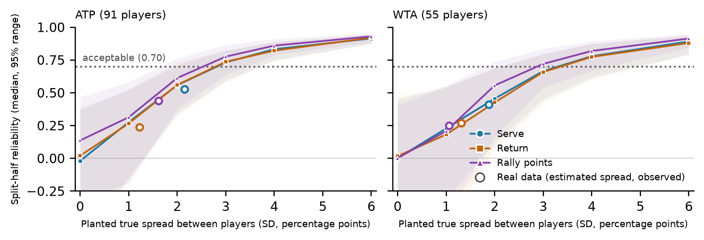

# Shot-Selection Consistency and Clutch Performance in Tennis: A Reliability Warning for Clutch Metrics

*Code, derived data and analysis plans: [repository link supplied in the submission form].*

## 1. Introduction

When a broadcaster says a player "raises their level on the big points," a number is usually behind the claim. Leverage-weighted metrics, descended from Morris's (1977) definition of a point's importance, are the standard way to produce it: weight each point by how much it moves the probability of winning the match, then ask whether a player wins more of the high-leverage points than the low-leverage ones. Tennis Abstract publishes such a metric, the Balanced Leverage Ratio (BLR) (Sackmann, Tennis Abstract), and a 2022 finalist paper at this conference (Seidl and Lucey, 2022) used leverage and momentum metrics to find key moments in women's tennis.

**What we find.** In Match Charting Project data for 91 ATP and 55 WTA players, no clutch rating we tested is reliable enough to support claims about individual players, whether it is built on serve points, return points, rally points or the errors and winners of every shot hit (table below). The shot-level ratings do best, the forehand most of all, but none reaches 0.70, and Tennis Abstract's BLR is no better. The test is not the obstacle: planted differences of 4 points between players would pass it. True differences are real but about the size of the noise on one player's score, different indicators do not pick out the same players, and the scores do not predict who wins decisive sets in other matches. A reliable return rating would need about 550 charted matches, and Carlos Alcaraz's return-clutch rank is 32 of 91 with a 95% interval of 14 to 64. Entropy shows no detectable relationship with clutch (informative bounds on ATP, not on WTA return). We recommend that any clutch rating be published with its own split-half reliability.

**At a glance: median split-half reliability over 1,000 random splits of each player's charted matches (0.70 is the criterion).**

| Measure | ATP | WTA | Reliably measured? |
|---|---|---|---|
| Entropy (predictor) | 0.93 | 0.90 | Yes |
| Serve clutch | 0.53 | 0.41 | No |
| Return clutch | 0.24 | 0.27 | No |
| BLR (Tennis Abstract) | 0.54 | 0.29 | No |
| Rally-point clutch | 0.44 | 0.25 | No |
| Error clutch (all shots) | 0.60 | 0.50 | No |
| Winner clutch (all shots) | 0.58 | 0.47 | No |
| Forehand / backhand error clutch | 0.49 / 0.32 | 0.41 / 0.22 | No |
| Pooled ratio (exploratory) | 0.76 | 0.45 | No (ATP 93% of splits) |

Two questions drive the paper. **Can these metrics be measured reliably?** A rating that fails the split-half test is mostly noise, not a trait; the correlation across players, corrected to full length, is its reliability. **Does shot-selection predictability predict clutch performance?** Commentary contrasts a flair player such as Carlos Alcaraz with a metronomic one such as Jannik Sinner and implies that unpredictability pays under pressure. We test this against every clutch outcome we can build, on both tours. A null on the second is only as informative as the measurement behind it, so we lead with reliability.

**Contributions.** (1) To our knowledge the first split-half reliability estimates for leverage-weighted tennis clutch metrics, including BLR, from serve to shot level, with a positive control. (2) Practitioner-scale translations (data needed, true spread, rank uncertainty) and a test against decisive-set results. (3) A power-analysed entropy null with equivalence bounds corrected for measurement error, replicated on a second tour. (4) An open pipeline.

## 2. Related work

Morris (1977) defined a point's importance as the change in match-win probability between winning and losing it, and recursive win-probability models are standard (Klaassen and Magnus, 2003; Barnett and Clarke, 2005; Newton and Keller, 2005). Klaassen and Magnus (2001) showed that points are close enough to independent and identically distributed that a constant server point-win probability is a reasonable approximation, which we use and test. BLR averages a serve and a return leverage ratio (mean leverage of points won divided by points lost; above 1 is read as clutch), and Seidl and Lucey (2022) built closely related metrics at Stats Perform. We build on this family rather than proposing a new one.

The reliability question has a long history outside tennis. Cramer (1977) asked whether a baseball batter who is clutch in one season stays clutch in the next and found that largely he does not; most later baseball studies agree, though whether the tests can detect a small true effect is debated. Tennis pressure research is mostly economic or psychological: Cohen-Zada et al. (2017) and De Paola and Scoppa (2017) compare performance across stakes and by gender, which asks whether pressure changes average performance, not whether individual players differ stably in handling it. To our knowledge, neither reliability testing of leverage-weighted tennis metrics nor the pairing of an information-theoretic style predictor with a leverage-weighted outcome has been published. We use Spearman-Brown split-half reliability, attenuation-corrected equivalence bounds and empirical-Bayes shrinkage (Efron and Morris, 1975).

## 3. Data and methods

**Data.** We use the Match Charting Project (Sackmann), crowd-sourced point-by-point data with shot-level notation (CC BY-NC-SA 4.0). The pools are every ATP player with at least 40 charted matches (n = 91; median 74 matches, 1.13 million points) and every WTA player with at least 40 (n = 55; median 64, 426,000 points). The repository (Appendix) holds derived per-player data, fetch instructions and the supplementary tables S1 to S19 cited below. Section 4.6 also uses tour-level match results (Appendix).

**Shot-selection consistency.** Conditional normalized Shannon entropy measures how unpredictable a player's shot choice is given the preceding shot, from the 6-by-6 matrix (forehand and backhand by three directions) of shot-to-shot transition probabilities over every rally shot, scaled to [0, 1]; lower means more predictable. It is nearly uncorrelated with net-play rate, drop-shot rate, serve direction and return depth (|r| at most 0.17).

**Leverage and clutch.** Leverage comes from a recursive win-probability engine with a constant server point-win probability (p = 0.65 primary; four sensitivity variants: p = 0.60, p = 0.70, a tiered p, and tour-specific empirical p of 0.644 ATP and 0.573 WTA). For each player and role (serve or return), the **quartile clutch score** is the point-win rate in the top leverage quartile minus the rate in the bottom quartile (Figure 1). The **leverage ratio** (LR) is the mean leverage of points won divided by that of points lost; the faithful **BLR** is (LR serve + LR return) / 2, as Tennis Abstract defines it, and the **pooled LR** applies the ratio to serve and return points together. We test career-aggregated BLR only, so the per-match BLR Tennis Abstract publishes can only be less reliable.

**Figure 1.** What a high-leverage point is. (a) Leverage is how much winning rather than losing a point moves the server's chance of winning the match; the same score is worth more late in a close match (best of three, 65% serve-point win probability). (b) Over every ATP point in the pool, the top and bottom quarters by leverage are the high- and low-leverage points; a clutch score is the win rate on the first minus the win rate on the second.

**All-shot outcomes.** Serve and return are only the first two shots of a point. We classify each point by where it ended (serve-, return- or rally-decided), attribute each shot to its hitter, and build outcomes under the same leverage quartiles: the point-win clutch score on rally-decided points (**R1**), unforced errors (**R2**) and winners (**R3**) per shot hit, signed so that higher means better under pressure, errors within forehand, backhand, slice and net-game shots (**R4 to R7**), and double faults and aces per serve point (**R8, R9**). All were specified, with sufficiency floors, before they were computed.

**Break-point statistics.** Conversion and save are the shares of break-point return and serve points won (tiebreaks excluded); the clutch differential subtracts the player's rate on other points in that role.

**Reliability.** A tour's matches are sorted by date and assigned alternately to halves A and B, so career drift is not mistaken for noise. Each measure is computed on each half, and the split-half correlation across players is Spearman-Brown corrected to full length, with Fisher z intervals. We use 0.70, the common minimum for group-level comparisons, as the threshold; decisions about individuals are usually held to higher standards, 0.90 or more (Nunnally and Bernstein, 1994), so 0.70 is lenient for the claims at issue. We call an outcome reliably measured only if its random-split median is at least 0.70 and at least 95% of splits are. Because one split is one draw, we repeat the analysis over 1,000 random balanced splits per tour. Entropy is not re-split (extraction is slow and its reliability is not contested).

**Plans and tests.** The plan fixed the predictor (conditional entropy), the outcomes, two-sided Pearson tests by tour and role with Bonferroni correction, Spearman and influence checks, a pooled regression, equivalence bounds (TOST) and power. Every analysis has a dated, self-registered plan, and their order cannot be independently verified (Section 8).

## 4. Are clutch metrics reliable?

We ask four questions in turn: are the scores reliable (4.1, 4.2); do fixes or the choice of sample change that (4.3); does it hold for every shot (4.4); and is the stable part meaningful (4.5, 4.6).

### 4.1 Serve and return

**Table 1.** Split-half reliability (Spearman-Brown corrected): the interleaved original split, and the median and 95% range over 1,000 random balanced splits.

| Measure | ATP original | ATP random splits | WTA original | WTA random splits |
|---|---|---|---|---|
| Conditional entropy | 0.925 | not re-split | 0.897 | not re-split |
| Serve clutch (quartile) | 0.572 | 0.532 [0.343, 0.674] | 0.578 | 0.410 [0.107, 0.611] |
| Return clutch (quartile) | 0.231 | 0.241 [−0.058, 0.462] | 0.055 | 0.267 [−0.089, 0.538] |
| BLR (faithful) | 0.460 | 0.537 [0.353, 0.664] | 0.206 | 0.294 [−0.021, 0.557] |
| Pooled LR | 0.683 | **0.761 [0.679, 0.831]** | 0.443 | 0.449 [0.209, 0.641] |

Entropy is reliably measured on both tours. The clutch scores are not, and the problem is worst on return. Serve, return and BLR fall below 0.70 in at least 99% of random splits on both tours (Figure S3 shows the original split). The original split was a typical draw for every measure, though not always the central one: WTA return clutch is 0.055 on it and 0.27 at the median, both poor.

**Figure 2.** Positive control. Median reliability (line) and 95% range (band) of the same test when stable differences of known size are planted in the real design, by outcome. The hollow marker is the real data (estimated true spread, observed reliability). Noise is binomial only, so the curves are upper bounds (Table S15).

This is not a thin-data artifact (each player's leverage buckets hold hundreds to thousands of points per half); return clutch also depends on the opponent's serve quality, which serve clutch does not.

**Could the pipeline detect real clutch?** Yes, for larger differences. Planting stable differences of known size in the real design (Figure 2, Table S15), the criterion is met at a true standard deviation of 4 points on ATP serve, return and rally points (WTA: 4 to 6), about twice the estimated serve spread and three times the return spread; at the estimated spreads the simulation reproduces the observed reliabilities within 0.09.

### 4.2 The faithful BLR, and what pooling does

BLR is below 0.70 in 99.7% (ATP) and 100% (WTA) of random splits. Our rule that an original-split value below 0.50 would strengthen the claim (0.46 ATP, 0.21 WTA) proved split-dependent, since the ATP random-split median is 0.54, so we report both.

Pooling serve and return points into one ratio behaves differently. On ATP it is the one typically acceptable measure (median 0.76; 93% of random splits at or above 0.70), because the BLR average inherits the noisy return component; on WTA it is 0.45 and below 0.70 in 99.6% of splits. It answers "does this player win more of the big points overall" but cannot support role-level claims, and it is reliable but not validated: it relates to general strength (r with overall point-win rate −0.22 ATP, −0.47 WTA). We found it after seeing the other results, on one tour, so it is exploratory.

### 4.3 Attempted fixes

None of the obvious fixes rescues the scores (Tables S5, S9 to S14). A continuous slope of point-win on leverage does no better (random-split medians of at most 0.50 on serve and 0.31 on return; Table S10); adjusting return points for the opponent's serve does not help (ATP 0.182, WTA −0.106); and empirical-Bayes shrinkage helps in every cell (ATP serve 0.594, return 0.371; WTA serve 0.624, return 0.132) but clears 0.70 in none. For the rally outcomes shrinkage lifts ATP winner clutch to 0.74 and WTA unforced-error clutch to 0.71, but only 79% and 55% of splits reach 0.70, short of our 95% rule (Table S9). A chronological split, each player's earlier matches against the later ones, absorbs real change in form and does no better (ATP serve 0.44, return 0.20; WTA 0.40 and 0.12; no outcome above 0.66; Table S11).

Surface, opponent and time do not explain it: adjusting for surface, best-of-5, match date and opponent strength leaves scores almost unchanged (correlation with the raw score 0.96 to 1.00) and reliability unchanged (medians of at most 0.54; Table S13). Nor does selection: pools of 20 to 80 charted matches raise ATP serve reliability from 0.29 to 0.68 with the length of the record, in line with the roughly 150 matches projected in Section 6.1, but none meets the criterion; tournament-blocked splits move medians by at most 0.03, Grand Slam matches alone are no more reliable, and charted volume does not predict a score at the 0.0042 threshold, though all 12 correlations are negative, the direction weak selection on level would take (Table S14).

### 4.4 Beyond serve and return: every shot

About two thirds of points are decided in the rally (ATP 62% to 66%, WTA 67% to 71%; Table S8), so Figure S1 in the supplement applies the same test to the all-shot outcomes of Section 3 (numbers in Table S7). No outcome meets the pre-registered criterion on either tour. The most reliable use every shot hit: unforced-error clutch reaches 0.60 on ATP [0.44, 0.72] and 0.50 on WTA, winner clutch 0.58 and 0.47, and at most 4.2% of random splits reach 0.70. Both beat return clutch (0.24, 0.27) and rally-point clutch (0.44, 0.25) and modestly exceed serve clutch (0.54, 0.41 in these random splits; Table 1's serve is 0.53). By shot type, forehand errors are the most reliable (0.49 ATP, 0.41 WTA), backhand errors less (0.32, 0.22), and slice, net-game, ace and double-fault outcomes are no better. The practice-side analyses of Section 6 and the checks of Section 4.3 repeat for these outcomes with the same picture (Table S9).

### 4.5 Does the stable part mean anything?

A noisy score can still be partly stable, so we asked two questions of the earlier-versus-later split, where no points are shared (Table S17). Is the stable part more than ability? On ATP, holding the early overall rate fixed leaves the early-to-late correlation almost unchanged for rally points, errors, winners and forehand errors (partial correlations 0.29 to 0.50); serve (0.27, p = 0.010) narrowly misses our 0.007 bar, so it is borderline, not absent, and return is not stable. On WTA only winners clear it. Do different indicators pick out the same players? Largely not: of 21 cross-time correlations, one passes the multiplicity correction on ATP (all-shot errors with forehand errors, which overlap by construction) and none on WTA (mean +0.11 on ATP against 0.31 for an indicator with itself; −0.03 on WTA). Stable differences belong to a role or a shot, not to one general clutch trait. This is weak evidence: with stabilities of 0.1 to 0.5 every cross-time correlation is heavily attenuated, so a small common trait cannot be ruled out.

### 4.6 Does clutch predict winning?

Agreement and persistence are not winning, so we tested the scores against results they never saw: each player's deciding-set matches and tiebreak sets in tour-level matches outside the charted sample, against an Elo strength expectation built without those sets (Table S18). A standard deviation of serve clutch goes with +0.5 points of deciding-set win probability on ATP [95% interval −0.7, +1.8] and −0.1 on WTA [−1.7, +1.5]; the composite of all seven indicators gives +1.0 [−0.2, +2.3] on ATP. If the estimated spread in serve clutch were a shift in the points of a deciding set, it would be worth 4.6 to 9.2 points per standard deviation of the score on ATP and 3.8 to 7.7 on WTA, so the intervals exclude it. None of the 28 secondary tests passes its correction, and the small positive ATP slopes vanish when matches between two pool players are dropped. The criterion is partly stable (split-half 0.20 ATP, 0.53 WTA): some players win decisive sets more than their strength predicts, but the clutch scores do not identify them. Power is good on ATP and weaker on WTA, which rules out only larger effects.

## 5. Does shot-selection entropy predict clutch?

### 5.1 Tests

Table S16 gives the correlation of conditional entropy with each clutch outcome, with the outcome's reliability and the corrected bound on the true correlation (Section 5.2). The ten correlations run from −0.26 to +0.20 (n = 91 ATP, 55 WTA). No correlation survives Bonferroni correction (thresholds 0.005 for serve and return, 0.0083 for the all-shot outcomes), and the smallest nominal p, 0.056 (WTA serve), does not survive Spearman re-testing (p = 0.20) or removal of its three most influential players (p = 0.20). The null also holds across five leverage variants, era and surface confounds, four secondary style predictors and entropy change under pressure. Pooling the tours (n = 146) is null, with no evidence the slope differs by tour (Table S3).

### 5.2 What the null can and cannot rule out

The bound is the largest true correlation, in absolute value, that the data cannot rule out with 95% confidence (a two one-sided equivalence test): 0.30 means entropy would explain at most 9% of the variation in true clutch, and a bound near or above 1 means no relationship can be ruled out.

All pools are well powered for medium effects (r of 0.3 or more) but not small ones; WTA alone has 61% power for a medium effect (Table S3). Observed bounds apply where both variables carry measurement error, so we divide by the attenuation implied by both reliabilities (Figure S2, Table S2). For ATP the claim survives, loosened: the true relationship is not large for serve (0.30), return (0.40), rally points (0.28), winners (0.32) or errors (0.43). For WTA the corrected bounds are informative only for the shot-level outcomes (0.38 to 0.41) and loose for serve (0.75), rally points (0.61) and return (0.82; 1.82 at the original-split reliability, so no true relationship can be ruled out).

This is why reliability must be reported before a clutch correlation is interpreted: it separates a modest null from a number that carries no information.

## 6. What the unreliability means in practice

These are derived projections and descriptive uncertainty, not new hypothesis tests.

### 6.1 Data needed, true spread, and what it is worth

If a measure has full-length reliability ρ, the Spearman-Brown prophecy gives the multiple of data needed to reach a target ρ\*: k = ρ\*(1 − ρ) / (ρ(1 − ρ\*)), applied to each tour's median charted matches (ATP 74, WTA 64). A variance decomposition separately gives the standard deviation of players' true clutch scores, to compare with the typical standard error on one player's score. Table 2 puts both beside the reliability.

**Table 2.** What the reliability means. Reliability is the random-split median; matches needed for 0.70 passes its 95% range through the Spearman-Brown formula ("unbounded": the lower limit is zero or negative). True SD is the between-player standard deviation of true clutch († the interval reaches zero) and noise SE the typical standard error on one player's score; the last column is one true SD times the summed leverage per match of the bottom (low end) and top (high end) quartile, a first-order range (Tables S6, S9).

| Tour, role | Reliability | Matches needed [95% range] | True SD, pp | Noise SE, pp | One true SD in match-win probability, pp |
|---|---|---|---|---|---|
| ATP serve | 0.53 | 152 [83, 331] | 2.15 | 1.74 | 0.5 to 5 |
| ATP return | 0.24 | 544 [201, unbounded] | 1.22 | 1.74 | 0.3 to 3 |
| ATP rally points | 0.44 | 223 [116, 618] | 1.62 | 1.71 | 0.5 to 6 |
| WTA serve | 0.41 | 215 [95, 1,246] | 1.88 | 2.08 | 0.4 to 4 |
| WTA return | 0.27 | 411 [128, unbounded] | 1.31† | 2.07 | not detectable |
| WTA rally points | 0.25 | 445 [141, unbounded] | 1.06† | 1.87 | not detectable |

**Data needed.** An acceptable ATP return-clutch score needs about 550 matches (interval 200 to unbounded), 7 to 8 times the median player's 74 (the longest career in the pool is 723, Federer). Rally-decided outcomes are no easier (errors and winners need 120 to 170; Table S9), and only 31% of ATP players already reach player-level reliability 0.70 on serve and 3% on return (Table S5).

**True spread.** On serve there are real differences: the true standard deviation is about 2 percentage points, about as large as the noise on one player's score. On return it is at most about 1.2 points against 1.7 to 2.1 of noise, and for WTA return the interval reaches zero. For unforced-error and winner clutch the true SD is 0.6 to 0.8 points per shot, about the size of the noise (Table S9). A multilevel model and a match-clustered estimator agree (Table S6; ATP serve 2.0 and 2.1 points, return 1.1 and 1.1), and a three-level ATP model finds a stable difference on serve (SD 2.0 points) and rally points (1.2) but none on return (0.5 [0.0, 1.1]), against 3.6 to 4.7 points of match-to-match variation in a player's own clutch (Table S12). So real, small differences exist on serve, and the weakness is in measuring them.

**What it is worth.** Leverage is the change in match-win probability from winning rather than losing a point, so to first order a shift of d in a player's win rate on a set of points changes their match-win probability by d times the summed leverage of those points. The median ATP player has about 2.4 units of top-quartile serve leverage per charted match but only 0.2 in the bottom quartile, so one true standard deviation of serve clutch is worth from about 0.5 points of match-win probability (all from the bottom quartile) to about 5 (all from the top).

### 6.2 How uncertain is a named player's rank?

Reliability is a pool-level statistic, but practitioners talk about named players. About 70% of ATP matches are between two pool players, so we resample the global list of matches with replacement (B = 2,000, fixed seed), give each match the same draw count in both players' scores, re-estimate quartile thresholds and rank all players in every replicate (Figure 3).

**Figure 3.** 95% match-level bootstrap rank intervals for every ATP player, serve and return clutch (rank 1 = most clutch among 91). The dotted diagonal marks the point-estimate rank.

The data do not support the narrative that motivated this study, and not because these players are thinly charted: Alcaraz (222 charted matches) and Sinner (298) are among the nine most charted in the pool. Alcaraz's return-clutch rank is 32 (95% interval 14 to 64) and Sinner's is 57 (33 to 80); on serve they are 50 (28 to 74) and 56 (35 to 77). Only Djokovic (serve rank 72 [54, 79], return 78 [53, 84]) and Federer (64 [48, 73], 86 [63, 86]) have intervals clearly below the pool mean, and even theirs span 23 to 31 ranks. On Tennis Abstract's BLR the data cannot order Federer and Djokovic (both 0.976 against a pool mean of 1.006; ranks 81 and 83), and the ratio is lower for stronger players (Section 4.2), so this is not evidence of weakness under pressure.

In short, these ratings can separate an extreme from the middle of the pool, not neighbours from one another. Across the pool the typical 95% rank interval spans 52 (serve) to 64 (return) of 91 ranks on ATP and 35 and 40 of 55 on WTA; only 21 ATP serve-clutch intervals exclude the pool mean (8 on return, close to the 4.5 that chance alone would give). Rally outcomes are no sharper (Table S9).

### 6.3 Break-point conversion and save rates

The statistic broadcasters quote most is break-point conversion or saving. On ATP the raw rates are borderline-to-acceptable (median reliability 0.72 save, 0.73 conversion) but mostly measure general ability (r of 0.77 and 0.80 with the player's other points); the clutch-specific part, how much better a player does on break points than usual, is not reliable (0.34 serve, 0.23 return), and on WTA even the raw rates fall below 0.70 in every split (Table S4). It is descriptive, not causal.

## 7. Discussion

**The reliability finding and the null interact.** A reliable predictor paired with an unreliable outcome produces a null whether or not a true relationship exists. ATP's null remains informative (Section 5.2) and the more reliable all-shot outcomes extend it; WTA return's does not.

**What the null says about style.** Our predictor is how predictable a player's next groundstroke wing and direction are given the previous shot; it does not capture serve placement, net approaches or tactical variation. So this is a null for that measure: it rules out large effects on ATP (a player one standard deviation more varied would differ in true clutch by at most 0.3 standard deviations) but not on WTA. The flair narrative finds no support here; it is not refuted.

**What could be published instead.** If a rating must be published, the evidence favours shot-level outcomes over role-level ones: unforced-error and winner clutch per shot hit (ATP reliability 0.60 and 0.58, or 0.62 and 0.74 once shrunk; WTA error clutch 0.71 shrunk) and, among single shots, the forehand (0.49 ATP, 0.41 WTA). Any such rating should be a shrunk estimate with its interval and its own reliability. None meets our criterion (the closest reach 0.70 in 79% and 55% of splits), and forehand errors need about 180 to 210 matches (Table S17).

**The threshold matters, and the verdict is about individuals.** At a lenient 0.50, ATP serve clutch and the all-shot error and winner outcomes would pass, and at 0.90 nothing does. We hold the 0.70 line because the claims at issue are about named players; the threshold-free reading is the ratio of true spread to noise in Table 2, about 1.2 points of signal against 1.7 of noise for ATP return.

## 8. Limitations and deviations

- **Selected, observational data.** The Match Charting Project is crowd-sourced, the pool is well-charted and mostly elite, and charted matches are not a random sample of a player's career (they favour Grand Slams). Reliability rises with the player-volume floor but no pool reaches 0.70, and another population needs its own estimate (Table S14, which varies the floor and level, not unobserved selection). Context adjustment is linear and uses measured covariates only, and shot-level outcomes depend on charters' coding (hitter parity 95% to 97% on winner points). The decisive-set test (Section 4.6) rests on an Elo strength expectation and a third-party copy of the results, and its WTA power is weak.
- **Model assumptions.** Leverage uses a constant server point-win probability (13 of 91 players on serve and 19 of 91 on return differ in sign between p = 0.60 and p = 0.70). Quartile contrasts compare different score states, so a clutch score is descriptive, not the causal effect of pressure, and the match-win translation is first-order.
- **Estimation.** One split is one draw; entropy was not re-split; corrected bounds treat reliabilities as fixed (Table S2); many reliability comparisons are reported without multiplicity correction, so the conclusion rests on the pattern. About 70% of ATP matches are between two pool players: the rank bootstrap resamples matches jointly, but Fisher intervals and cross-player correlations treat players as independent.
- **ATP clutch-file provenance.** The script that generated the committed ATP clutch table was lost. Sections 4 and 6 regenerate leverage from raw data, and rerunning Section 5 on the regenerated table moves no correlation by more than 0.005 (smallest p 0.66).
- **Plans are self-registered.** Their order cannot be independently verified: the earliest preserved commit is dated 2026-07-07, the public history was squashed on 2026-09-23, and the November plans were written after earlier results were known (`docs/combined/preregistration_timeline.md`). Two plans changed after a first run (the match-nested model moved to REML and lost its WTA fit, Table S12; the confounder-adjustment validation was redesigned, Table S13), some checks printed results in a validation run before their full runs, the player-level bootstrap missed its pre-registered bias tolerance (0.0018 to 0.0027 against 0.002; the match-level version was not rechecked), and one rule (a faithful BLR below 0.50 strengthens the claim) proved split-dependent, so we report both values.

## 9. Conclusion

Role-specific leverage-weighted clutch scores and Tennis Abstract's BLR are too unreliable to support routine claims about individual players, particularly on return, and the problem extends to every shot. True differences are real on serve (about 2 points, up to about 5 points of match-win probability) but no larger than the noise on one player's score, a named player's rank typically has a 95% interval covering more than half the pool, a reliable ATP return score needs about 550 charted matches against a median of 74, and the scores do not predict who wins decisive sets (Section 4.6). The exception is one pooled ATP ratio, exploratory and not validated.

Four rules follow. (1) Before citing a clutch rating, ask for its split-half reliability; treat a value below 0.70 as a noisy estimate. (2) Treat role-specific clutch, above all return clutch, as a noisy descriptor: cite a named player, or a ranking, only with an interval, and only when it excludes the pool mean (21 of 91 ATP players on serve, 8 on return, about chance). (3) The ATP pooled ratio, the only reliable measure we found, is exploratory and unvalidated: a lead, not a rating to publish. (4) Budget several hundred charted matches per player for any return-side measure. Separately, shot-selection predictability shows no relation to clutch on either tour or any outcome, with bounds that are informative for ATP but not for WTA return.

**What next.** This paper does not recommend using clutch ratings. For coaches, federations and broadcasters the advice is negative: do not label a named player clutch or not from these numbers, and do not read them as evidence of who wins big matches (Section 4.6). For analysts the priority is measurement: the most repeatable outcomes are shot-level ones (winners and errors per shot, the forehand first) and the serve, and a rating built on them needs shrinkage, an interval and about 120 to 200 matches per player. Their repeatability may owe much to data volume (reliability rises with events per player; Table S19), so the next study should follow them across full careers and test whether the stable part predicts anything.

## References

- Barnett, T., and Clarke, S. R. (2005). Combining player statistics to predict outcomes of tennis matches. *IMA Journal of Management Mathematics*, 16(2), 113-120.
- Cohen-Zada, D., Krumer, A., Rosenboim, M., and Shapir, O. M. (2017). Choking under pressure and gender: Evidence from professional tennis. *Journal of Economic Psychology*, 61, 176-190.
- Cramer, D. (1977). Do clutch hitters exist? *Baseball Research Journal* (Society for American Baseball Research).
- De Paola, M., and Scoppa, V. (2017). Gender differences in reaction to psychological pressure: Evidence from tennis players. *European Journal of Work and Organizational Psychology*, 26(3), 444-456.
- Efron, B., and Morris, C. (1975). Data analysis using Stein's estimator and its generalizations. *Journal of the American Statistical Association*, 70(350), 311-319.
- Klaassen, F. J. G. M., and Magnus, J. R. (2001). Are points in tennis independent and identically distributed? Evidence from a dynamic binary panel data model. *Journal of the American Statistical Association*, 96(454), 500-509.
- Klaassen, F., and Magnus, J. R. (2003). Forecasting the winner of a tennis match. *European Journal of Operational Research*, 148(2), 257-267.
- Morris, C. (1977). The most important points in tennis. In S. P. Ladany and R. E. Machol (Eds.), *Optimal Strategies in Sports* (pp. 131-140). North-Holland.
- Newton, P. K., and Keller, J. B. (2005). Probability of winning at tennis I. Theory and data. *Studies in Applied Mathematics*, 114(3), 241-269.
- Nunnally, J. C., and Bernstein, I. H. (1994). *Psychometric Theory* (3rd ed.). McGraw-Hill.
- Sackmann, J. Roger Federer wasn't clutch, but he was almost clutch enough. Tennis Abstract blog (defines the Balanced Leverage Ratio). tennisabstract.com/blog/?p=3666.
- Sackmann, J. et al. Match Charting Project. github.com/JeffSackmann/tennis_MatchChartingProject (CC BY-NC-SA 4.0).
- Seidl, R., and Lucey, P. (2022). Live counter-factual analysis in women's tennis using automatic key-moment detection. MIT Sloan Sports Analytics Conference (Stats Perform).

## Appendix: Disclosures, data and reproduction

**Bugs.** Five issues are written up in `docs/` with their effects, including a shot-parsing bug that inverted hitter labels (now guarded by a parity check).

**Data.** Match Charting Project (Sackmann et al.), commit `2c59eef194967e688b69e73df344184a06322cd8` (2026-05-25), CC BY-NC-SA 4.0. Raw files are checked against `DATA_MANIFEST.csv`; the README lists the commands and dated plans are in `docs/`. Section 4.6 uses Sackmann's ATP and WTA match files (CC BY-NC-SA 4.0) from an archival mirror (`Aneeshers/tennis-sackmann-archive`, commit `83733587353df8a41f2fd4f516147d5aa83f5a8d`), because the upstream repositories were no longer reachable.
