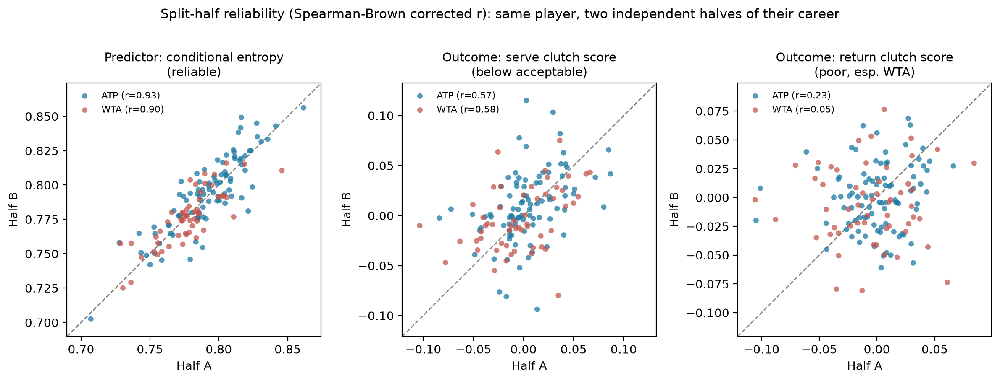
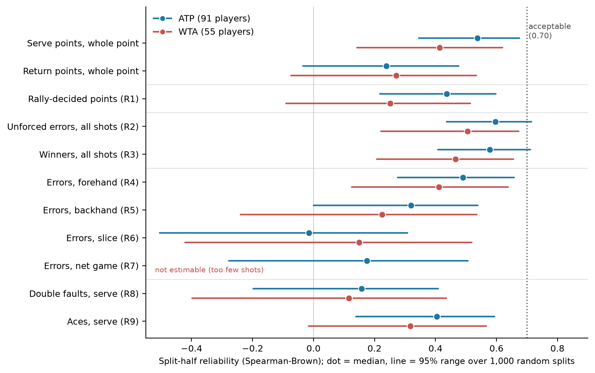

# Supplementary tables

Supplementary tables S1 to S17 for "Shot-Selection Consistency and Clutch Performance in Tennis: A Reliability Warning for Clutch Metrics" (SSAC 2027, Paper ID 353). Section and figure numbers refer to the paper.

**Table S1.** Split-half reliability on the original split with 95% CI (Spearman-Brown), and the median and 95% range over 1,000 random splits, for the quartile clutch scores and the leverage ratios.

| Measure | Tour | Original [95% CI] | Random-split median [95% range] |
|---|---|---|---|
| Serve quartile clutch | ATP | 0.572 [0.350, 0.718] | 0.532 [0.343, 0.674] |
| Return quartile clutch | ATP | 0.231 [-0.167, 0.494] | 0.241 [-0.058, 0.462] |
| LR, serve | ATP | 0.500 [0.241, 0.671] | 0.525 [0.347, 0.648] |
| LR, return | ATP | 0.320 [-0.033, 0.552] | 0.321 [0.070, 0.508] |
| BLR (faithful) | ATP | 0.460 [0.180, 0.645] | 0.537 [0.353, 0.664] |
| Pooled LR | ATP | 0.683 [0.519, 0.791] | 0.761 [0.679, 0.831] |
| Serve quartile clutch | WTA | 0.578 [0.274, 0.755] | 0.410 [0.107, 0.611] |
| Return quartile clutch | WTA | 0.055 [-0.628, 0.451] | 0.267 [-0.089, 0.538] |
| LR, serve | WTA | 0.557 [0.237, 0.743] | 0.375 [0.094, 0.597] |
| LR, return | WTA | -0.092 [-0.881, 0.366] | 0.090 [-0.389, 0.398] |
| BLR (faithful) | WTA | 0.206 [-0.368, 0.539] | 0.294 [-0.021, 0.557] |
| Pooled LR | WTA | 0.443 [0.040, 0.676] | 0.449 [0.209, 0.641] |

**Table S2.** TOST equivalence bound on |r|, observed versus corrected for measurement error, at the original-split clutch reliability, the random-split median, and the range from the 97.5th to the 2.5th percentile reliability. "Vacuous" means the bound exceeds 1 or the reliability is at or below zero. The original-split column uses the documented (rounded) reliabilities, as in Figure 2. The all-shot rows (R1 to R3) are computed at the random-split median only.

| Tour | Role | Observed | Original split | Random-split median | Random-split range |
|---|---|---|---|---|---|
| ATP | Serve | 0.213 | 0.293 | 0.304 | [0.270, 0.379] |
| ATP | Return | 0.189 | 0.410 | 0.401 | [0.290, vacuous] |
| WTA | Serve | 0.457 | 0.635 | 0.754 | [0.617, vacuous (1.48)] |
| WTA | Return | 0.403 | **vacuous (1.82)** | 0.823 | [0.579, vacuous] |
| ATP | R1 rally points | 0.180 | n/a | 0.284 | n/a |
| ATP | R2 errors | 0.320 | n/a | 0.431 | n/a |
| ATP | R3 winners | 0.235 | n/a | 0.322 | n/a |
| WTA | R1 rally points | 0.289 | n/a | 0.609 | n/a |
| WTA | R2 errors | 0.277 | n/a | 0.412 | n/a |
| WTA | R3 winners | 0.247 | n/a | 0.382 | n/a |

**Table S3.** Pooled ATP+WTA test (n = 146) and power for the entropy hypothesis.

| Quantity | Serve | Return |
|---|---|---|
| Pooled r [95% CI], p | -0.124 [-0.282, 0.041], 0.141 | +0.084 [-0.081, 0.245], 0.320 |
| Entropy-by-tour interaction, p | 0.146 | 0.207 |
| Cochran's Q homogeneity, p | 0.200 | 0.297 |
| Pooled TOST bound on abs(r) | 0.174 | 0.241 |

Minimum detectable effect at 80% power and two-sided alpha = 0.05: ATP 0.29, WTA 0.37, pooled 0.23. Power to detect a medium effect (r = 0.3): ATP 82.7%, WTA 60.7%. Power to detect a small effect (r = 0.1): ATP 15.6%, WTA 11.2%.

**Table S4.** Split-half reliability (Spearman-Brown) of break-point statistics: original split, and median [95% range] over 1,000 random splits.

| Measure | ATP original | ATP random splits | WTA original | WTA random splits |
|---|---|---|---|---|
| BP save (serve), raw rate | 0.754 | 0.715 [0.619, 0.790] | 0.439 | 0.332 [0.043, 0.571] |
| BP save, differential from baseline | 0.400 | 0.344 [0.110, 0.533] | 0.118 | -0.159 [-0.677, 0.270] |
| BP conversion (return), raw rate | 0.617 | 0.729 [0.631, 0.807] | 0.063 | 0.267 [-0.094, 0.511] |
| BP conversion, differential from baseline | 0.054 | 0.227 [-0.060, 0.446] | -0.290 | -0.016 [-0.487, 0.323] |

**Table S5.** Charted matches needed for reliability 0.70 (Spearman-Brown projection), with the interval obtained by passing the 95% limits of the reliability estimate (the Fisher interval for the original split, the 2.5th to 97.5th percentile for random splits) through the same formula. "Unbounded" means the lower limit of the reliability is zero or negative.

| Measure | Original split: ρ, matches [95% interval] | Random-split median: ρ, matches [95% range] |
|---|---|---|
| ATP serve clutch | 0.572, 129 [68, 321] | 0.532, 152 [83, 331] |
| ATP return clutch | 0.231, 575 [177, unbounded] | 0.241, 544 [201, unbounded] |
| ATP BLR | 0.460, 203 [95, 786] | 0.537, 149 [88, 316] |
| WTA serve clutch | 0.578, 109 [48, 396] | 0.410, 215 [95, 1,246] |
| WTA return clutch | 0.055, 2,566 [182, unbounded] | 0.267, 411 [128, unbounded] |
| WTA BLR | 0.206, 577 [128, unbounded] | 0.294, 358 [119, unbounded] |

For WTA return, the original split's 0.055 implies 2,566 matches and the random-split median of 0.27 implies about 410; we take the lower as the better point estimate, though the intervals show the data cannot pin it down.

**Table S6.** True between-player standard deviation of quartile clutch (percentage points) with 95% bootstrap intervals, by four estimators, beside the typical standard error on one player's score (binomial and match-clustered). The variance and half-split methods assume binomial sampling variance; the last two do not (Section 6.1).

| Tour, role | Variance method | Half-split method | Multilevel model | Clustered two-stage | SE: binomial / clustered |
|---|---|---|---|---|---|
| ATP serve | 2.15 [1.62, 2.57] | 2.10 [1.61, 2.50] | 2.02 [1.41, 2.38] | 2.11 [1.61, 2.54] | 1.74 / 1.86 |
| ATP return | 1.22 [0.52, 1.68] | 1.04 [0.00, 1.63] | 1.10 [0.64, 1.69] | 1.09 [0.00, 1.58] | 1.74 / 1.89 |
| WTA serve | 1.88 [0.99, 2.48] | 2.14 [1.30, 2.71] | 1.83 [0.98, 2.45] | 1.84 [0.92, 2.50] | 2.08 / 2.15 |
| WTA return | 1.31 [0.00, 1.99] | 0.59 [0.00, 1.82] | 1.31 [0.50, 1.96] | 1.29 [0.00, 1.98] | 2.07 / 2.13 |

Multilevel intervals come from 200 player-bootstrap refits, the others from 2,000 resamples. Implied reliability of a career-length score from the clustered estimator: ATP serve 0.56 [0.42, 0.66], ATP return 0.25 [0.00, 0.41], WTA serve 0.42 [0.15, 0.58], WTA return 0.27 [0.00, 0.47]. Likelihood-ratio test of the random slope: p below 0.0001 (ATP serve), below 0.0001 (ATP return), 0.0001 (WTA serve), 0.002 (WTA return); the test ignores clustering of points within matches.

**Table S7.** Split-half reliability of the all-shot clutch outcomes (Section 3 of the paper): original split, and median [95% range] over 1,000 random balanced splits, with the share of random splits at or above 0.70. The first two rows are the paper's own serve and return scores, recomputed by the same code as a validation (they reproduce the original-split values in Table 1 within 0.0005; their random-split medians differ slightly from Table 1 because this run uses its own random seed).

| Outcome | ATP original | ATP random splits | ATP share >= 0.70 | WTA original | WTA random splits | WTA share >= 0.70 |
|---|---|---|---|---|---|---|
| Serve quartile clutch (paper) | 0.572 | 0.538 [0.346, 0.676] | 0.9% | 0.578 | 0.414 [0.142, 0.620] | 0.0% |
| Return quartile clutch (paper) | 0.231 | 0.239 [-0.035, 0.476] | 0.0% | 0.055 | 0.271 [-0.074, 0.534] | 0.1% |
| R1 Rally-phase point clutch | 0.391 | 0.436 [0.218, 0.598] | 0.1% | 0.047 | 0.251 [-0.090, 0.514] | 0.0% |
| R2 Unforced-error clutch, all shots | 0.651 | 0.596 [0.437, 0.715] | 4.2% | 0.437 | 0.505 [0.222, 0.673] | 0.9% |
| R3 Winner clutch, all shots | 0.611 | 0.578 [0.407, 0.711] | 3.5% | 0.595 | 0.466 [0.207, 0.656] | 0.6% |
| R4 Error clutch, forehand | 0.546 | 0.490 [0.276, 0.658] | 0.2% | 0.312 | 0.411 [0.126, 0.638] | 0.1% |
| R5 Error clutch, backhand | 0.413 | 0.320 [0.000, 0.539] | 0.0% | 0.241 | 0.225 [-0.239, 0.536] | 0.0% |
| R6 Error clutch, slice | -0.102 | -0.015 [-0.505, 0.308] | 0.0% | -0.255 | 0.150 [-0.421, 0.519] | 0.0% |
| R7 Error clutch, net game | 0.202 | 0.175 [-0.278, 0.506] | 0.0% | not estimable | not estimable | - |
| R8 Double-fault clutch (serve) | 0.111 | 0.157 [-0.197, 0.409] | 0.0% | -0.012 | 0.116 [-0.398, 0.436] | 0.0% |
| R9 Ace clutch (serve) | 0.364 | 0.405 [0.139, 0.593] | 0.1% | 0.300 | 0.318 [-0.016, 0.567] | 0.1% |

**Table S8.** Share of points decided on the serve, on the return and in the rally, by leverage quartile (top, middle, bottom; "other" points, 0.3% to 1.4%, are not shown).

| Tour | Leverage | Serve-decided | Return-decided | Rally-decided |
|---|---|---|---|---|
| ATP | bottom | 12.5% | 23.9% | 62.3% |
| ATP | middle | 11.4% | 22.2% | 65.2% |
| ATP | top | 11.5% | 22.1% | 65.9% |
| WTA | bottom | 10.1% | 22.7% | 66.8% |
| WTA | middle | 9.2% | 21.2% | 69.1% |
| WTA | top | 8.8% | 20.2% | 70.7% |

**Table S9.** The practice-side analyses repeated for rally outcomes. Reliability is the random-split median; true SD and noise SE are in percentage points of point-win rate (rally points) or of rate per shot (errors, winners), from the match-clustered estimator; shrunk reliability is the random-split median after empirical-Bayes shrinkage, with the share of splits at or above 0.70; the best leverage variant is the highest random-split median over p = 0.60, p = 0.70, tiered and empirical leverage (200 splits each); the rank interval is the median 95% match-level bootstrap interval width in ranks, with quartile thresholds held at full-sample values.

| Tour, outcome | Reliability | Matches needed [95% range] | True SD [95% interval] | Noise SE | Shrunk reliability (share at or above 0.70) | Best other leverage variant | Rank interval width |
|---|---|---|---|---|---|---|---|
| ATP rally points | 0.44 | 223 [116, 618] | 1.62 [1.07, 2.06] | 1.71 | 0.46 (0.1%) | 0.44 | 55 of 91 |
| ATP unforced errors | 0.60 | 117 [69, 222] | 0.77 [0.57, 0.94] | 0.63 | 0.62 (6.6%) | 0.64 | 49 of 91 |
| ATP winners | 0.58 | 126 [70, 251] | 0.71 [0.49, 0.87] | 0.62 | 0.74 (79.4%) | 0.61 | 48 of 91 |
| WTA rally points | 0.25 | 445 [141, unbounded] | 1.06 [0.00, 1.66] | 1.87 | 0.11 (0.0%) | 0.31 | 38 of 55 |
| WTA unforced errors | 0.50 | 146 [72, 524] | 0.73 [0.26, 1.07] | 0.71 | 0.71 (54.5%) | 0.59 | 37 of 55 |
| WTA winners | 0.47 | 171 [78, 572] | 0.64 [0.38, 0.82] | 0.65 | 0.46 (0.2%) | 0.55 | 34 of 55 |

Shrinkage comes closest to the line for ATP winners and WTA unforced errors, but in neither does at least 95% of splits reach 0.70. Break-point rates and the pooled ratio are not repeated for rally points: the first is defined by score state, not by how a point ends, and the second already uses every point.

**Table S10.** A continuous leverage-slope clutch score against the quartile score, on the same 1,000 random balanced splits. The slope is the least-squares slope of point-win on leverage over all of a player's points in the role (rally-decided points for rally), scaled by the player's leverage standard deviation, so it reads as the change in win probability for a one-SD higher-leverage point. Reliability is Spearman-Brown corrected; "share" is the share of splits at or above 0.70. True SD and implied reliability use the match-clustered estimator of Section 6.1.

| Tour, outcome | Slope: original split | Slope: random-split median [95% range] | Slope: share at or above 0.70 | Quartile: random-split median | True SD of slope score, pp [95% interval] | Noise SE, pp | Implied reliability | Correlation with quartile score |
|---|---|---|---|---|---|---|---|---|
| ATP serve | 0.46 | 0.50 [0.32, 0.64] | 0.1% | 0.54 | 0.67 [0.50, 0.81] | 0.66 | 0.51 | 0.87 |
| ATP return | 0.30 | 0.31 [0.04, 0.51] | 0.0% | 0.24 | 0.47 [0.00, 0.67] | 0.68 | 0.32 | 0.87 |
| ATP rally points | 0.30 | 0.48 [0.29, 0.63] | 0.1% | 0.44 | 0.58 [0.38, 0.74] | 0.59 | 0.49 | 0.88 |
| WTA serve | 0.55 | 0.36 [0.09, 0.59] | 0.0% | 0.41 | 0.60 [0.24, 0.80] | 0.75 | 0.39 | 0.86 |
| WTA return | -0.07 | 0.10 [-0.31, 0.41] | 0.0% | 0.27 | 0.31 [0.00, 0.68] | 0.78 | 0.13 | 0.81 |
| WTA rally points | 0.10 | 0.17 [-0.18, 0.44] | 0.0% | 0.25 | 0.31 [0.00, 0.51] | 0.65 | 0.19 | 0.81 |

The slope without the SD scaling gives random-split medians within 0.05 of these, except WTA return (0.15). This table extends the earlier single-split check of a continuous slope reported in `docs/atp/04_regression_results/split_half_reliability.md`.

**Table S11.** Chronological split: each player's earlier half of charted matches against the later half (earlier half rounded up; quartile thresholds recomputed within each half). r is the early-late correlation; the next column steps it up to full length with Spearman-Brown; 95% player-bootstrap intervals in brackets. The last two columns repeat the interleaved original-split and random-split-median reliabilities for the same estimator.

| Tour, estimator, outcome | n | Early-late r [95% interval] | Spearman-Brown [95% interval] | Interleaved: original | Interleaved: median |
|---|---|---|---|---|---|
| ATP, quartile, serve | 91 | 0.28 [0.07, 0.50] | 0.44 [0.14, 0.66] | 0.57 | 0.54 |
| ATP, quartile, return | 91 | 0.11 [-0.09, 0.34] | 0.20 [-0.20, 0.50] | 0.23 | 0.24 |
| ATP, quartile, rally points | 91 | 0.29 [0.10, 0.46] | 0.45 [0.18, 0.63] | 0.39 | 0.44 |
| ATP, quartile, unforced errors | 91 | 0.49 [0.36, 0.61] | 0.66 [0.53, 0.76] | 0.65 | 0.60 |
| ATP, quartile, winners | 91 | 0.40 [0.21, 0.57] | 0.57 [0.34, 0.73] | 0.61 | 0.58 |
| ATP, slope, serve | 91 | 0.35 [0.17, 0.52] | 0.51 [0.29, 0.68] | 0.46 | 0.50 |
| ATP, slope, return | 91 | 0.26 [0.03, 0.46] | 0.41 [0.05, 0.63] | 0.29 | 0.31 |
| ATP, slope, rally points | 91 | 0.39 [0.19, 0.55] | 0.56 [0.32, 0.71] | 0.30 | 0.48 |
| WTA, quartile, serve | 55 | 0.25 [-0.04, 0.51] | 0.40 [-0.08, 0.67] | 0.58 | 0.41 |
| WTA, quartile, return | 55 | 0.06 [-0.22, 0.35] | 0.12 [-0.58, 0.52] | 0.05 | 0.27 |
| WTA, quartile, rally points | 55 | 0.13 [-0.15, 0.38] | 0.23 [-0.34, 0.55] | 0.05 | 0.25 |
| WTA, quartile, unforced errors | 55 | 0.16 [-0.19, 0.49] | 0.28 [-0.47, 0.65] | 0.44 | 0.50 |
| WTA, quartile, winners | 55 | 0.43 [0.22, 0.64] | 0.60 [0.36, 0.78] | 0.59 | 0.47 |
| WTA, slope, serve | 55 | 0.23 [-0.04, 0.48] | 0.37 [-0.09, 0.65] | 0.55 | 0.36 |
| WTA, slope, return | 55 | -0.03 [-0.38, 0.27] | -0.05 [-1.21, 0.42] | -0.07 | 0.10 |
| WTA, slope, rally points | 55 | 0.11 [-0.12, 0.32] | 0.20 [-0.28, 0.49] | 0.10 | 0.17 |

No outcome has a chronological Spearman-Brown estimate at or above 0.70; the highest is ATP unforced-error clutch (0.66, interval 0.53 to 0.76), whose interval does reach 0.70. The intervals are wide because there is a single chronological split per tour.

**Table S12.** Three-level variance model, ATP only. Per-match clutch score (top-quartile minus bottom-quartile rate, percentage points) = overall mean + player effect (stable SD) + match effect within player (match-to-match SD) + known sampling error; fitted by restricted maximum likelihood on matches with at least 3 points in each bucket, with 95% player-bootstrap intervals (1,000 refits). Career reliability is the stable variance over the stable variance plus the error variance of a player's inverse-variance-weighted mean score over their retained matches. Matches needed (for reliability 0.70) are in charted matches and are scaled up for the matches dropped by the 3-point rule. p-values are likelihood-ratio tests with a 50:50 chi-square(0,1) mixture. The WTA fit failed the pre-registered simulation check (Section 6.1) and is not reported.

| Outcome | Matches kept | Stable SD [95% interval] | Match-to-match SD [95% interval] | Sampling SD per match | Career reliability [95% interval] | Matches needed [95% interval] | p, stable SD = 0 | p, match SD = 0 |
|---|---|---|---|---|---|---|---|---|
| ATP serve | 8,755 of 10,168 | 1.99 [1.43, 2.48] | 3.58 [2.56, 4.42] | 18.7 | 0.46 [0.30, 0.57] | 248 [162, 488] | below 0.0001 | 0.0002 |
| ATP return | 8,897 of 10,168 | 0.53 [0.00, 1.08] | 4.58 [3.80, 5.20] | 18.8 | 0.06 [0.00, 0.20] | 3,573 [851, unbounded] | 0.27 | below 0.0001 |
| ATP rally points | 9,746 of 10,168 | 1.24 [0.54, 1.72] | 4.73 [3.98, 5.49] | 17.1 | 0.30 [0.08, 0.45] | 497 [259, 2,661] | 0.0003 | below 0.0001 |

Sensitivity to the minimum points per bucket (stable SD, career reliability, matches needed): serve at 1 points: 1.95, 0.45, 321; serve at 5 points: 1.91, 0.43, 258; return at 1 points: 0.54, 0.06, 4,227; return at 5 points: 0.47, 0.04, 4,456; rally points at 1 points: 1.27, 0.31, 534; rally points at 5 points: 1.29, 0.31, 445. The simulation check recovered the ATP serve design (true stable SD 1.5 and match SD 3.0 gave means 1.48 and 2.92; true match SD 0 gave 0.74).

**Table S13.** Confounder adjustment (plan: `docs/combined/confound_adjustment_preregistration.md`). Adjusted score A replaces each point's outcome by its residual after removing, within player and leverage bucket (top quartile, middle, bottom quartile), linear effects of surface (clay, grass), Best-of-5, match date and opponent strength (the opponent's win rate in the opposing role, excluding every point from matches between the two players, shrunk to the tour mean with weight 200 points), then applies the quartile rule. The within-match score B averages each match's top-minus-bottom difference, weighted by 1/(1/n_top + 1/n_bottom), over matches with at least 3 points in each bucket, which removes everything constant within a match without a model. Same points, players and quartile rule as Table 1; 1,000 random balanced splits with a new seed, so medians differ from Tables 1 and S10 in the second decimal. Shot-level outcomes (errors, winners) were not adjusted.

| Tour, outcome | Raw: random-split median | Adjusted (A): original split | A: random-split median [95% range] | A: share at or above 0.70 | Within-match (B): random-split median | A: chronological Spearman-Brown | True SD, pp: raw to A | Correlation, A with raw | Mean shift, A minus raw, pp |
|---|---|---|---|---|---|---|---|---|---|
| ATP serve | 0.54 | 0.64 | 0.54 [0.35, 0.68] | 1.0% | 0.43 | 0.44 | 2.11 to 2.09 | 0.98 | -0.46 |
| ATP return | 0.23 | 0.20 | 0.21 [-0.09, 0.46] | 0.0% | 0.05 | 0.18 | 1.09 to 1.05 | 0.98 | +0.04 |
| ATP rally points | 0.44 | 0.40 | 0.37 [0.13, 0.56] | 0.1% | 0.28 | 0.39 | 1.62 to 1.42 | 0.96 | -0.27 |
| WTA serve | 0.41 | 0.58 | 0.41 [0.11, 0.61] | 0.1% | 0.32 | 0.41 | 1.84 to 1.80 | 1.00 | -0.02 |
| WTA return | 0.27 | -0.02 | 0.28 [-0.06, 0.53] | 0.0% | 0.14 | 0.12 | 1.29 to 1.29 | 0.99 | +0.18 |
| WTA rally points | 0.24 | 0.01 | 0.22 [-0.18, 0.50] | 0.0% | 0.28 | 0.21 | 1.06 to 1.03 | 1.00 | +0.09 |

The covariates matter for point outcomes (opponent's rate in the opposing role: a 1-point stronger opponent lowers the player's win rate by 0.6 to 0.85 points; clay lowers ATP serve-point wins by 2.3 points and raises return-point wins by 2.0; grass does the reverse), but they are only weakly related to which points are high-leverage, so adjusted scores correlate 0.96 to 1.00 with raw ones. Averages move most for ATP serve (raw clutch about 0.5 points too high). The extended covariate set (late round, Grand Slam) and opponent shrinkage of 50 or 1,000 move no random-split median by more than 0.02 and no share at or above 0.70 above 1.1%. Re-estimating the covariate coefficients inside each half at the original split changes no adjusted reliability by more than 0.003. B has lower reliability because it discards information (matches with too few points in a bucket, and all between-match comparison) and adds weighting noise; its random-split medians are at most 0.43 and its shares at or above 0.70 at most 0.2%.

Headline entropy-clutch correlation (conditional normalized entropy against full-sample clutch; Pearson r with p in parentheses), raw and adjusted:

| Tour, outcome | Raw r (p) | A: r (p) | B: r (p) |
|---|---|---|---|
| ATP serve | -0.042 (0.692) | -0.069 (0.514) | -0.080 (0.453) |
| ATP return | +0.019 (0.859) | -0.003 (0.981) | +0.124 (0.243) |
| WTA serve | -0.259 (0.056) | -0.246 (0.070) | -0.150 (0.276) |
| WTA return | +0.196 (0.151) | +0.182 (0.183) | +0.154 (0.262) |

Validation (every check passed before any result was used): the raw scores reproduce the committed clutch tables to 1e-16 and the original-split reliabilities exactly; the fast routine reproduces the earlier code to 4e-16; leave-pair-out opponent strength matches a brute-force recomputation. In simulations on the real design with no true clutch effect, outcomes drawn with and without covariate effects from the same random numbers show A and B within 3 standard errors of unbiased in all 36 settings, while the raw score is biased up to 0.5 points at the real covariate effects (ATP serve). When leverage is built to track opponent strength, the raw score is biased by 9 to 19 points and A by 0.2 or less (B within sampling error); a planted clutch effect is recovered with slope 0.95 to 1.04 by all three scores. The adjustment therefore removes confounding that is there; in these data there is little to remove.

**Table S14.** Selection checks (plan: `docs/combined/selection_checks_preregistration.md`). Same outcomes, definitions and 1,000-split design as Table 1; seed 20261120, so the 40-match medians differ from Table 1 in the second decimal. Part A: the pool is every player with at least the stated number of charted matches (all matches involving a pool player are split at random); cells are the random-split median reliability with the share of splits at or above 0.70 in parentheses. Part B: whole tournament editions (tournament and year) are assigned to one half instead of single matches. Part C: reliability within Grand Slam matches only and within all other matches only (quartile thresholds from the points in the half), then the paired difference in full-sample scores (percentage points, player-level standard error), the correlation of the two scores across players, and that correlation divided by the square root of the product of the two strata's median reliabilities (a value above 1 means the strata are too noisy to disattenuate, not that the scores agree more than perfectly). Part D: Spearman correlation of a player's score with the number of charted matches and with the share of those matches played at Grand Slams (n = 91 ATP, 55 WTA; Bonferroni threshold over the 12 tests 0.0042).

*A. Player-volume floor (players; median charted matches in the pool)*

| Tour, outcome | 20 | 30 | 40 (paper) | 60 | 80 |
|---|---|---|---|---|---|
| ATP serve | 0.29 (0%) | 0.44 (0%) | 0.53 (1%) | 0.63 (19%) | 0.68 (42%) |
| ATP return | 0.14 (0%) | 0.19 (0%) | 0.24 (0%) | 0.31 (0%) | 0.20 (0%) |
| ATP rally points | 0.27 (0%) | 0.36 (0%) | 0.43 (0%) | 0.54 (3%) | 0.50 (2%) |
| WTA serve | 0.09 (0%) | 0.29 (0%) | 0.41 (0%) | 0.51 (5%) | 0.43 (6%) |
| WTA return | 0.13 (0%) | 0.23 (0%) | 0.28 (0%) | 0.25 (0%) | 0.48 (12%) |
| WTA rally points | 0.12 (0%) | 0.17 (0%) | 0.25 (0%) | 0.37 (1%) | 0.56 (17%) |
| ATP players; median matches | 158; 46 | 119; 56 | 91; 74 | 55; 116 | 42; 136 |
| WTA players; median matches | 105; 41 | 76; 50 | 55; 64 | 31; 81 | 16; 112 |

*B. Tournament-blocked splits*

| Tour, outcome | Random match splits: median | Tournament-blocked: median [95% range] | Share at or above 0.70 | Difference |
|---|---|---|---|---|
| ATP serve | 0.53 | 0.54 [0.36, 0.67] | 1.0% | +0.01 |
| ATP return | 0.24 | 0.24 [-0.05, 0.47] | 0.0% | 0.00 |
| ATP rally points | 0.43 | 0.45 [0.23, 0.60] | 0.0% | +0.01 |
| WTA serve | 0.41 | 0.41 [0.12, 0.62] | 0.6% | 0.00 |
| WTA return | 0.28 | 0.25 [-0.14, 0.53] | 0.0% | -0.03 |
| WTA rally points | 0.25 | 0.26 [-0.08, 0.50] | 0.0% | +0.00 |

*C. Grand Slam matches against all others*

| Tour, outcome | Slam only: median | Other only: median | Slam minus other, pp (SE) | r (Slam, other) | Disattenuated r |
|---|---|---|---|---|---|
| ATP serve | 0.37 | 0.22 | -0.44 (0.46) | +0.37 | 1.31 |
| ATP return | 0.22 | 0.07 | +0.10 (0.44) | +0.14 | 1.14 |
| ATP rally points | 0.24 | 0.24 | -0.10 (0.37) | +0.34 | 1.42 |
| WTA serve | 0.27 | 0.33 | +0.17 (0.73) | +0.10 | 0.34 |
| WTA return | 0.10 | 0.34 | +0.07 (0.70) | +0.12 | 0.66 |
| WTA rally points | 0.07 | 0.27 | +0.27 (0.59) | +0.06 | 0.43 |

*D. Charting volume and Slam share against the score (Spearman rho, p)*

| Tour, outcome | Charted matches | Grand Slam share |
|---|---|---|
| ATP serve | -0.19 (0.067) | -0.14 (0.191) |
| ATP return | -0.25 (0.015) | -0.21 (0.045) |
| ATP rally points | -0.22 (0.033) | -0.21 (0.048) |
| WTA serve | -0.10 (0.448) | -0.14 (0.317) |
| WTA return | -0.12 (0.397) | -0.17 (0.210) |
| WTA rally points | -0.10 (0.483) | -0.15 (0.278) |

Reading. Reliability rises with the floor because players with more matches have longer scores, and falls when lightly charted players are added, but nothing reaches the criterion: the highest random-split median anywhere is 0.68 (ATP serve at 80 matches: 42 players, 42% of splits at or above 0.70), and the pool of 80 or more is the most heavily charted players, so it is the least representative. The largest difference between tournament-blocked and random-split medians is 0.03, so shared tournament conditions do not inflate the headline figures. Within Grand Slam matches reliability is at most 0.37, within other matches at most 0.34. The Slam-minus-other differences are within about one standard error of zero. The cross-stratum correlations are positive in all six cells (0.06 to 0.37) but the strata's own reliabilities are too low for the disattenuated values to be read: above 1 on ATP, 0.34 to 0.66 on WTA, with no interval. All twelve correlations with charting volume or Slam share are negative (-0.10 to -0.25); the smallest p is 0.015 (ATP return against charted matches), above the 0.0042 threshold, so we do not call it selection on the score, though it is the direction a selection effect would take. These checks speak to selection on observed features only.

**Table S15.** Positive control (plan: `docs/combined/positive_control_preregistration.md`). Stable differences between players are planted in the real design: every point's outcome is redrawn as Bernoulli around the player's own role win rate, plus a shift drawn from a normal distribution with the stated standard deviation (percentage points) on the player's top-leverage-quartile points (rally-decided top-quartile points for rally points). Same players, points, leverage, matches, 30-point floor and Spearman-Brown routine as Table 1; 40 planted draws x 25 random balanced splits per cell (1,000 values; seed 20261121). Cells are the median reliability with the share of splits at or above 0.70 in parentheses. The "estimated spread" is the true standard deviation estimated from the real data (Table 2), planted and compared with the real random-split median. The simulated noise is binomial only, so these reliabilities are upper bounds for a given spread. Validation: the real-data original-split reliabilities were reproduced exactly; null medians at 0 pp were within 0.15 of zero in all six cells (largest 0.14); simulated medians at the estimated spread were within 0.15 of the real ones in all six cells (largest gap 0.09).

| Tour, outcome | 0 | 1 | 2 | 3 | 4 | 6 | Estimated spread (pp): simulated vs observed median | Smallest spread meeting the criterion |
|---|---|---|---|---|---|---|---|---|
| ATP serve | -0.02 (0%) | 0.28 (0%) | 0.56 (3%) | 0.73 (69%) | 0.83 (100%) | 0.91 (100%) | 2.15: 0.60 vs 0.53 | 4 pp |
| ATP return | 0.02 (0%) | 0.27 (0%) | 0.56 (6%) | 0.74 (72%) | 0.82 (100%) | 0.92 (100%) | 1.22: 0.29 vs 0.24 | 4 pp |
| ATP rally points | 0.14 (0%) | 0.31 (0%) | 0.61 (14%) | 0.78 (88%) | 0.86 (100%) | 0.93 (100%) | 1.62: 0.53 vs 0.44 | 4 pp |
| WTA serve | 0.00 (0%) | 0.23 (0%) | 0.46 (2%) | 0.67 (34%) | 0.78 (85%) | 0.89 (100%) | 1.88: 0.46 vs 0.41 | 6 pp |
| WTA return | 0.02 (0%) | 0.18 (0%) | 0.43 (2%) | 0.66 (34%) | 0.77 (84%) | 0.88 (100%) | 1.31: 0.25 vs 0.27 | 6 pp |
| WTA rally points | 0.00 (0%) | 0.21 (0%) | 0.56 (7%) | 0.72 (61%) | 0.82 (95%) | 0.91 (100%) | 1.06: 0.25 vs 0.25 | 4 pp |

Reading. A planted spread of 4 percentage points meets the criterion on all three ATP outcomes and on WTA rally points (95% of splits at or above 0.70), and 6 points on every cell; WTA serve and return need more than 4. At 3 points the median passes 0.70 on ATP but only 69% to 88% of splits do. The spreads estimated from the real data (1.1 to 2.2 points) give simulated reliabilities of 0.25 to 0.60, close to the observed ones, so the pipeline detects clutch differences about twice the size of the estimated serve spread and three times that of the return spread; the low reliabilities reflect small true differences, not a test that cannot reach 0.70.

**Table S16.** Correlation of conditional entropy with each clutch outcome, the outcome's reliability (random-split median) and the 95% bound on the true |r| (Section 5.2 of the paper) after correcting for both variables' reliability; observed bounds are in Table S2. n = 91 (ATP) and 55 (WTA). R1 to R3 are the all-shot outcomes of Section 3 (rally-decided points, unforced errors and winners over every shot hit). A corrected bound near or above 1 means the data cannot rule out any relationship.

| Tour | Outcome | r (p) | Outcome reliability | Corrected bound on true r |
|---|---|---|---|---|
| ATP | Serve | -0.041 (0.697) | 0.53 | 0.30 |
| ATP | Return | +0.016 (0.877) | 0.24 | 0.40 |
| ATP | R1 rally points | +0.007 (0.947) | 0.44 | 0.28 |
| ATP | R2 errors | +0.155 (0.142) | 0.60 | 0.43 |
| ATP | R3 winners | -0.064 (0.544) | 0.58 | 0.32 |
| WTA | Serve | -0.259 (0.056) | 0.41 | 0.75 |
| WTA | Return | +0.196 (0.151) | 0.27 | 0.82 |
| WTA | R1 rally points | +0.069 (0.616) | 0.25 | 0.61 |
| WTA | R2 errors | -0.056 (0.683) | 0.50 | 0.41 |
| WTA | R3 winners | +0.024 (0.859) | 0.47 | 0.38 |

**Figure S1.** Each point is one player's half-A versus half-B value on the original split. Entropy clusters tightly, serve clutch loosely, return clutch barely (the Spearman-Brown reliabilities are in Table 1).

**Figure S2.** Median split-half reliability (dot) and 95% range over 1,000 random splits (line) for clutch measured on serve and return points, on rally-decided points, and on shot-level outcomes (numbers in Table S7). The dotted line is the 0.70 threshold. WTA net-game errors are not estimable (too few shots).

**Table S17.** Validity checks (plan: `docs/combined/validity_checks_preregistration.md`). Chronological split: each player's earlier half of charted matches against the later half (no shared points). Outcomes are signed so that higher means better under pressure. Part A: early-late correlation for each outcome, and the partial correlation holding the early overall rate fixed (serve-point win rate for serve, return-point win rate for return, rally-point win rate for rally points, errors or winners per shot for the shot outcomes, errors per forehand or backhand shot for those); "Yes" means the partial correlation is at least half the raw one with p below 0.05/7 = 0.007. Part B: cross-time correlation matrices (early score of one outcome with the late score of another, averaged over both directions); the diagonal (bold) is each outcome's own early-late correlation; * marks a pair below the Bonferroni threshold 0.05/21 = 0.0024 (n = 91 ATP, 55 WTA). Part C: forehand and backhand errors with the two all-shot outcomes for comparison, over 1,000 random balanced splits (seed 20261122): raw and empirical-Bayes-shrunk median reliability, the match-clustered true standard deviation against the standard error of one player's score, and matches needed for reliability 0.70 (Spearman-Brown on the raw median), then the chronological Spearman-Brown reliability (random-split medians differ in the second decimal from Table S7 and Section 4.4: new splits).

*A. Stability beyond ability*

| Tour, outcome | Early-late r [95% CI] | Partial r given overall rate (p) | Stable beyond ability? |
|---|---|---|---|
| ATP serve | +0.28 [+0.08, +0.50] | +0.27 (0.010) | No |
| ATP return | +0.11 [-0.11, +0.33] | +0.12 (0.279) | No |
| ATP rally points | +0.29 [+0.11, +0.46] | +0.29 (0.005) | Yes |
| ATP errors, all shots | +0.49 [+0.36, +0.61] | +0.50 (0.000) | Yes |
| ATP winners, all shots | +0.40 [+0.22, +0.57] | +0.40 (0.000) | Yes |
| ATP errors, forehand | +0.37 [+0.12, +0.58] | +0.35 (0.001) | Yes |
| ATP errors, backhand | +0.19 [-0.06, +0.44] | +0.16 (0.128) | No |
| WTA serve | +0.25 [-0.02, +0.50] | +0.22 (0.118) | No |
| WTA return | +0.06 [-0.23, +0.35] | +0.01 (0.938) | No |
| WTA rally points | +0.13 [-0.14, +0.37] | +0.14 (0.305) | No |
| WTA errors, all shots | +0.16 [-0.19, +0.48] | +0.16 (0.250) | No |
| WTA winners, all shots | +0.43 [+0.22, +0.65] | +0.41 (0.002) | Yes |
| WTA errors, forehand | +0.25 [-0.10, +0.53] | +0.25 (0.072) | No |
| WTA errors, backhand | +0.05 [-0.27, +0.33] | +0.04 (0.750) | No |

*B. Cross-time correlations between indicators*

| ATP | S | Rt | R1 | R2 | R3 | R4 | R5 |
|---|---|---|---|---|---|---|---|
| S serve | **+0.28** | +0.01 | +0.22 | +0.10 | +0.25 | +0.07 | +0.09 |
| Rt return | +0.01 | **+0.11** | +0.14 | +0.14 | +0.00 | +0.10 | +0.12 |
| R1 rally points | +0.22 | +0.14 | **+0.29** | +0.09 | +0.17 | +0.08 | +0.06 |
| R2 errors, all shots | +0.10 | +0.14 | +0.09 | **+0.49** | -0.09 | +0.40* | +0.28 |
| R3 winners, all shots | +0.25 | +0.00 | +0.17 | -0.09 | **+0.40** | -0.02 | -0.01 |
| R4 errors, forehand | +0.07 | +0.10 | +0.08 | +0.40* | -0.02 | **+0.37** | +0.15 |
| R5 errors, backhand | +0.09 | +0.12 | +0.06 | +0.28 | -0.01 | +0.15 | **+0.19** |

| WTA | S | Rt | R1 | R2 | R3 | R4 | R5 |
|---|---|---|---|---|---|---|---|
| S serve | **+0.25** | +0.06 | +0.14 | +0.19 | +0.03 | +0.20 | +0.21 |
| Rt return | +0.06 | **+0.06** | +0.09 | -0.20 | -0.14 | -0.17 | -0.19 |
| R1 rally points | +0.14 | +0.09 | **+0.13** | -0.11 | -0.06 | -0.09 | -0.08 |
| R2 errors, all shots | +0.19 | -0.20 | -0.11 | **+0.16** | -0.32 | +0.15 | +0.06 |
| R3 winners, all shots | +0.03 | -0.14 | -0.06 | -0.32 | **+0.43** | -0.26 | -0.17 |
| R4 errors, forehand | +0.20 | -0.17 | -0.09 | +0.15 | -0.26 | **+0.25** | -0.01 |
| R5 errors, backhand | +0.21 | -0.19 | -0.08 | +0.06 | -0.17 | -0.01 | **+0.05** |

Mean of the 21 cross-time correlations: ATP +0.11 [+0.02, +0.20] (mean same-outcome correlation +0.31); WTA -0.03 [-0.14, +0.08] (+0.19). Pairs below the threshold: ATP 1 of 21 (errors on all shots with forehand errors, which overlap by construction), WTA 0 of 21.

*C. Forehand and backhand errors*

| Tour, outcome | Raw median (share at or above 0.70) | Shrunk median (share) | True SD vs noise SE, pp per shot | Matches needed | Chronological reliability [95% CI] |
|---|---|---|---|---|---|
| ATP forehand errors | 0.49 (0.1%) | 0.49 (0%) | 0.99 [0.67, 1.24] vs 0.98 | 179 | 0.54 [+0.22, +0.74] |
| ATP backhand errors | 0.32 (0.0%) | 0.34 (0%) | 0.74 [0.17, 1.04] vs 1.06 | 361 | 0.31 [-0.13, +0.61] |
| ATP errors, all shots | 0.60 (5.1%) | 0.62 (6%) | 0.77 [0.56, 0.92] vs 0.63 | 113 | 0.66 [+0.53, +0.76] |
| ATP winners, all shots | 0.58 (3.7%) | 0.74 (80%) | 0.71 [0.50, 0.87] vs 0.62 | 125 | 0.57 [+0.36, +0.72] |
| WTA forehand errors | 0.42 (0.5%) | 0.58 (10%) | 0.97 [0.35, 1.34] vs 1.09 | 206 | 0.40 [-0.22, +0.69] |
| WTA backhand errors | 0.23 (0.0%) | 0.06 (1%) | 0.61 [0.00, 1.13] vs 1.15 | 499 | 0.10 [-0.76, +0.50] |
| WTA errors, all shots | 0.50 (1.1%) | 0.71 (57%) | 0.73 [0.27, 1.06] vs 0.71 | 147 | 0.28 [-0.48, +0.65] |
| WTA winners, all shots | 0.47 (1.0%) | 0.46 (0%) | 0.64 [0.38, 0.81] vs 0.65 | 166 | 0.60 [+0.36, +0.79] |

Reading. The stable part of the shot-level and rally-point scores on ATP is not just ability (partial correlations 0.29 to 0.50 for rally points, errors, winners and forehand errors; serve 0.27 with p 0.010 narrowly misses our 0.007 bar; return and backhand errors are not stable). On WTA only winners clear it. The indicators do not converge: 18 of 21 cross-time correlations on ATP are positive but only the nested pair passes the correction, the mean is about a third of the mean same-outcome stability, and on WTA the mean is about zero. Where stable differences exist they look specific to a role or a shot, not one general clutch trait; but with stabilities of 0.1 to 0.5 every cross-time correlation is heavily attenuated and the disattenuated values have no intervals, so this is weak evidence against a common trait, not proof of its absence. Of the single shots, the forehand is the most reliable (ATP 0.49, WTA 0.42; chronological 0.54 on ATP) and the backhand, slice and net game are weaker, but forehand errors need about 180 to 210 matches, true spread is about the size of the noise, and no shot-level measure meets the criterion: the closest are ATP winner clutch shrunk (median 0.74, 80% of splits at or above 0.70) and WTA all-shot error clutch shrunk (0.71, 57%). These checks speak to agreement and persistence, not to winning matches.
